<p align="center">
  
</p>

<h1 align="center">KAFEINA</h1>

<p align="center">
  <b>Specialty Roastery &amp; Multi-Branch Retail POS Enterprise Resource Planning (ERP) Platform</b>
</p>

<p align="center">
  <a href="https://laravel.com"></a>
  <a href="https://php.net"></a>
  <a href="https://tailwindcss.com"></a>
  <a href="https://alpinejs.dev"></a>
  <a href="https://mysql.com"></a>
  <a href="https://vitejs.dev"></a>
  <a href="https://vercel.com"></a>
  <a href="LICENSE"></a>
</p>

<p align="center">
  Platform ERP industri specialty coffee modern berkinerja tinggi yang mengintegrasikan rantai pasok hulu ke hilir: pengadaan biji mentah (<i>green beans</i>) dari mitra petani, laboratorium pengujian mutu sensori (<i>QC Lab SCA Cupping</i>), penjadwalan sangrai mesin industri (<i>Giesen W15A</i>), pengawasan susut sangrai (<i>Yield Loss</i>), mutasi inventori multi-gudang (<i>FIFO</i>), hingga terminal kasir layar sentuh (<i>Touchscreen POS</i>) dengan auto-deduct resep gramatur dan Dynamic QRIS Midtrans.
</p>

---

Didesain dengan standar kriya antarmuka tinggi (*high craft & design engineering*), sistem ini mengadopsi filosofi visual modern: tata letak monokromatik berpresisi piksel, notifikasi mengambang (*Modern Floating Toast Notification Engine*) berfisika pegas (*spring physics*), **Spotlight Command Palette** instan dengan tombol shortcut keyboard (`/`), komponen layar sentuh POS kasir responsif bebas lag, serta kepatuhan mutlak standar toleransi industri sangrai kopi Specialty Coffee Association (SCA).

---

##  Arsitektur Aplikasi & Infrastruktur

Sistem **KAFEINA** dibangun dengan arsitektur modular berorientasi domain (*Domain-Driven Decoupled Architecture*) pada fondasi **Laravel 12 (PHP 8.3)** dan antarmuka reaktif **Alpine.js**:

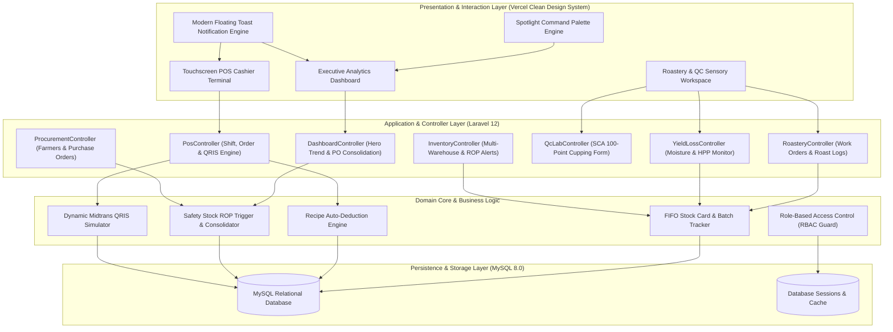

###  Pola Arsitektur Utama
- **Zero-Latency In-Memory Spotlight Search**: Kotak pencarian dasbor memanfaatkan pemindaian terindeks pada koleksi batch, peringatan stok ROP, dan entitas gerai tanpa memicu beban query berulang ke server basis data.
- **Single-Flight PO Emergency Consolidation**: Mekanisme penggabungan seluruh item di bawah ambang batas aman (*Reorder Point*) menjadi satu dokumen Purchase Order bernomor unik (`PO-KONS-YYYYMMDD-XXX`) secara transaksional aman (*ACID compliant*).
- **FIFO Recipe Deduction Matrix**: Setiap transaksi yang diselesaikan pada terminal kasir secara otomatis memotong stok bahan baku (roasted beans, fresh milk, sirup, pouch, paper cup) sesuai gramatur resep presisi pada cabang yang bersangkutan.
- **Modern Floating Toast Notification Engine**: Seluruh dialog peringatan dan pesan konfirmasi bawaan peramban digantikan oleh notifikasi mengambang berbasis CSS blur, squircle adaptif, tema terang (*Light Glass*), dan penutupan otomatis (*auto-dismiss timer*).
- **Vercel-Style Fast Role Switcher**: Kemudahan pergantian identitas pengguna simulasi (*Super Admin, Head Roaster, Barista, QC Inspector*) untuk mempermudah demonstrasi dan audit lintas departemen.

---

##  Alur Kerja Ekosistem (End-to-End Pipeline)

Diagram sekuens berikut menggambarkan siklus pergerakan biji kopi dari hulu pengadaan hingga transaksi kasir ritel:

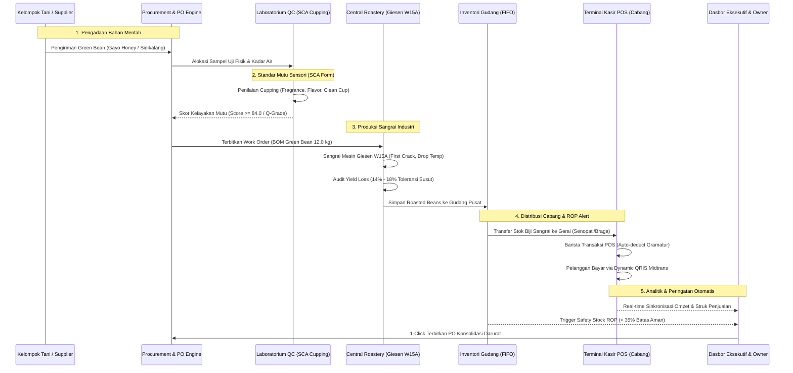

---

##  Fitur Unggulan KAFEINA

### 1.  Dasbor Eksekutif & Spotlight Command Palette (<code>/</code>)
- **Pencarian Cepat Instan**: Menekan tombol shortcut keyboard `/` atau mengklik search bar langsung menampilkan panel pencarian cerdas *Spotlight* bergaya modern.
- **Filter Fuzzy Terintegrasi**: Secara langsung mencocokkan kode batch sangrai (`WO-202611-001`), stok bahan baku kritis, navigasi modul, serta tombol filter cabang instan.
- **Grafik Tren Interaktif**: Visualisasi omzet 7 hari / 30 hari, volume struk POS, dan jam sibuk (*rush hour*) dengan tooltip analitik dinamis.

### 2.  Modern Floating Toast Notification Engine (Light Theme)
- **Kapsul Mengambang Elegan**: Menggantikan pesan konfirmasi jadul (`window.alert`) dengan kapsul notifikasi mengambang berestetika *Light Glass* (`bg-white/95 backdrop-blur-2xl border border-neutral-200/90`).
- **Ikon Squircle & Animasi Pegas**: Dilengkapi ikon status berbasis squircle (emerald untuk PO berhasil, rose untuk error, amber untuk peringatan) dengan animasi masuk berfisika pegas (*spring physics*).

### 3.  1-Click Buat PO Konsolidasi Darurat (Safety Stock ROP)
- **Deteksi Otomatis Item Kritis**: Memantau 5 bahan baku krusial (Green Beans Aceh Gayo, Cold Cup PET 12oz, Susu Greenfields, Oatly Barista, Degassing Valve Pouch) yang menyentuh batas aman *Reorder Point*.
- **Penerbitan PO Real-Time**: Tombol `+ Buat PO Konsolidasi` terhubung ke API backend riil yang menerbitkan dokumen PO ke vendor secara instan, mengubah status tombol menjadi `✓ PO Berhasil Diterbitkan ✓`.

### 4.  Terminal Kasir Touchscreen POS (Multi-Cabang)
- **Antarmuka Layar Sentuh Modern**: Desain kartu produk grid dengan kategori terindeks (Espresso Based, Manual Brew Reserve, Beans Retail, Artisan Tea, Pastry).
- **Shift Drawer Barista**: Manajemen kas awal (*opening float*), pencatatan setoran kasir, rekonsiliasi tunai akhir hari, dan otorisasi supervisor.
- **Kunci Isolasi Cabang**: Barista gerai (Senopati, Braga, Malioboro) hanya dapat memproses pesanan dan melihat riwayat transaksi cabang masing-masing.

### 5.  Dynamic QRIS Midtrans Payment Simulator
- **Generator QRIS Dinamis**: Menghasilkan kode QR pembayaran unik per transaksi sesuai total tagihan kasir.
- **Simulasi Pembayaran Real-Time**: Dilengkapi tombol simulasi scan pembeli yang langsung memvalidasi pembayaran ke sistem POS tanpa perlu integrasi bank manual saat pengujian.

### 6.  Roastery & Work Orders (Mesin Giesen W15A)
- **Pelacakan Siklus Sangrai**: Mengontrol status sangrai (*Planned, In-Progress, Roasting, Cooling, Completed*).
- **Bill of Materials (BOM)**: Integrasi lot biji hijau dengan target profil (Light-Medium, Omni-Roast, Dark Espresso).

### 7.  Yield Loss Monitor & Audit HPP Riil
- **Formula Otomatis Susut Bobot**: Menghitung susut sangrai dengan rumus baku:
  $$\text{Loss \%} = \frac{\text{Bobot Green} - \text{Bobot Roasted}}{\text{Bobot Green}} \times 100$$
- **Toleransi Industri (14.0% – 18.0%)**: Indikator visual instan penanda profil optimal atau review evaluasi mutu.

### 8.  QC Lab & SCA Cupping Sensori (100 Poin)
- **Formulir Cupping Standar SCA**: Evaluasi 10 atribut sensori (Fragrance/Aroma, Flavor, Aftertaste, Acidity, Body, Balance, Uniformity, Clean Cup, Sweetness, Overall).
- **Katalog Lot Biji Mentah**: Dokumentasi kadar air (*moisture meter*), kerapatan curah (*bulk density*), proses pasca-panen, dan elevasi kebun.

### 9.  Inventaris Multi-Cabang & Saldo FIFO Gudang
- **Visibilitas Stok Multi-Lokasi**: Pelacakan saldo gudang sangrai pusat (*Central Hub Cilandak*) dan gudang gerai ritel.
- **Surat Jalan & Transfer**: Alokasi perpindahan barang terkontrol dengan dokumen nomor transfer resmi.

### 10.  Voucher Promosi & Manajemen Kuota
- **Diskon Nominal & Persentase**: Validasi batas minimal pembelian, tanggal kedaluwarsa, dan kuota pemakaian kupon.

---

##  Galeri Antarmuka Sistem (2-Column Grid)

|  Halaman & Fitur Sistem |  Halaman & Fitur Sistem |
| :---: | :---: |
| 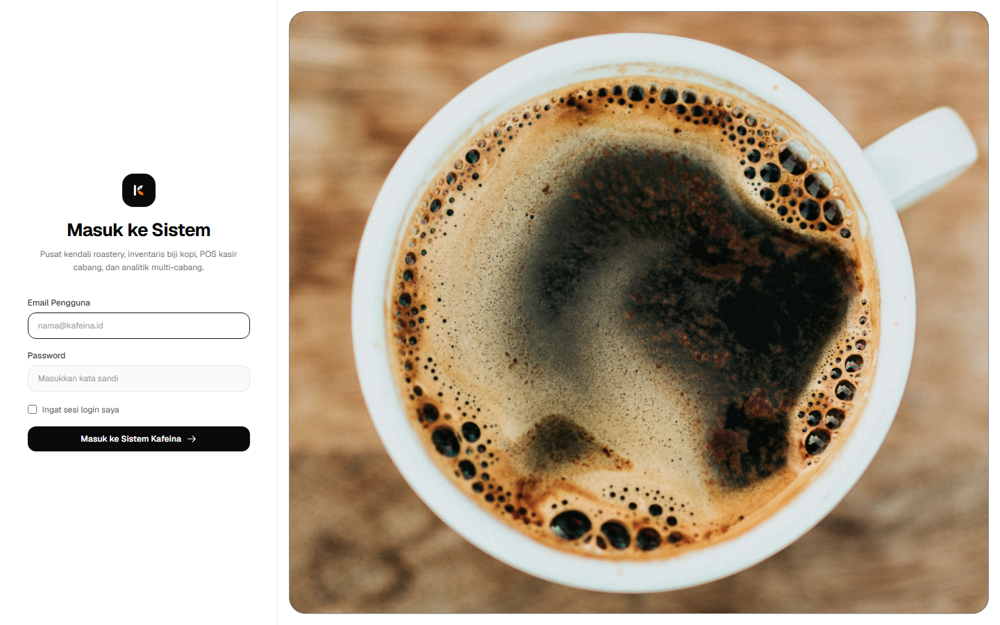<br /><b>01. Masuk ke Sistem (Compact Split View & Circular K Logo)</b> | 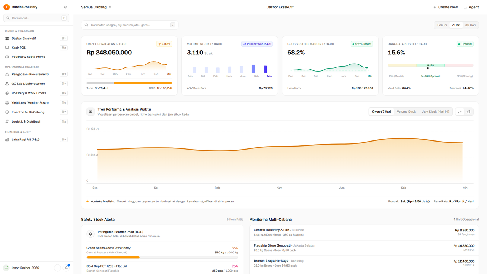<br /><b>02. Dasbor Eksekutif & Analitik Multi-Cabang</b> |
| 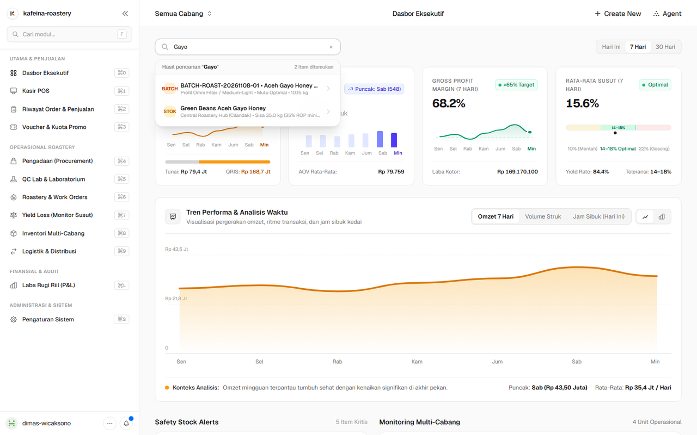<br /><b>03. Spotlight Command Palette (Shortcut <code>/</code>)</b> | 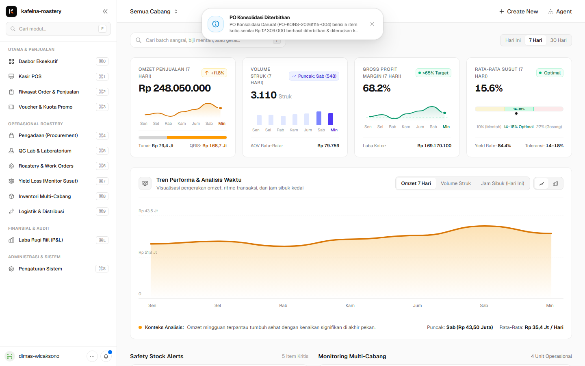<br /><b>04. Notifikasi Sistem Mengambang (Light Glass Toast Engine)</b> |
| 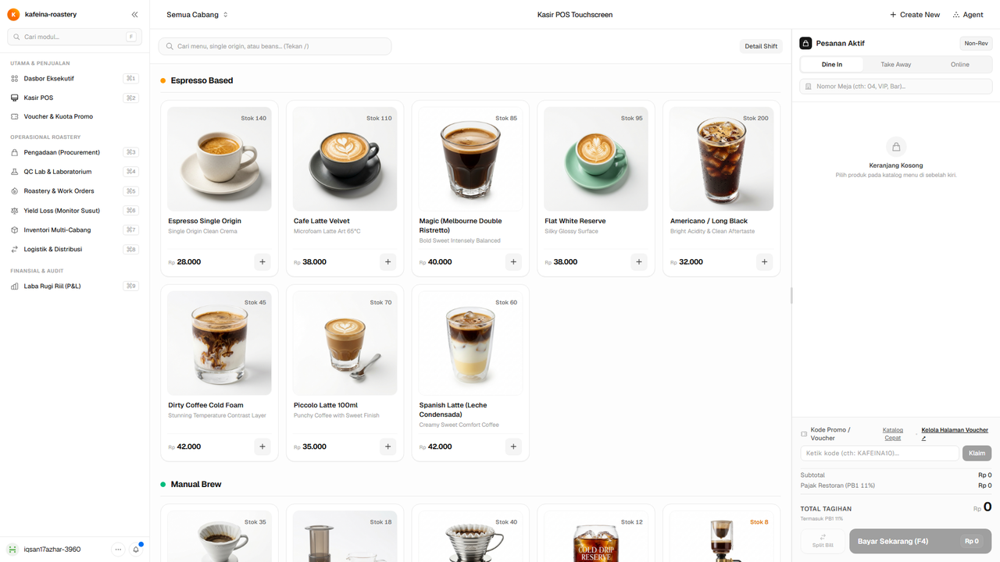<br /><b>05. Terminal Kasir Layar Sentuh POS (Senopati Flagship)</b> | 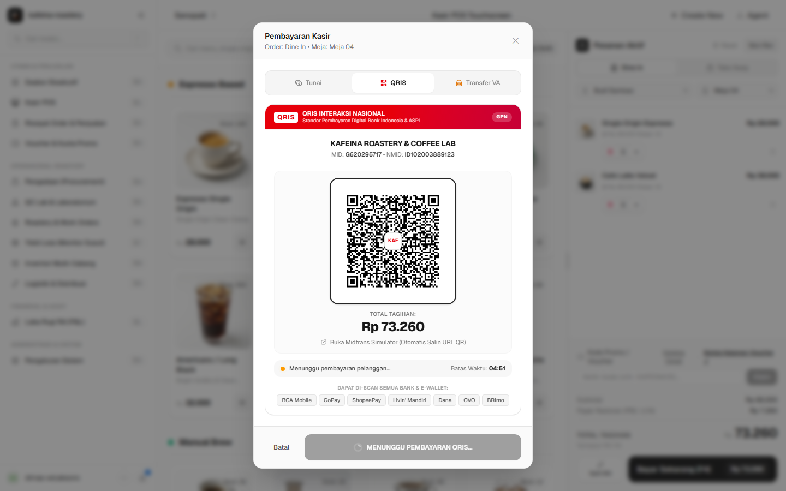<br /><b>06. Simulasi Pembayaran Dinamis QRIS Midtrans</b> |
| 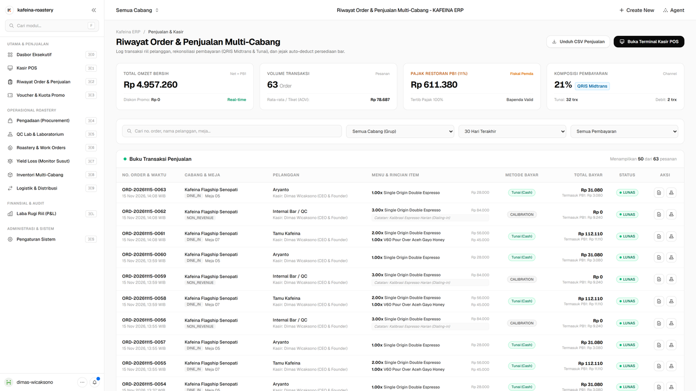<br /><b>07. Riwayat Penjualan & Audit Pemotongan Resep POS</b> | 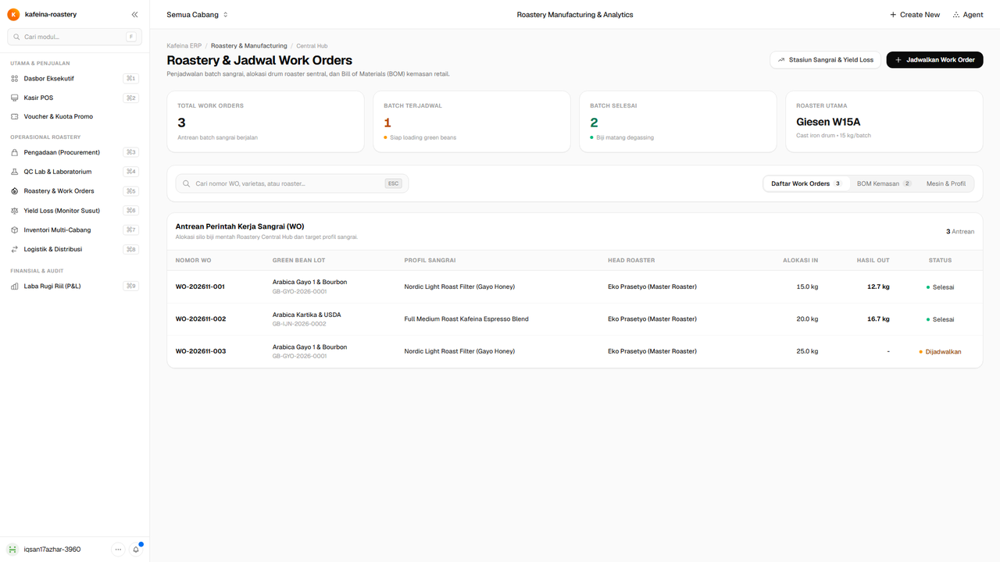<br /><b>08. Roastery & Penjadwalan Mesin Sangrai Giesen W15A</b> |
| 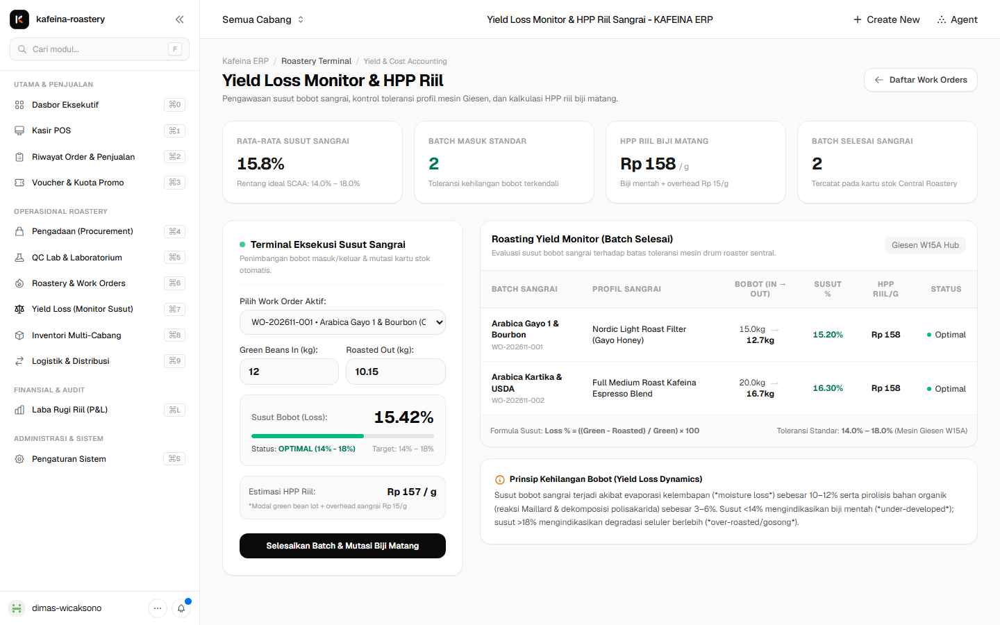<br /><b>09. Audit Susut Bobot Sangrai (Yield Loss) & HPP Riil</b> | 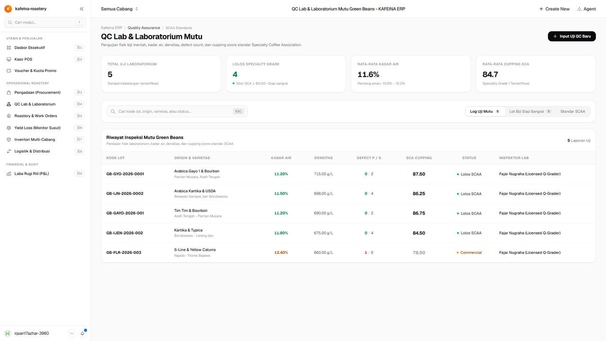<br /><b>10. Laboratorium Mutu QC Lab SCA 100-Point Form</b> |
| 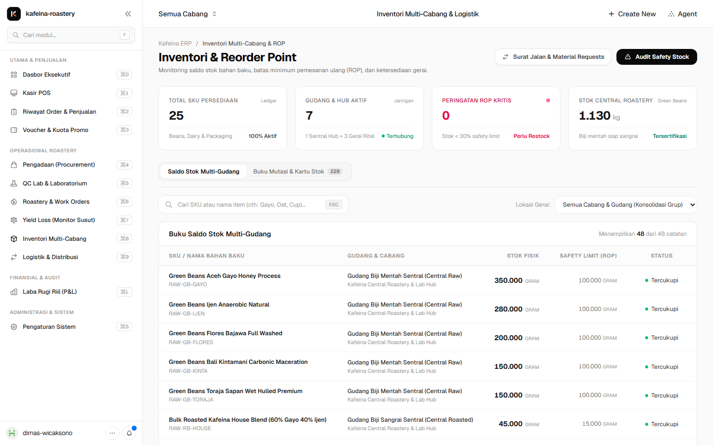<br /><b>11. Manajemen Inventori 7 Gudang & Kartu Stok FIFO</b> | 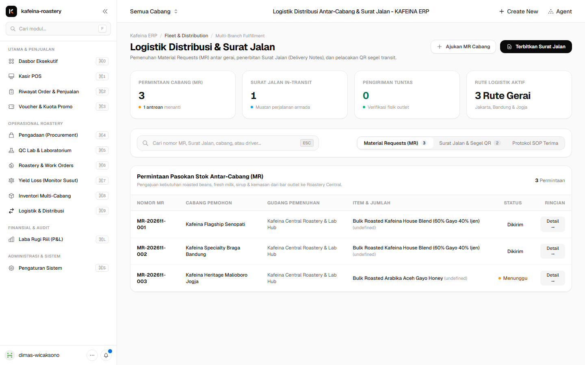<br /><b>12. Logistik Permintaan Barang (MR) & Surat Jalan (DN)</b> |
| 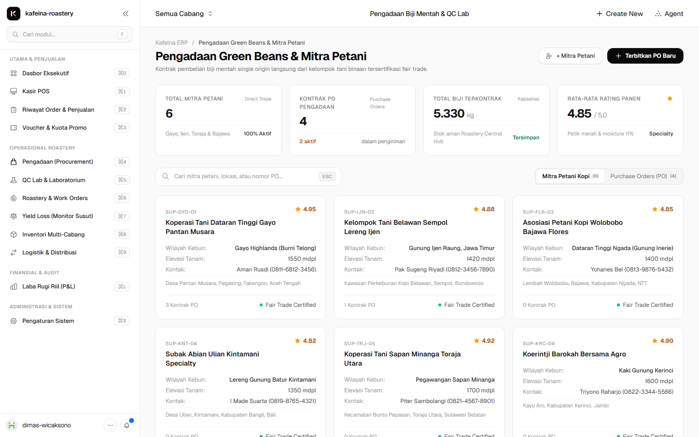<br /><b>13. Pengadaan Green Beans & Kemitraan Koperasi Petani</b> | 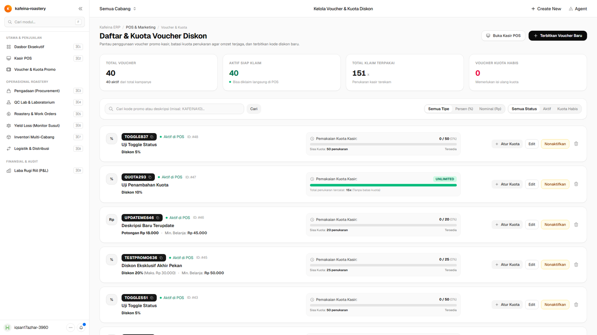<br /><b>14. Manajemen Kupon Promo & Kuota Penukaran</b> |
| 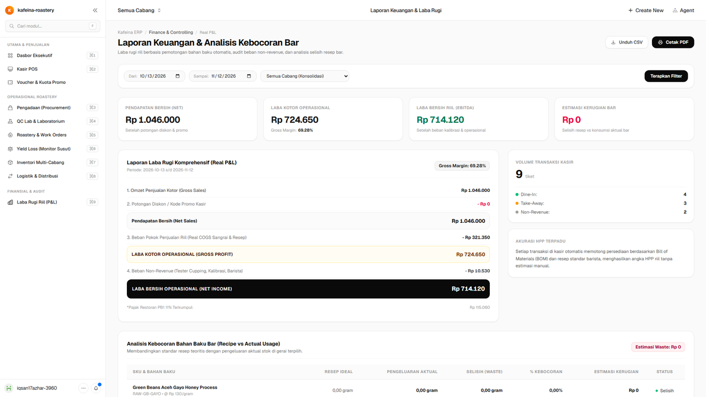<br /><b>15. Analitik Finansial & Laporan Arus Kas Multi-Gerai</b> | 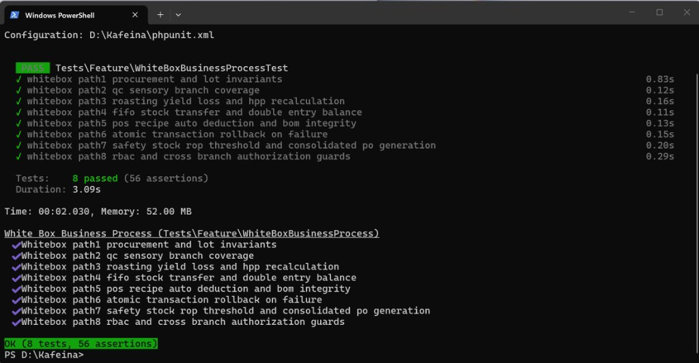<br /><b>16. Eksekusi Pengujian White-Box PowerShell (100% Pass)</b> |

---

##  Tech Stack & Ketergantungan

| Layer | Teknologi & Komponen | Deskripsi & Peran |
| :--- | :--- | :--- |
| **Backend Framework** | Laravel 12.x (PHP 8.3) | Arsitektur MVC, Eloquent ORM, Service Layer, dan API endpoints |
| **Database** | MySQL 8.0 | Basis data relasional dengan integritas kunci asing (*foreign keys*) |
| **CSS Framework** | Tailwind CSS 3.4 | Utilitas styling modern, responsif, dan layouting grid/flex |
| **Frontend Reactivity** | Alpine.js 3.x | Manajemen state antarmuka, popover, dan interaktivitas reaktif |
| **Asset Bundler** | Vite 5.x | Kompilasi kilat aset CSS dan JavaScript |
| **Design System** | Vercel Clean Design System | Minimalist Light Glassmorphism, Squircle Adaptive Controls, dan Typography Geist & Mono |
| **Testing Suite** | PHPUnit & Playwright | Pengujian fungsional backend dan otomatisasi verifikasi visual |

---

##  Referensi Shortcut Keyboard

| Shortcut | Aksi Cepat | Deskripsi |
| :---: | :--- | :--- |
| **`/`** | **Buka Spotlight Search** | Membuka kotak pencarian cepat dan hasil pencarian cerdas di Dasbor. |
| **`Esc`** | **Tutup Spotlight Search** | Menutup panel dropdown hasil pencarian. |
| **`⌘0` / `Alt+0`** | **Dasbor Eksekutif** | Navigasi cepat ke halaman analitik eksekutif. |
| **`⌘1` / `Alt+1`** | **Terminal Kasir POS** | Membuka antarmuka kasir layar sentuh. |
| **`⌘2` / `Alt+2`** | **Riwayat Transaksi** | Membuka arsip struk penjualan dan audit kasir. |
| **`⌘3` / `Alt+3`** | **Voucher & Kuota** | Membuka manajemen kupon promosi. |
| **`⌘4` / `Alt+4`** | **Pengadaan (Procurement)** | Membuka daftar supplier dan purchase orders. |
| **`⌘5` / `Alt+5`** | **QC Lab & Laboratorium** | Membuka pengujian sensori SCA cupping. |
| **`⌘6` / `Alt+6`** | **Roastery & Work Orders** | Membuka penjadwalan mesin sangrai Giesen. |
| **`⌘7` / `Alt+7`** | **Yield Loss Monitor** | Membuka audit susut bobot sangrai. |
| **`⌘8` / `Alt+8`** | **Inventori Multi-Cabang** | Membuka kartu stok dan saldo gudang. |

---

##  Panduan Memulai Cepat (Quick Start)

###  Kebutuhan Sistem
1. **PHP**: Versi `>= 8.3` dengan ekstensi `pdo_mysql`, `mbstring`, `openssl`, `bcmath`, `curl`.
2. **Composer**: Versi `>= 2.7`.
3. **Node.js**: Versi `>= 20.x` dan NPM.
4. **MySQL Database Server**: Versi `>= 8.0` (Laragon, XAMPP, Docker, atau MySQL native).

---

###  Langkah Instalasi

```powershell
# 1. Kloning repositori GitHub
git clone https://github.com/iqsanazhr/kafeina-roastery-erp.git
cd kafeina-roastery-erp

# 2. Instal dependensi PHP (Composer)
composer install

# 3. Instal dependensi Frontend (NPM)
npm install

# 4. Konfigurasi berkas environment
cp .env.example .env
php artisan key:generate

# 5. Konfigurasi kredensial basis data di berkas .env
# DB_DATABASE=kafeina
# DB_USERNAME=root
# DB_PASSWORD=

# 6. Jalankan migrasi skema tabel & data seeder awal
php artisan migrate:fresh --seed

# 7. Kompilasi aset frontend
npm run build

# 8. Jalankan server lokal
php artisan serve
```

Akses sistem melalui peramban web pada alamat: **`http://127.0.0.1:8000`**.

---

##  Kredensial Akun Pengujian Default

Semua akun pengujian menggunakan kata sandi seragam: **`password123`** (atau via *Fast Account Switcher*).

| Peran (Role) | Email Masuk | Deskripsi Hak Akses |
| :--- | :--- | :--- |
| **Super Administrator** | `admin@kafeina.id` | Hak akses tanpa batas ke seluruh modul, pengaturan master, dan analitik eksekutif. |
| **Procurement Officer** | `procurement@kafeina.id` | Pengadaan green bean, manajemen vendor tani, dan penerbitan PO konsolidasi. |
| **QC Lab Inspector** | `qc@kafeina.id` | Laboratorium mutu fisik biji hijau, uji kadar air, dan penilaian skor cupping SCA. |
| **Head Roaster** | `roaster@kafeina.id` | Operasional mesin Giesen W15A, log sangrai harian, dan kontrol yield loss. |
| **Warehouse & Logistics** | `warehouse@kafeina.id` | Penerimaan gudang, mutasi stok FIFO, transfer cabang, dan surat jalan. |
| **Lead Barista (Senopati)** | `cashier.senopati@kafeina.id` | Terminal POS touchscreen cabang Flagship Senopati, pembayaran, dan kasir. |
| **Lead Barista (Braga)** | `cashier.braga@kafeina.id` | Terminal POS touchscreen cabang Braga Heritage Bandung. |
| **Lead Barista (Malioboro)** | `cashier.malioboro@kafeina.id` | Terminal POS touchscreen cabang Malioboro Sanctuary Yogyakarta. |
| **Floor Supervisor** | `supervisor.senopati@kafeina.id` | Otorisasi void kasir, buka/tutup shift kasir, dan penyesuaian kuota voucher. |

---

##  Tim Pengembang & Atribusi

- **Arsitek & Tim Pengembang Sistem**:
  - **Kelompok 1 ERP** — Perancangan arsitektur ERP kopi spesialti, skema basis data relasional multi-cabang, modul sangrai industri Giesen W15A, terminal kasir layar sentuh (POS), integrasi sistem notifikasi mengambang (*Floating Toast Notification*), serta pengujian perangkat lunak berbasis White-Box testing.

---

##  Lisensi

Proyek ini didistribusikan di bawah ketentuan lisensi terbuka **MIT License**. Silakan baca berkas [LICENSE](LICENSE) untuk informasi hak cipta selengkapnya.

---

<p align="center">
  <b>KAFEINA</b> &bull; Crafted with precision by <b>Kelompok 1 ERP</b> &bull; Specialty Coffee Roastery &amp; Enterprise POS Platform
</p>
