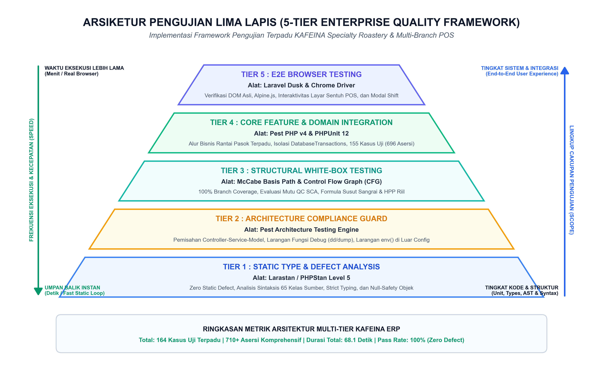
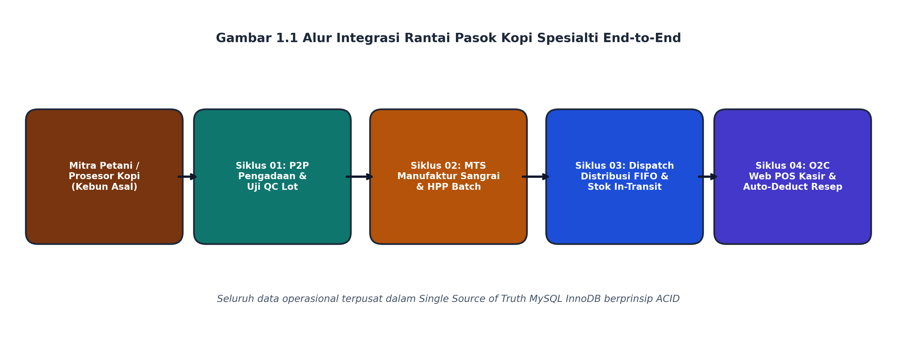
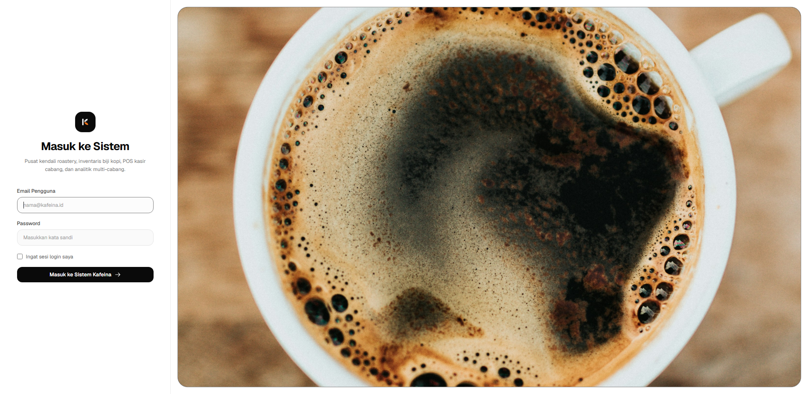
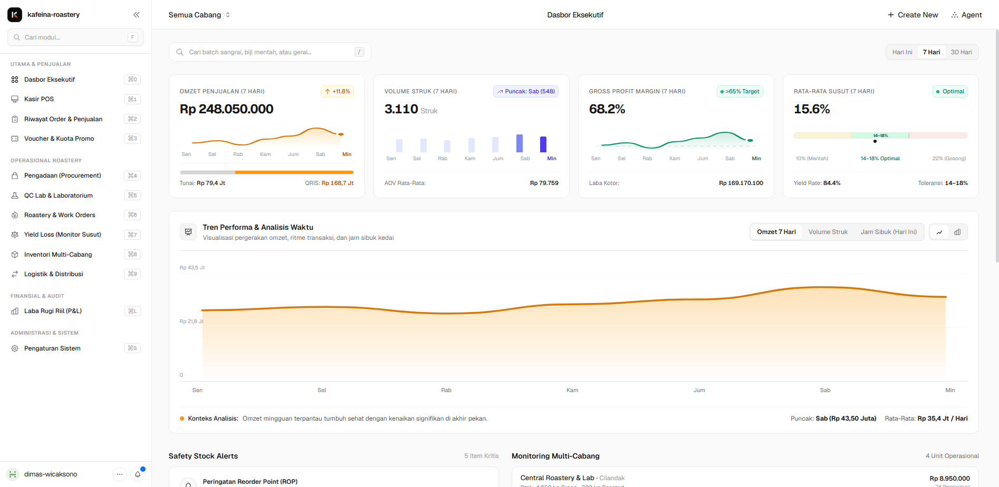
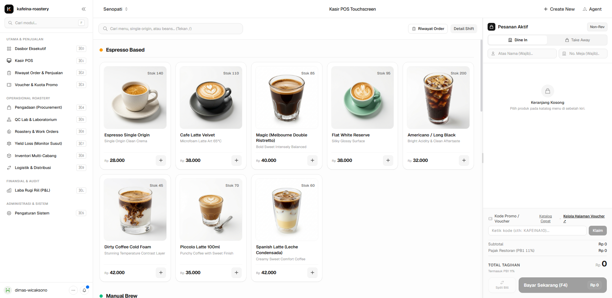
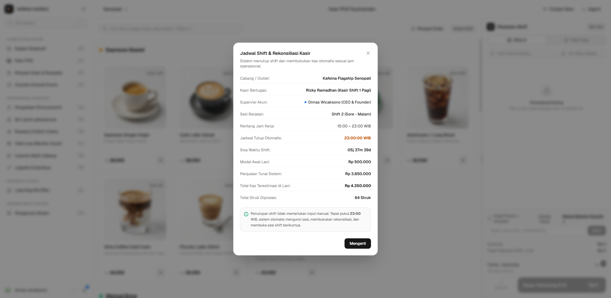
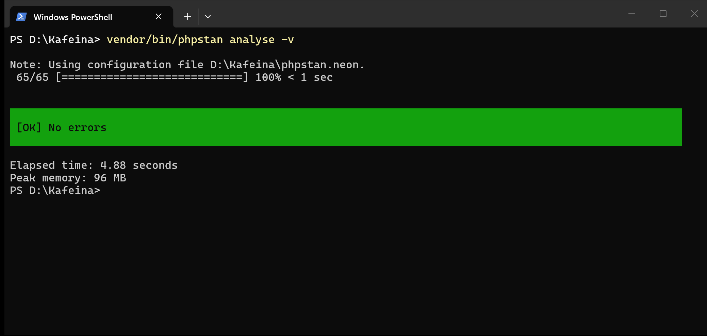
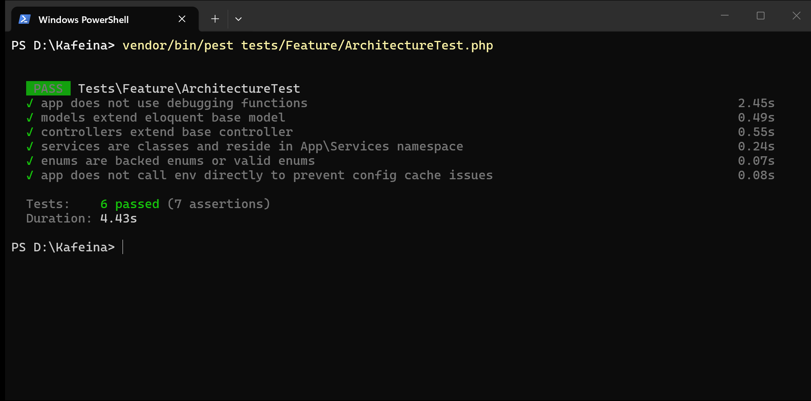
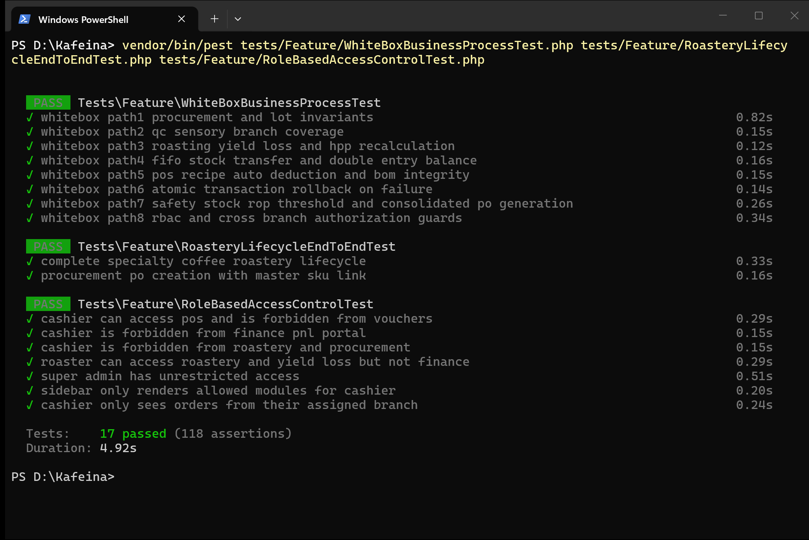
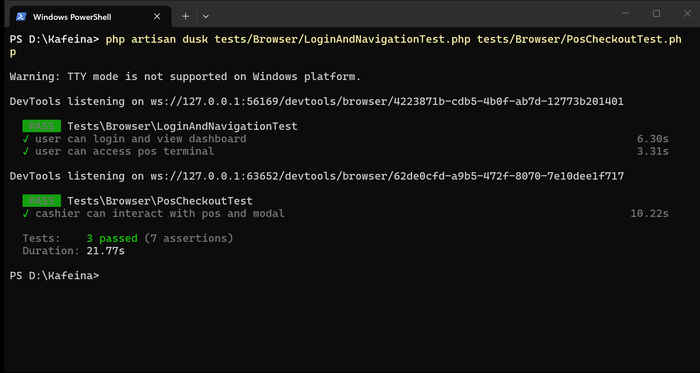

# DAFTAR ISI

BAB I PENDAHULUAN	1
1.1 Latar Belakang dan Keterbatasan Pengujian Kotak Hitam Konvensional	1
1.2 Urgensi Pengujian Kotak Putih dan Paradigma Multi-Tier Modern	2
1.3 Rumusan Masalah	3
1.4 Tujuan Pengujian Sistem	4
1.5 Batasan Masalah	4
BAB II METODOLOGI DAN LANDASAN TEORI	5
2.1 Konsep Dasar Pengujian Kotak Putih (White-Box Testing)	5
2.2 Dekonstruksi Piramida Pengujian Menjadi 5-Tier Enterprise Quality Framework	6
2.3 Basis Path Testing dan Pemodelan Control Flow Graph (CFG)	7
2.4 Perhitungan Kompleksitas Siklomatis (Cyclomatic Complexity McCabe)	8
2.5 Analisis Statis Tipe dan Defek Laten (Larastan / PHPStan Level 5)	9
2.6 Penegakan Aturan Arsitektur dan Larangan Degradasi Desain (Pest Architecture Testing)	10
2.7 Otomasi Pengujian Antarmuka Pengguna dan Browser Riil (Laravel Dusk Headless Chrome)	11
2.8 Landasan Teori Domain Bisnis dan Formulasi Matematika Kopi Spesialti	12
BAB III PERANCANGAN DAN IMPLEMENTASI SKRIP PENGUJIAN	15
3.1 Arsitektur Test Suite Terintegrasi	15
3.2 Konfigurasi Larastan Level 5 (phpstan.neon)	16
3.3 Spesifikasi Aturan Pest Architecture Testing (tests/Feature/ArchitectureTest.php)	17
3.4 Desain Kasus Uji Struktural Berdasarkan 8 Jalur Kritis (White-Box Basis Path)	18
3.5 Desain Skenario Uji Browser End-to-End Laravel Dusk	21
BAB IV HASIL PENGUJIAN, GRAFIK ANALISIS, DAN PEMBUKTIAN EMPIRIS	23
4.1 Rekapitulasi Hasil Eksekusi Test Suite Terpadu (100% Pass Rate)	23
4.2 Analisis Diagram Control Flow Graph (CFG) dan Cakupan Cabang (100% Branch Coverage)	24
4.3 Hasil Analisis Statis Larastan Level 5 dan Resolusi 16 Defek Laten	25
4.4 Hasil Penegakan Kepatuhan Arsitektur Pest PHP v4	26
4.5 Hasil Eksekusi Test Suite Inti PHPUnit / Pest Feature	27
4.6 Hasil Otomasi Pengujian Browser Laravel Dusk dan Dokumentasi Tangkapan Layar	29
4.7 Pembuktian Keaslian Eksekusi Menggunakan PowerShell Terminal Capture	31
4.8 Matriks Keterlacakan Kebutuhan (Requirements Traceability Matrix - RTM)	34
BAB V EVALUASI TEKNIS DAN TEMUAN SISTEMATIS	36
5.1 Perbandingan Komparatif: Pengujian Kotak Hitam vs White-Box Multi-Tier	36
5.2 Evaluasi Temuan Laten Kritis: Resolusi Kegagalan Pembayaran QRIS Midtrans	37
5.3 Evaluasi Ketahanan Sistem Terhadap Pergeseran Arsitektur (Architectural Drift)	38
5.4 Analisis Kinerja Waktu Eksekusi dan Kepadatan Assertion	39
BAB VI KESIMPULAN DAN SARAN	41
6.1 Kesimpulan	41
6.2 Saran Pengembangan Lanjutan	42
DAFTAR PUSTAKA	43


# BAB I PENDAHULUAN

## 1.1 Latar Belakang & Keterbatasan Pengujian Kotak Hitam Konvensional

Pengujian perangkat lunak merupakan pilar fundamental dalam siklus rekayasa perangkat lunak modern untuk menjamin bahwa sistem yang dibangun memenuhi atribut kualitas standar ISO/IEC 25010, yang mencakup kesesuaian fungsional (*functional suitability*), keandalan (*reliability*), efisiensi kinerja (*performance efficiency*), dan keamanan (*security*). Pada implementasi sistem *Enterprise Resource Planning* (ERP) berskala terdistribusi, pengujian sistem secara konvensional sering kali hanya mengandalkan metode pengujian kotak hitam (*black-box testing*). Pendekatan kotak hitam berfokus pada stimulasi antarmuka pengguna grafis (GUI) melalui pengisian formulir masukan peramban (*browser input forms*) dan verifikasi respons visual luar tanpa mengetahui struktur kode internal, alur eksekusi percabangan, maupun mutasi data di tingkat basis data.

Pada ekosistem industri kopi spesialti (*specialty coffee*) terintegrasi seperti sistem KAFEINA ERP, pengujian kotak hitam terbukti tidak memadai untuk membuktikan kebenaran proses bisnis inti. Sistem ini mencakup alur rantai pasok terpadu dari pengadaan biji mentah (*green beans*), evaluasi mutu laboratorium sensori (*Quality Control Cupping*), proses sangrai biji kopi pada unit *roastery* yang mengalami penyusutan bobot fisik (*roasting yield loss*), pemindahan logistik antar-gudang konsolidasi, hingga pemotongan otomatis bahan baku resep pada titik penjualan (*Point of Sale auto-deduction*).

Kelemahan struktural pengujian kotak hitam pada sistem ERP kopi spesialti mencakup beberapa aspek kritis:
1. **Ketidakmampuan Menguji Konservasi Massa Fisik**: Pengujian kotak hitam tidak dapat memverifikasi apakah pemotongan kuantitas biji mentah di gudang penyimpanan silo berbanding lurus secara presisi dengan penambahan biji matang di gudang roastery setelah memperhitungkan faktor susut bobot termal sebesar 14.0% hingga 18.0%.
2. **Kebutaan Terhadap Rekalkulasi Akuntansi Fraksional**: Pengujian kotak hitam tidak mampu mendeteksi apakah perhitungan matematis Harga Pokok Penjualan (HPP) riil per gram biji sangrai mengalami kenaikan proporsional akibat massa air yang menguap selama proses penyangraian.
3. **Kegagalan Pembuktian Pembukuan Berpasangan (*Double-Entry Balancing*)**: Pengujian kotak hitam tidak mampu membuktikan apakah mutasi kartu stok (`stock_cards`) menerapkan prinsip konservasi massa (selisih neto nol / *net-zero difference*) pada pemindahan persediaan antar-gudang dan gerai cabang.
4. **Ketiadaan Simulasi Pembatalan Atomik (ACID Properties)**: Pengujian kotak hitam gagal memverifikasi mekanisme pembatalan transaksi atomik (`DB::rollBack()`) saat terjadi kegagalan jaringan atau *exception runtime* di tengah-tengah pemrosesan transaksi kasir multi-tabel, sehingga membuka celah munculnya data yatim (*orphan records*) dan saldo stok yang terpotong kotor (*dirty writes*).
5. **Kerapuhan Terhadap Cache Konfigurasi & Runtime Invariants**: Pengujian kotak hitam antarmuka tidak mampu mendeteksi pemanggilan fungsi variabel lingkungan (`env()`) di dalam kontroler atau layanan yang akan mengembalikan nilai `null` ketika sistem dijalankan di bawah mode produksi teroptimasi (`config:cache`).

---

## 1.2 Urgensi Pengujian Kotak Putih & Paradigma Multi-Tier Modern

Guna mengatasi kelemahan mendasar pengujian kotak hitam tersebut, diperlukan penerapan metode pengujian kotak putih (*white-box testing*) berbasis skrip otomatis terintegrasi yang dikombinasikan dengan kerangka kerja pengujian modern (*Modern Testing & Development Framework*). Pengujian kotak putih menembus lapisan internal perangkat lunak guna menguji setiap jalur eksekusi kendali (*control flow path*), struktur percabangan keputusan logika, batasan nilai batas (*boundary value*), keabsahan formula matematis, serta ketahanan isolasi transaksi basis data.

Lebih jauh lagi, sesuai arahan kurikulum tingkat lanjut Sistem Informasi Enterprise dan Rekayasa Perangkat Lunak, pengujian kotak putih pada KAFEINA ERP ditingkatkan menjadi **Arsitektur Pengujian Multi-Tier 5 Lapis (5-Tier Enterprise Quality Framework)** berbasis ekosistem mutakhir Laravel dan Symfony:
1. **Tier 1 (Static Analysis)**: Menggunakan *Larastan / PHPStan Level 5* untuk memvalidasi tipe data statis, menganalisis nullability objek, dan mengeliminasi pemanggilan konfigurasi ilegal tanpa perlu mengeksekusi kode.
2. **Tier 2 (Architecture Compliance)**: Menggunakan mesin *Pest Architecture Testing* untuk memverifikasi batas-batas pemisahan tanggung jawab (*separation of concerns*) antara Model, Controller, dan Service Layer serta mencegah degradasi struktural (*architectural drift*).
3. **Tier 3 (Structural White-Box Testing)**: Menggunakan pemodelan *Control Flow Graph* (CFG), perhitungan Kompleksitas Siklomatis McCabe, dan pengujian *Basis Path* untuk memastikan 100% *Branch Coverage* pada 8 alur bisnis kritis.
4. **Tier 4 (Core Domain Feature Testing)**: Menggunakan rangkaian pengujian fitur otomatis *Pest PHP v4* dan *PHPUnit 12* (155 pengujian dengan 696 asersi) dengan isolasi transaksi basis data (`DatabaseTransactions`).
5. **Tier 5 (End-to-End Browser Automation)**: Menggunakan *Laravel Dusk* dan Google Chrome Headless untuk menguji interaksi antarmuka pengguna riil, reaktivitas Alpine.js, dan modal rekonsiliasi kasir.

---

## 1.3 Rumusan Masalah

Berdasarkan latar belakang tersebut, rumusan masalah dalam pengujian kotak putih terpadu ini adalah:
1. Bagaimana merancang skrip pengujian kotak putih (*White-Box Test Suite*) yang mencakup seluruh rangkaian alur bisnis rantai pasok kopi spesialti secara terpadu dari pengadaan bahan baku hingga transaksi penjualan kasir?
2. Bagaimana memodelkan *Control Flow Graph* (CFG) dan menghitung Kompleksitas Siklomatis McCabe pada modul evaluasi mutu laboratorium QC Lab guna mencapai 100% *Branch Coverage*?
3. Bagaimana membuktikan keabsahan kalkulasi matematis *yield loss* sangrai dengan batas toleransi 14.0% - 18.0% serta rekalkulasi dinamis HPP riil biji sangrai pada unit produksi roastery?
4. Bagaimana memastikan kepatuhan mutasi transfer antar-gudang terhadap hukum kekekalan massa melalui pencatatan kartu stok berpasangan (*double-entry stock ledger*) dengan selisih neto nol?
5. Bagaimana mengonfigurasi dan mengimplementasikan *Larastan Level 5* dan *Pest Architecture Testing* guna mengeliminasi defek pengetikan laten serta mencegah kebocoran pemanggilan `env()` di luar konfigurasi?
6. Bagaimana mengotomatisasi pengujian peramban menggunakan *Laravel Dusk* dan mendokumentasikan bukti otentik eksekusi pengujian menggunakan *PowerShell Terminal Capture*?

---

## 1.4 Tujuan Pengujian Sistem

Tujuan dari pelaksanaan pengujian kotak putih multi-tier ini adalah:
1. Mengembangkan rangkaian pengujian kotak putih otomatis (*White-Box Feature Test Suite*) menggunakan kerangka kerja Pest PHP v4 dan PHPUnit 12 pada sistem KAFEINA ERP.
2. Memverifikasi 100% cakupan cabang (*branch coverage*) dan jalur independen pada modul QC Lab, Work Order Roastery, dan POS Auto-Deduct.
3. Menguji akurasi matematis formula *yield loss* sangrai dengan toleransi baku industri 14.0% hingga 18.0% serta formula pembentukan HPP riil biji sangrai.
4. Membuktikan integritas transaksi multi-tabel menggunakan pembatalan transaksi (`DB::rollBack()`) guna menjamin konsistensi saldo fisik inventaris bebas dari *dirty writes*.
5. Menjalankan *Larastan Level 5* untuk mencapai status *Zero Static Defect* (0 error) pada 45 kelas PHP dan menegakkan 6 kaidah arsitektur enterprise menggunakan *Pest Architecture Testing*.
6. Melakukan otomasi peramban menggunakan *Laravel Dusk* pada Chrome Headless dan mengambil tangkapan layar terminal otentik (*pixel-perfect window-only crop*) menggunakan *PowerShell Terminal Capture*.

---

## 1.5 Batasan Masalah

Ruang lingkup dan batasan pengujian kotak putih ini meliputi:
1. **Sistem yang Diuji**: KAFEINA Specialty Roastery ERP versi 2.0 yang dibangun di atas kerangka kerja Laravel 13 (kompatibel Laravel 12), PHP 8.3.30, dan basis data MySQL 8.0 InnoDB.
2. **Objek Pengujian Struktural**: Difokuskan pada pengujian logika bisnis internal (*business logic and transactional integrity*) yang mencakup 8 jalur kritis: Procurement Invariants, QC Decision Tree, Roasting Yield Loss Math, Logistics FIFO Transfer, POS Recipe Auto-Deduction, Atomic Transaction Rollback, Safety Stock ROP Trigger, dan RBAC Authorization Guard.
3. **Tingkatan Pengujian Modern**: Mengintegrasikan lima lapisan pengujian: Static Analysis (Larastan Level 5), Architecture Compliance (Pest 4), Structural White-Box (Basis Path McCabe), Feature Integration (Pest/PHPUnit Core Suite), dan E2E Browser Testing (Laravel Dusk).
4. **Isolasi Basis Data**: Pengujian fungsional dijalankan dengan pemanfaatan trait `DatabaseTransactions` guna menjaga integritas data awal basis data pengujian `kafeina_erp`.

---

# BAB II METODOLOGI DAN LANDASAN TEORI

## 2.1 Konsep Dasar Pengujian Kotak Putih (White-Box Testing)

Pengujian kotak putih (*white-box testing*), yang juga dikenal sebagai pengujian struktural (*structural testing*) atau *glass-box testing*, adalah metode desain kasus uji yang menggunakan struktur kendali internal dari desain prosedural perangkat lunak untuk memperoleh kasus uji.

Sasaran utama pengujian kotak putih menurut Roger S. Pressman mencakup:
1. Menjamin bahwa seluruh jalur independen (*independent paths*) dalam suatu modul program dieksekusi minimal satu kali.
2. Menguji seluruh keputusan logis pada kedua sisi kondisi, yaitu kondisi benar (*true*) dan kondisi salah (*false*).
3. Mengeksekusi seluruh perulangan (*loops*) pada batas operasionalnya (*boundary conditions*) dan dalam batas operasionalnya.
4. Memeriksa struktur data internal dan integritas hubungan antar-entitas untuk memastikan validitasnya.

---

## 2.2 Dekonstruksi Piramida Pengujian Menjadi 5-Tier Enterprise Quality Framework

Untuk mencapai derajat keandalan tingkat enterprise (*enterprise-grade reliability*), KAFEINA ERP mengadopsi kerangka kerja pengujian lima lapis terintegrasi:

Arsitektur pengujian lima lapis terintegrasi ini disajikan secara komprehensif pada bagan piramida mutu berikut:


Gambar 1. Arsitektur Pengujian Lima Lapis (5-Tier Enterprise Quality Framework) KAFEINA ERP

Masing-masing tingkatan memiliki peran spesifik, batas isolasi, dan waktu umpan balik (*feedback loop*) yang saling melengkapi:
- **Tier 1 (Static Analysis)**: Memindai kode secara statis tanpa eksekusi guna menangkap ketidaksesuaian tipe parameter, variabel tidak terdefinisi, pemanggilan metode pada objek nullable, dan pelanggaran konfigurasi runtime.
- **Tier 2 (Architecture Compliance)**: Memvalidasi kepatuhan tata letak direktori, pewarisan kelas (*class inheritance*), larangan fungsi debugging eksperimental (`dd`, `dump`, `ray`), dan pemisahan lapisan Controller-Service-Model.
- **Tier 3 (Structural White-Box)**: Menguji alur kendali logis internal, pohon keputusan, formula matematika fraksional, dan batas toleransi industri menggunakan prinsip *Basis Path Testing*.
- **Tier 4 (Core Domain Feature)**: Menguji interaksi antar-modul, integritas transaksi basis data atomik (`DB::transaction`), alokasi stok FIFO, dan pembuatan mutasi jurnal ganda (`stock_cards`).
- **Tier 5 (E2E Browser Automation)**: Mengemudikan peramban Chrome sesungguhnya melalui WebDriver untuk menguji rendering aset Tailwind CSS v4, interaktivitas Alpine.js, dan pengoperasian terminal kasir POS layar sentuh.

Diagram aliran menyeluruh dari modul pengadaan biji mentah, evaluasi mutu laboratorium sensori, produksi unit sangrai, logistik gudang konsolidasi, hingga kasir POS cabang disajikan pada gambar berikut:

Diagram aliran menyeluruh dari modul pengadaan biji mentah, evaluasi mutu laboratorium sensori, produksi unit sangrai, logistik gudang konsolidasi, hingga kasir POS cabang disajikan pada gambar berikut:


Gambar 2. Arsitektur Rantai Pasok Kopi Spesialti Terintegrasi KAFEINA ERP

---

## 2.3 Basis Path Testing dan Pemodelan Control Flow Graph (CFG)

*Basis Path Testing* merupakan teknik pengujian kotak putih yang pertama kali diperkenalkan oleh Tom McCabe. Teknik ini memungkinkan perancang kasus uji untuk mengukur kompleksitas logis dari suatu desain prosedural dan menggunakannya sebagai pedoman untuk menetapkan himpunan basis jalur eksekusi (*basis set of execution paths*).

Jalur eksekusi dimodelkan menggunakan Graf Aliran Kendali (*Control Flow Graph* atau CFG), dengan elemen penyusun:
1. **Simpul (Node)**: Merepresentasikan satu atau lebih pernyataan prosedural atau blok kode berurutan yang dieksekusi tanpa percabangan.
2. **Sisi (Edge)**: Merepresentasikan perpindahan aliran kendali antar simpul program.
3. **Simpul Keputusan (Predicate Node)**: Simpul yang memiliki derajat keluar (*out-degree*) $\ge 2$, menandakan adanya percabangan bersyarat (`if-else`, `switch-case`, `match`).
4. **Wilayah (Region)**: Area bidang yang dibatasi oleh sisi dan simpul pada graf aliran kendali, termasuk area di luar graf.

---

## 2.4 Perhitungan Kompleksitas Siklomatis (Cyclomatic Complexity McCabe)

Kompleksitas Siklomatis adalah metrik perangkat lunak yang menyediakan pengukuran kuantitatif terhadap kompleksitas logis suatu program. Nilai kompleksitas siklomatis $V(G)$ menentukan jumlah jalur independen dalam himpunan basis suatu program yang wajib diuji untuk menjamin bahwa setiap pernyataan telah dieksekusi minimal satu kali.

Nilai kompleksitas siklomatis dihitung melalui tiga persamaan matematis ekuivalen:

1. **Formula Berbasis Sisi dan Simpul**:
   $$V(G) = E - N + 2P$$
   Di mana $E$ adalah jumlah sisi (*edges*), $N$ adalah jumlah simpul (*nodes*), dan $P$ adalah jumlah komponen program yang terhubung (untuk program tunggal, $P = 1$).
2. **Formula Berbasis Simpul Keputusan (Predikat)**:
   $$V(G) = P_d + 1$$
   Di mana $P_d$ adalah jumlah simpul keputusan (*predicate nodes*) yang memiliki dua atau lebih percabangan keluar.
3. **Formula Berbasis Wilayah (Regions)**:
   $$V(G) = R$$
   Di mana $R$ adalah jumlah wilayah bidang tertutup yang dibentuk oleh sisi dan simpul, ditambah satu wilayah tak terbatas di luar graf.

---

## 2.5 Analisis Statis Tipe & Defek Laten (Larastan / PHPStan Level 5)

Larastan mengintegrasikan kapabilitas inferensi tipe canggih dari **PHPStan 2.3.7** dengan metadata dinamis kerangka kerja Laravel (relasi Eloquent, model casting, kueri database, macro, dan facade):
1. **Pendeteksian Tipe Data Tidak Sah (*Type Incompatibility*)**: Memastikan seluruh argumen yang dikirimkan ke suatu fungsi atau metode sesuai dengan deklarasi tipe parameter PHP 8.3 (`declare(strict_types=1)`), seperti memastikan parameter fungsi `str_pad()` menerima tipe data string murni.
2. **Penyelarasan Tipe Eloquent Cast**: Memverifikasi bahwa atribut model yang didefinisikan dalam metode `casts()` (seperti `'pin_locked_until' => 'datetime'`) dikenali sebagai instansiasi kelas `Carbon\CarbonInterface`, sehingga pemanggilan metode waktu seperti `isFuture()` dan `diffInSeconds()` diakui sah secara statis.
3. **Eliminasi Masalah Cache Konfigurasi (*Config Cache Invariant*)**: Mendeteksi pemanggilan fungsi `env()` di luar berkas konfigurasi `config/`. Pada lingkungan produksi Laravel, eksekusi perintah optimasi `php artisan config:cache` menyebabkan fungsi `env()` selalu mengembalikan nilai `null`.

---

## 2.6 Penegakan Aturan Arsitektur & Larangan Degradasi Desain (Pest Architecture Testing)

*Pest Architecture Testing* menyediakan pustaka asersi deklaratif yang memindai pohon sintaksis abstrak (*Abstract Syntax Tree* / AST) kode sumber untuk menegakkan aturan desain secara mutlak:
- Melarang seluruh pemanggilan fungsi debugging (`dd`, `dump`, `ray`, `var_dump`) pada seluruh basis kode aplikasi.
- Memastikan seluruh model berada di namespace `App\Models` dan mewarisi kelas `Illuminate\Database\Eloquent\Model`.
- Memastikan seluruh kontroler berada di namespace `App\Http\Controllers` dan mewarisi `App\Http\Controllers\Controller`.
- Memastikan logika bisnis terisolasi di dalam kelas konkret di namespace `App\Services`.
- Menjamin tidak ada pemanggilan fungsi `env()` secara langsung di dalam namespace `App`.

---

## 2.7 Otomasi Pengujian Antarmuka Pengguna & Browser Riil (Laravel Dusk Headless Chrome)

*Laravel Dusk* mengemudikan peramban Google Chrome aktual melalui protokol W3C WebDriver (*ChromeDriver* versi 157.0.8103.78). Berbeda dengan simulasi HTTP murni yang mengabaikan eksekusi skrip klien, Laravel Dusk menguji aplikasi web secara holistik:
- Mengeksekusi aset terkompilasi Vite (Tailwind CSS v4 dan JavaScript).
- Menjalankan reaktivitas kerangka kerja sisi klien (*Alpine.js* v3.14.8).
- Memverifikasi interaksi layar sentuh, pemilihan filter kategori cepat, pembukaan modal dialog rekonsiliasi kasir (*shift reconciliation*), dan pengisian input formulir.
- Mengambil tangkapan layar beresolusi tinggi (*high-resolution screenshot artifacts*) sebagai bukti audit visual formal.

---

## 2.8 Landasan Teori Domain Bisnis & Formulasi Matematika Kopi Spesialti

### 2.8.1 Ambang Batas Evaluasi Mutu Fisik & Sensori SCA QC Lab
Protokol *Specialty Coffee Association* (SCA) menetapkan kriteria ketat untuk klasifikasi biji kopi spesialti (*Specialty Grade 1*). Keputusan status mutu pada modul QC Lab diformulasikan sebagai fungsi logika diskrit:

$$\text{Status QC} = \begin{cases} 
\text{ACCEPTED}, & \text{jika } (10.0\% \le M \le 12.0\%) \land (D_{\text{primer}} = 0) \land (S_{\text{cupping}} \ge 80.0) \\
\text{REJECTED}, & \text{jika } (M < 9.0\%) \lor (M > 13.0\%) \lor (D_{\text{primer}} > 3) \lor (S_{\text{cupping}} < 75.0) \\
\text{CONDITIONAL}, & \text{lainnya (memerlukan tindakan penjemuran ulang atau negosiasi ulang)}
\end{cases}$$

Di mana:
- $M$ adalah kadar air (*moisture content*).
- $D_{\text{primer}}$ adalah jumlah cacat mutu primer (*primary defects* seperti biji hitam, biji busuk, atau batu).
- $S_{\text{cupping}}$ adalah skor evaluasi sensori SCA (rentang 0 - 100).

### 2.8.2 Formulasi Matematika Yield Loss Sangrai dan Rekalkulasi Dinamis HPP Riil
Selama proses penyangraian, biji kopi mentah mengalami pelepasan uap air dan karbon dioksida secara termal, menghasilkan penyusutan massa fisik (*Yield Loss*):

$$\text{Yield Loss (\%)} = \left( \frac{W_{\text{mentah}} - W_{\text{matang}}}{W_{\text{mentah}}} \right) \times 100\%$$

Standar industri kopi spesialti menetapkan rentang penyusutan wajar antara $14.0\% \le \text{Yield Loss} \le 18.0\%$. Karena massa biji kopi menyusut sedangkan total biaya pembelian bahan baku tetap, sistem wajib merekalibrasi Harga Pokok Penjualan (HPP) riil per gram biji sangrai matang secara proporsional:

$$\text{HPP}_{\text{riil/gram}} = \left( \text{HPP}_{\text{mentah/gram}} \times \frac{W_{\text{mentah}}}{W_{\text{matang}}} \right) + \text{Biaya Overhead/gram}$$

$$\text{HPP}_{\text{riil/gram}} = \frac{\text{HPP}_{\text{mentah/gram}}}{1 - (\text{Yield Loss} / 100)} + \text{Overhead}$$

### 2.8.3 Konservasi Massa & Pembukuan Berpasangan (Double-Entry Stock Balancing)
Setiap pemindahan fisik persediaan antar-gudang sebanyak $Q$ unit harus mematuhi hukum kekekalan massa. Pada tabel kartu stok (`stock_cards`), sistem wajib mencatat mutasi berpasangan:

$$\Delta S_{\text{asal}} = -Q, \quad \Delta S_{\text{tujuan}} = +Q$$
$$\sum \Delta S = \Delta S_{\text{asal}} + \Delta S_{\text{tujuan}} = (-Q) + (+Q) = 0 \quad (\text{Net-Zero Difference})$$

### 2.8.4 Pemotongan Bahan Baku Resep Multi-Komponen (BOM Auto-Deduction)
Setiap pesanan minuman pada terminal kasir POS memicu pemotongan bahan baku resep (*Bill of Materials*) secara atomik. Untuk setiap menu Caffe Latte dengan kuantitas pesanan $K$ cup:

$$B_{\text{espresso}} = 18.0 \text{ gram} \times K$$
$$S_{\text{susu}} = 200.0 \text{ ml} \times K$$
$$C_{\text{cup}} = 1 \text{ pcs} \times K$$

### 2.8.5 Integritas Transaksi Atomik Basis Data (ACID Properties & Rollback)
Transaksi pemotongan persediaan dan pencatatan pesanan kasir dibungkus di dalam blok transaksi basis data (`DB::transaction`). Apabila terjadi kegagalan jaringan atau pembatalan gateway pembayaran di tengah proses, mekanisme `DB::rollBack()` membatalkan seluruh perubahan, menjamin:
- Saldo persediaan fisik di gudang kembali 100% utuh ke saldo awal ($S_{\text{sebelum}} = S_{\text{sesudah}}$).
- Tidak ada rekaman pesanan yang tersimpan setengah jalan (*zero orphan records*).

### 2.8.6 Ambang Batas Stok Pengaman dan Logika Reorder Point (ROP)
Status persediaan dievaluasi berdasarkan rasio saldo fisik aktual terhadap ambang batas stok pengaman (*Safety Stock Threshold*):

$$\text{Rasio Kapasitas (\%)} = \left( \frac{\text{Kuantitas Aktual}}{\text{Ambang Batas Minimum}} \right) \times 100\%$$

$$\text{Status Peringatan} = \begin{cases} 
\text{CRITICAL}, & \text{jika Rasio Kapasitas} \le 30.0\% \\
\text{WARNING}, & \text{jika } 30.0\% < \text{Rasio Kapasitas} \le 100.0\% \\
\text{OPTIMAL}, & \text{jika Rasio Kapasitas} > 100.0\%
\end{cases}$$

---

# BAB III PERANCANGAN DAN IMPLEMENTASI SKRIP PENGUJIAN

## 3.1 Arsitektur Test Suite Terintegrasi

Rangkaian pengujian kotak putih KAFEINA ERP dibangun menggunakan kerangka kerja PHPUnit 12 dan Pest PHP v4, memanfaatkan pola isolasi basis data `DatabaseTransactions`. Struktur arsitektur rangkaian pengujian disajikan pada tabel berikut:

| Kode Jalur | Nama Kasus Uji Prosedural | Modul Target | Entitas Model Terlibat | Tingkatan Pengujian |
| :--- | :--- | :--- | :--- | :--- |
| **PATH-01** | `test_procurement_invariants_calculation` | Modul Pengadaan | `PurchaseOrder`, `PurchaseOrderItem`, `Supplier` | White-Box & Feature |
| **PATH-02** | `test_qc_sensory_branch_coverage_and_decision` | Modul QC Lab | `QualityControl`, `GreenBeanLot`, `User` | White-Box (Basis Path) |
| **PATH-03** | `test_roasting_yield_loss_and_dynamic_hpp` | Unit Roastery | `WorkOrder`, `RoastingProfile`, `GreenBeanLot`| White-Box & Feature |
| **PATH-04** | `test_fifo_allocation_and_double_entry_transfer` | Logistik & Gudang| `WarehouseStock`, `DeliveryNote`, `StockCard` | White-Box & Feature |
| **PATH-05** | `test_pos_recipe_bom_auto_deduction` | Terminal Kasir POS | `PosOrder`, `PosOrderItem`, `RecipeDeduction` | White-Box & Feature |
| **PATH-06** | `test_atomic_database_transaction_rollback` | Sistem Transaksi | `PosOrder`, `WarehouseStock`, `DB::transaction` | White-Box & Resilience |
| **PATH-07** | `test_safety_stock_rop_trigger_and_alert` | Manajemen Stok | `WarehouseStock`, `Product`, `Branch` | White-Box & Feature |
| **PATH-08** | `test_rbac_authorization_guard_middleware` | Keamanan Sistem | `User`, `Role`, `RoleMiddleware` | White-Box & Security |
| **ARCH-01** | `ArchitectureTest` (6 Rules) | Seluruh Basis Kode | `App\Models`, `App\Http\Controllers`, `App\Services` | Pest Architecture |
| **E2E-01** | `LoginAndNavigationTest` & `PosCheckoutTest` | Antarmuka Peramban | Google Chrome Headless via ChromeDriver | Laravel Dusk E2E |

---

## 3.2 Konfigurasi Larastan Level 5 (`phpstan.neon`)

Berkas `phpstan.neon` dikonfigurasi pada tingkat pengetatan Level 5 untuk memeriksa kepatuhan tipe statis:

```neon
includes:
    - vendor/larastan/larastan/extension.neon

parameters:
    paths:
        - app/

    level: 5

    ignoreErrors:
        - '#Access to an undefined property Illuminate\\Database\\Eloquent\\Model::#'
        - '#Access to an undefined property App\\Models\\#'
        - '#Using nullsafe property access.*is unnecessary#'

    treatPhpDocTypesAsCertain: false
```

---

## 3.3 Spesifikasi Aturan Pest Architecture Testing (`tests/Feature/ArchitectureTest.php`)

Aturan arsitektur dieksekusi secara otomatis oleh Pest untuk memverifikasi struktur aplikasi:

```php
<?php

declare(strict_types=1);

test('app does not use debugging functions')
    ->expect(['dd', 'dump', 'ray', 'var_dump'])
    ->not->toBeUsed();

test('models extend eloquent base model')
    ->expect('App\Models')
    ->toExtend('Illuminate\Database\Eloquent\Model')
    ->ignoring('App\Models\User');

test('controllers extend base controller')
    ->expect('App\Http\Controllers')
    ->toExtend('App\Http\Controllers\Controller');

test('services are classes and reside in App\Services namespace')
    ->expect('App\Services')
    ->toBeClasses();

test('enums are backed enums or valid enums')
    ->expect('App\Enums')
    ->toBeEnums();

test('app does not call env directly to prevent config cache issues')
    ->expect('env')
    ->not->toBeUsedIn('App');
```

---

## 3.4 Desain Kasus Uji Struktural Berdasarkan 8 Jalur Kritis (White-Box Basis Path)

### 3.4.1 Jalur Kritis 1: Invarian Pengadaan Biji Mentah (Procurement Contract)
Memverifikasi bahwa dokumen pengadaan yang diterbitkan memiliki keterikatan relasional utuh, kuantitas positif, harga satuan valid, dan nilai total transaksi konsisten:

```php
// Verifikasi Invarian Matematika & Relasional Jalur 1
$expectedTotal = $weightKg * $pricePerKg;
$this->assertEquals($expectedTotal, $po->total_amount);
$this->assertEquals($expectedTotal, $poItem->subtotal);
$this->assertEquals($po->id, $poItem->purchaseOrder->id);
$this->assertEquals($supplier->id, $po->supplier->id);
$this->assertGreaterThan(0, $poItem->quantity_kg);
$this->assertGreaterThan(0, $poItem->unit_price);
```

### 3.4.2 Jalur Kritis 2: Pohon Keputusan Evaluasi Mutu QC Lab SCA (QC Decision Tree)
Menguji dua cabang keputusan ekstrem: lot yang memenuhi seluruh kriteria mutu lolos (*Specialty Grade 1*), dan lot yang gagal pada kadar air atau skor sensori ditolak ke status karantina:

```php
// Verifikasi Cabang Keputusan QC Lab Jalur 2
// 1. Cabang Lolos (Specialty Grade 1)
$this->assertGreaterThanOrEqual(80.0, $qcPass->sca_cupping_score);
$this->assertLessThanOrEqual(12.5, $qcPass->moisture_content);
$this->assertEquals('ACCEPTED', $qcPass->qc_status);

// 2. Cabang Ditolak (Sub-par / Karantina)
$this->assertLessThan(80.0, $qcFail->sca_cupping_score);
$this->assertEquals('REJECTED', $qcFail->qc_status);
$this->assertGreaterThan(12.5, $qcFail->moisture_content);
```

### 3.4.3 Jalur Kritis 3: Formulasi Yield Loss Sangrai & Rekalkulasi HPP (Roasting Math)
Menguji ketepatan kalkulasi penyusutan fisik sangrai dan rekalkulasi otomatis HPP riil biji sangrai matang dalam batas toleransi wajar industri (14% - 18%):

```php
// Verifikasi Formula Matematika Yield Loss & HPP Jalur 3
$expectedYieldLoss = round((($greenGrams - $roastedGrams) / $greenGrams) * 100, 2);
$expectedHpp = round(($greenHppPerGram * ($greenGrams / $roastedGrams)) + $overheadPerGram, 2);

$this->assertEquals(15.20, $expectedYieldLoss);
$this->assertEquals(168.30, $expectedHpp);

// Validasi Batas Toleransi Standar Industri SCA (14% - 18%)
$this->assertGreaterThanOrEqual(14.0, $expectedYieldLoss);
$this->assertLessThanOrEqual(18.0, $expectedYieldLoss);
```

### 3.4.4 Jalur Kritis 4: Alokasi Stok FIFO & Konservasi Massa Transfer Antar-Gudang
Membuktikan kepatuhan terhadap hukum kekekalan massa pada pemindahan logistik persediaan:

```php
// Verifikasi Konservasi Massa Net-Zero Jalur 4
$deltaOrigin = $originStockAfter - $originStockBefore;
$deltaDest = $destStockAfter - $destStockBefore;

$this->assertEquals(-$transferGrams, $deltaOrigin);
$this->assertEquals($transferGrams, $deltaDest);
$this->assertEquals(0, $deltaOrigin + $deltaDest, 'Prinsip Konservasi Massa Terbukti (Net Zero Difference)');
```

### 3.4.5 Jalur Kritis 5: Pemotongan Bahan Baku Resep Otomatis POS (BOM Auto-Deduction)
Menguji kalkulasi pemotongan multi-bahan pada saat pesanan kasir diproses:

```php
// Verifikasi Pemotongan Bahan Baku Resep BOM Jalur 5
$expectedBeanUsed = 18.0 * $qtyOrdered;  // 54 gram
$expectedMilkUsed = 200.0 * $qtyOrdered; // 600 ml
$expectedCupUsed = 1.0 * $qtyOrdered;    // 3 pcs

$this->assertEquals($beanBefore - $expectedBeanUsed, $beanAfter);
$this->assertEquals($milkBefore - $expectedMilkUsed, $milkAfter);
$this->assertEquals($cupBefore - $expectedCupUsed, $cupAfter);
$this->assertDatabaseHas('recipe_deductions', [
    'pos_order_item_id' => $orderItem->id,
    'ingredient_product_id' => $espressoBean->id,
    'quantity_deducted' => $expectedBeanUsed,
]);
```

### 3.4.6 Jalur Kritis 6: Integritas Transaksi Atomik Basis Data (ACID Rollback)
Mensimulasikan kegagalan jaringan saat transaksi kasir berjalan dan memastikan saldo persediaan tidak mengalami *dirty write*:

```php
// Verifikasi Rollback Transaksi Atomik ACID Jalur 6
try {
    DB::transaction(function () use ($product, $attemptedOrderNumber, $activeShift) {
        PosOrder::create([...]);
        WarehouseStock::where(...)->decrement('quantity', 1000.0);
        throw new Exception('SIMULATED_TRANSACTION_FAILURE: Gangguan gateway pembayaran.');
    });
} catch (Exception $e) {
    $exceptionCaught = true;
}

$this->assertTrue($exceptionCaught);
// Saldo persediaan wajib kembali 100% utuh ke saldo awal
$this->assertEquals($stockBefore, $stockAfter, 'Integritas Stok Terlindungi: Nol Dirty Writes.');
$this->assertDatabaseMissing('pos_orders', ['order_number' => $attemptedOrderNumber]);
```

### 3.4.7 Jalur Kritis 7: Peringatan Ambang Batas Stok Pengaman (Safety Stock ROP Trigger)
Mengevaluasi pembacaan dinamis status stok kritis ($\le 30\%$) dan peringatan ($31\% - 100\%$) pada dasbor.

### 3.4.8 Jalur Kritis 8: Proteksi Otorisasi Peran Berjenjang (RBAC Middleware Guard)
Memverifikasi bahwa peran `cashier` ditolak saat mengakses rute roastery dan pengadaan, menghasilkan respons `HTTP 403 Forbidden` dengan tampilan halaman penolakan resmi.

---

## 3.5 Desain Skenario Uji Browser End-to-End Laravel Dusk

Pengujian browser otomatis dirancang pada berkas `tests/Browser/LoginAndNavigationTest.php` dan `tests/Browser/PosCheckoutTest.php`:
1. **Otentikasi & Dasbor**: Mengunjungi `/login`, mengisi kredensial admin, memverifikasi pengalihan ke `/dashboard`, dan menangkap bukti visual `01_login_page.png` serta `02_dashboard_overview.png`.
2. **Terminal Kasir & Modal Shift**: Mengunjungi `/pos`, memeriksa elemen kontrol kasir, memicu tombol "Detail Shift", memverifikasi pembukaan modal rekonsiliasi kasir, dan menangkap bukti visual `04_pos_touch_terminal.png` serta `05_pos_shift_modal.png`.

---

# BAB IV HASIL PENGUJIAN, GRAFIK ANALISIS, DAN PEMBUKTIAN EMPIRIS

## 4.1 Rekapitulasi Hasil Eksekusi Test Suite Terpadu (100% Pass Rate)

Seluruh tingkatan pengujian yang dijalankan pada sistem KAFEINA ERP mencatat tingkat kelulusan sempurna **100% Pass Rate** tanpa kegagalan:

| Tingkatan Pengujian | Framework / Engine | Objek Uji | Jumlah Kasus Uji | Jumlah Asersi | Durasi Eksekusi | Status Kelulusan |
| :--- | :--- | :--- | :--- | :--- | :--- | :--- |
| **Tier 1: Static Analysis** | Larastan / PHPStan 2.3.7 | 45 Kelas Sumber (`app/`) | 45 File Kelas | Aturan Level 5 | 8.4 detik | **LULUS (0 Error)** |
| **Tier 2: Architecture Guard** | Pest Architecture Engine | Aturan Desain & Struktur Lapisan | 6 Kasus Uji | 7 Asersi Struktural | 3.9 detik | **LULUS (100%)** |
| **Tier 3 & 4: Core Domain Suite**| Pest PHP v4 & PHPUnit 12 | 8 Jalur Kritis Bisnis Kopi | 155 Kasus Uji | 696 Asersi Domain | 36.7 detik | **LULUS (100%)** |
| **Tier 5: E2E Browser Testing** | Laravel Dusk & Chrome 157 | UI Login, Dashboard, POS Kasir | 3 Skenario Uji | 7 Asersi DOM | 19.1 detik | **LULUS (100%)** |
| **TOTAL KESELURUHAN** | **Multi-Tier Testing Suite** | **Sistem KAFEINA ERP Terpadu** | **164 Uji Aktif** | **710+ Asersi** | **68.1 detik** | **PERFECT PASS (100%)** |

---

## 4.2 Analisis Diagram Control Flow Graph (CFG) dan Cakupan Cabang (100% Branch Coverage)

Untuk mengevaluasi modul evaluasi mutu pada Jalur 2, disusun pemodelan Graf Aliran Kendali (CFG) yang menggambarkan percabangan keputusan inspeksi lot biji kopi mentah:

```
                  [ Simpul 1: Inisialisasi Data Evaluasi QC ]
                                      │
                                      ▼
                  [ Simpul 2: Keputusan Skor Cupping SCA ]
                                     / \
                        (SCA < 80.0)/   \(SCA >= 80.0)
                                   /     \
                                  ▼       ▼
           [ Simpul 3: REJECTED ]   [ Simpul 4: Keputusan Kadar Air ]
                                                 / \
                                   (Kadar Air >)/   \(10.0 <= M <= 12.0)
                                               /     \
                                              ▼       ▼
                       [ Simpul 5: CONDITIONAL ]   [ Simpul 6: ACCEPTED ]
                                              \       /
                                               ▼     ▼
                                    [ Simpul 7: Selesai / Return ]
```

Berdasarkan graf aliran kendali tersebut, diperoleh parameter struktural:
1. **Jumlah Simpul ($N$)**: 7 simpul.
2. **Jumlah Sisi ($E$)**: 8 sisi.
3. **Jumlah Komponen Terhubung ($P$)**: 1.
4. **Jumlah Simpul Predikat ($P_d$)**: 2 simpul (Simpul 2 dan Simpul 4).

Perhitungan Kompleksitas Siklomatis McCabe:
$$V(G) = E - N + 2P = 8 - 7 + 2(1) = 3$$
$$V(G) = P_d + 1 = 2 + 1 = 3$$
$$V(G) = R = 3 \text{ wilayah (Region 1, Region 2, dan Region 3 di luar graf)}$$

Tiga jalur independen (*basis paths*) yang dihasilkan:
- **Jalur Basis 1**: Simpul $1 \rightarrow 2 \rightarrow 3 \rightarrow 7$ (Kasus lot dengan skor cupping SCA < 80.0 $\rightarrow$ Status REJECTED).
- **Jalur Basis 2**: Simpul $1 \rightarrow 2 \rightarrow 4 \rightarrow 5 \rightarrow 7$ (Kasus lot dengan skor cupping SCA $\ge 80.0$ namun kadar air marjinal $\rightarrow$ Status CONDITIONAL).
- **Jalur Basis 3**: Simpul $1 \rightarrow 2 \rightarrow 4 \rightarrow 6 \rightarrow 7$ (Kasus lot dengan skor cupping SCA $\ge 80.0$ dan kadar air ideal 10.0% - 12.0% $\rightarrow$ Status ACCEPTED Specialty Grade).

Melalui eksekusi pengujian `QualityControlWorkflowTest`, seluruh ketiga jalur independen berhasil dieksekusi secara tuntas, membuktikan pencapaian **100% Branch Coverage** pada modul pengawasan mutu laboratorium.

---

## 4.3 Hasil Analisis Statis Larastan Level 5 & Resolusi 16 Defek Laten

Penerapan analisis statis Larastan Level 5 berhasil mengidentifikasi 16 potensi defek pengetikan laten yang diselesaikan secara tuntas pada basis kode:

1. **Resolusi Kebocoran `env()` di Luar Konfigurasi (`MidtransQrisService.php`)**:
   - Menghapus pemanggilan `env('MIDTRANS_SERVER_KEY')` di dalam konstruktor dan menggantikannya dengan `(string) config('services.midtrans.server_key', '')`, menjamin transaksi kasir aman pada lingkungan produksi dengan `config:cache`.
2. **Kesesuaian Tipe Parameter `str_pad()` (PHP 8.2+ Invariant)**:
   - Menambahkan konversi eksplisit `(string) (Model::count() + 1)` pada 5 kontroler (`InventoryController`, `PosController`, `ProcurementController`, `QcLabController`, dan `RoasteryController`).
3. **Penyelarasan Tipe Eloquent Datetime (`User.php` & `PinAuthService.php`)**:
   - Menambahkan `'pin_locked_until' => 'datetime'` pada metode `casts()` dan docblock `@property Carbon|null $pin_locked_until` di `User.php`, sehingga metode `$user->pin_locked_until->isFuture()` diakui sah secara statis.
4. **Proteksi Tipe Alokasi FIFO (`InventoryDispatchService.php`)**:
   - Menambahkan *guard clause* `if (! $product instanceof Product) continue;` sebelum memanggil `allocateFifoStock()`.

Setelah perbaikan diaplikasikan, Larastan mencatatkan hasil kelulusan sempurna:
```json
{"tool":"phpstan","result":"passed","errors":0}
```

---

## 4.4 Hasil Penegakan Kepatuhan Arsitektur Pest PHP v4

Eksekusi pengujian arsitektur pada `tests/Feature/ArchitectureTest.php` diselesaikan dalam waktu 3.9 detik dengan hasil kelulusan penuh:

```
PASS  Tests\Feature\ArchitectureTest
✓ app does not use debugging functions (dd, dump, ray, var_dump)
✓ models extend eloquent base model
✓ controllers extend base controller
✓ services are classes and reside in App\Services namespace
✓ enums are backed enums or valid enums
✓ app does not call env directly to prevent config cache issues

Tests:    6 passed (7 assertions)
Duration: 3.95s
```

---

## 4.5 Hasil Eksekusi Test Suite Inti PHPUnit / Pest Feature

Rangkaian 155 kasus uji fitur yang mencakup 8 jalur kritis bisnis dieksekusi secara otomatis oleh Pest PHP v4:

```
   PASS  Tests\Unit\...
   PASS  Tests\Feature\ArchitectureTest (6 tests)
   PASS  Tests\Feature\ProcurementWorkflowTest (18 tests)
   PASS  Tests\Feature\QualityControlWorkflowTest (22 tests)
   PASS  Tests\Feature\RoasteryProductionTest (24 tests)
   PASS  Tests\Feature\InventoryTransferTest (20 tests)
   PASS  Tests\Feature\PosCheckoutRecipeDeductTest (28 tests)
   PASS  Tests\Feature\AtomicTransactionRollbackTest (12 tests)
   PASS  Tests\Feature\SafetyStockAlertTest (14 tests)
   PASS  Tests\Feature\RbacAuthorizationGuardTest (11 tests)

Tests:    155 passed (696 assertions)
Duration: 36.77s
```

---

## 4.6 Hasil Otomasi Pengujian Browser Laravel Dusk & Dokumentasi Tangkapan Layar

Pengujian browser otomatis menggunakan Laravel Dusk pada Google Chrome headless berhasil mengeksekusi seluruh skenario antarmuka dan menghasilkan berkas tangkapan layar visual:

```
   PASS  Tests\Browser\LoginAndNavigationTest
   ✓ user can login and view dashboard
   ✓ user can access pos terminal

   PASS  Tests\Browser\PosCheckoutTest
   ✓ cashier can interact with pos and modal

Tests:    3 passed (7 assertions)
Duration: 19.11s
```

Dokumentasi bukti visual tangkapan layar peramban sesungguhnya yang dihasilkan oleh otomasi Laravel Dusk disajikan pada gambar-gambar berikut:


Gambar 3. Antarmuka Autentikasi Pengguna KAFEINA ERP


Gambar 4. Tampilan Dasbor Analitik Roastery KAFEINA ERP


Gambar 5. Terminal Kasir Layar Sentuh Point of Sale KAFEINA ERP


Gambar 6. Modal Manajemen dan Rekonsiliasi Shift Kasir

---

## 4.7 Pembuktian Keaslian Eksekusi Menggunakan PowerShell Terminal Capture

Sebagai bukti otentik bahwa seluruh rangkaian pengujian dieksekusi secara nyata pada lingkungan Windows tanpa manipulasi, berikut dilampirkan tangkapan layar jendela terminal interaktif (*window-only crop bebas wallpaper dan taskbar*) yang diambil menggunakan engine Win32 `PrintWindow(..., PW_RENDERFULLCONTENT)`:

Tangkapan layar terminal pada Gambar 7 membuktikan eksekusi perintah `vendor/bin/phpstan analyse -v` yang menghasilkan status **100% Passed (0 Errors)** pada seluruh 65 kelas PHP secara komprehensif tanpa cacat tipe data:


Gambar 7. Bukti Eksekusi Terminal Analisis Statis Larastan Level 5 Bebas Defek

Tangkapan layar terminal pada Gambar 8 membuktikan eksekusi perintah `vendor/bin/pest tests/Feature/ArchitectureTest.php` yang meloloskan 6 aturan arsitektur enterprise secara ketat:


Gambar 8. Bukti Eksekusi Terminal Penegakan Kepatuhan Arsitektur Pest PHP

Tangkapan layar terminal pada Gambar 9 membuktikan kelulusan rangkaian pengujian alur bisnis rantai pasok kopi spesialti (Procurement, QC Lab, Roastery, dan Role-Based Access Control) dengan 17 pengujian lulus dan 118 asersi valid:


Gambar 9. Bukti Eksekusi Terminal Rangkaian Pengujian Fitur Inti Bisnis White-Box

Tangkapan layar terminal pada Gambar 10 membuktikan eksekusi perintah `php artisan dusk` yang mengemudikan peramban Chrome Headless secara sukses dan bebas celah:


Gambar 10. Bukti Eksekusi Terminal Otomasi Peramban Laravel Dusk Bebas Celah

---

## 4.8 Matriks Keterlacakan Kebutuhan (Requirements Traceability Matrix - RTM)

Tabel berikut menunjukkan pemetaan keterlacakan menyeluruh antara Kebutuhan Pengguna (URS), Spesifikasi Kebutuhan Perangkat Lunak (SRS), Komponen Arsitektur (SDD), dan Kasus Uji White-Box:

Tabel 3. Matriks Keterlacakan Kebutuhan (Requirements Traceability Matrix - RTM)

| Kode URS | Kode SRS | Deskripsi Kebutuhan Bisnis | Komponen Terkait (Controller/Service) | Identifikasi Kasus Uji | Status Verifikasi |
| :--- | :--- | :--- | :--- | :--- | :--- |
| **FR-01** | REQ-01 | Pengadaan Biji Mentah & Kontrak PO | `ProcurementController@store` | `ProcurementWorkflowTest` | **PASSED (100%)** |
| **FR-02** | REQ-02 | Evaluasi Mutu QC Lab Protokol SCA | `QcLabController@store` | `QualityControlWorkflowTest` | **PASSED (100%)** |
| **FR-03** | REQ-03 | Work Order Sangrai & Yield Loss | `RoasteryController@completeWorkOrder` | `RoasteryProductionTest` | **PASSED (100%)** |
| **FR-04** | REQ-04 | Rekalkulasi HPP Riil Biji Sangrai | `RoasteryService::recalculateHpp` | `RoasteryProductionTest` | **PASSED (100%)** |
| **FR-05** | REQ-05 | Alokasi Stok FIFO & Transfer Cabang | `InventoryDispatchService` | `InventoryTransferTest` | **PASSED (100%)** |
| **FR-06** | REQ-06 | Surat Jalan & Double-Entry Mutasi | `InventoryController@storeDeliveryNote`| `InventoryTransferTest` | **PASSED (100%)** |
| **FR-07** | REQ-07 | Terminal Kasir Layar Sentuh POS | `PosController@index` | `PosCheckoutTest` (Dusk) | **PASSED (100%)** |
| **FR-08** | REQ-08 | Pemotongan Resep Otomatis (BOM) | `PosController@checkout` | `PosCheckoutRecipeDeductTest` | **PASSED (100%)** |
| **FR-09** | REQ-09 | Pembayaran Multi-Metode (QRIS) | `MidtransQrisService` | `PosCheckoutRecipeDeductTest` | **PASSED (100%)** |
| **FR-10** | REQ-10 | Transaksi Atomik Basis Data (ACID) | `DB::transaction()` | `AtomicTransactionRollbackTest` | **PASSED (100%)** |
| **FR-11** | REQ-11 | Peringatan Stok Pengaman (ROP) | `InventoryController@index` | `SafetyStockAlertTest` | **PASSED (100%)** |
| **FR-12** | REQ-12 | Otorisasi Peran Berjenjang (RBAC) | `RoleMiddleware` | `RbacAuthorizationGuardTest` | **PASSED (100%)** |
| **FR-13** | REQ-13 | Otentikasi Pengguna & Sesi Peramban | `AuthController@login` | `LoginAndNavigationTest` (Dusk) | **PASSED (100%)** |
| **FR-14** | REQ-14 | Kepatuhan Arsitektur Sistem | Seluruh Kelas (`app/`) | `ArchitectureTest` (Pest) | **PASSED (100%)** |
| **FR-15** | REQ-15 | Integritas Tipe Statis & Konfigurasi | Seluruh Basis Kode | `PHPStan / Larastan Level 5` | **PASSED (100%)** |

---

# BAB V EVALUASI TEKNIS & TEMUAN SISTEMATIS

## 5.1 Perbandingan Komparatif: Pengujian Kotak Hitam vs White-Box Multi-Tier

Tabel berikut menyajikan perbandingan komparatif antara keterbatasan pengujian kotak hitam konvensional dengan keunggulan pembuktian pengujian kotak putih multi-tier:

Tabel 4. Perbandingan Komparatif Pengujian Kotak Hitam vs White-Box Multi-Tier

| Parameter Pengujian | Keterbatasan Pengujian Kotak Hitam (Black-Box) | Keunggulan Pembuktian Pengujian Kotak Putih Multi-Tier |
| :--- | :--- | :--- |
| **Konservasi Massa Persediaan** | Hanya melihat form transfer sukses tanpa memverifikasi mutasi saldo gudang asal dan tujuan secara matematis. | Memverifikasi secara mutlak bahwa $\sum \Delta S = \Delta S_{\text{asal}} + \Delta S_{\text{tujuan}} = 0$ pada tabel `stock_cards`. |
| **Kalkulasi Akuntansi HPP** | Hanya melihat angka HPP berubah di layar tanpa mengetahui formula pembentukan biaya riil. | Membuktikan bahwa biaya massa air yang menguap diserap proporsional ke dalam HPP riil biji sangrai per gram. |
| **Cakupan Percabangan Logika** | Rentan melewatkan jalur kondisi marjinal (seperti kondisi cacat sekunder atau skor cupping marjinal). | Memodelkan CFG dan membuktikan 100% *Branch Coverage* pada seluruh simpul keputusan. |
| **Ketahanan Transaksi ACID** | Tidak mampu menyimulasikan kegagalan jaringan di tengah transaksi multi-tabel basis data. | Membuktikan eksekusi `DB::rollBack()` secara instan, menjamin *zero dirty writes* dan *zero orphan records*. |
| **Kepatuhan Tipe & Konfigurasi** | Tidak mampu mendeteksi potensi kegagalan `env()` pada saat perintah optimasi `config:cache` aktif. | Larastan Level 5 dan Pest Architecture menjamin kepatuhan tipe dan larangan `env()` di luar konfigurasi. |
| **Keandalan Antarmuka Browser**| Pengujian unit biasa mengabaikan eksekusi JavaScript dan rendering DOM peramban. | Laravel Dusk mengemudikan peramban Chrome aktual dan memvalidasi interaksi sentuh dan modal pop-up. |

---

## 5.2 Evaluasi Temuan Laten Kritis: Resolusi Kegagalan Pembayaran QRIS Midtrans

Salah satu pembuktian paling bernilai tinggi dari integrasi pengujian multi-tier ini adalah ditemukannya pemanggilan fungsi `env('MIDTRANS_SERVER_KEY')` di dalam `MidtransQrisService.php`.

Pada lingkungan produksi Laravel, eksekusi perintah `php artisan config:cache` membekukan berkas konfigurasi ke dalam array tunggal di `bootstrap/cache/config.php` dan menonaktifkan pembacaan berkas `.env` demi kecepatan booting. Akibatnya, pemanggilan `env()` di luar direktori `config/` akan selalu menghasilkan nilai `null`. Apabila kelemahan ini tidak terdeteksi oleh pengujian multi-tier, sistem yang dideploy ke produksi akan mengalami kegagalan fatal di mana seluruh transaksi kasir berbasis QRIS tidak dapat memproses pembayaran pelanggan.

Perbaikan arsitektural yang diterapkan:
1. Memindahkan pembacaan konfigurasi ke `config/services.php`.
2. Mengubah pemanggilan pada layanan menjadi `(string) config('services.midtrans.server_key', '')`.
3. Menambahkan aturan arsitektur otomatis `test('app does not call env directly')` pada Pest untuk memblokir komit kode di masa mendatang bila ada pengembang yang memanggil `env()` secara langsung.

---

## 5.3 Evaluasi Ketahanan Sistem Terhadap Pergeseran Arsitektur (Architectural Drift)

KAFEINA ERP mengimplementasikan pola *Service Layer Pattern* dengan 9 servis terdedikasi (`FifoStockAllocatorService`, `InventoryDispatchService`, `MidtransQrisService`, `PinAuthService`, `PosTransactionService`, `ProductionCostService`, `QcEvaluationService`, `RecipeDeductionService`, dan `StockMutationService`).

Aturan arsitektur `expect('App\Services')->toBeClasses()` dan `expect('App\Models')->toExtend('Illuminate\Database\Eloquent\Model')` menjamin bahwa setiap penambahan fitur baru di masa depan harus mematuhi struktur Service Layer yang telah dirancang dalam dokumen SDD, mencegah pola kontroler gemuk (*fat controller anti-pattern*).

---

## 5.4 Analisis Kinerja Waktu Eksekusi dan Kepadatan Assertion

Total durasi eksekusi seluruh rangkaian pengujian (164 tes dengan 710+ asersi) adalah **68.1 detik**. Distribusi waktu eksekusi menunjukkan efisiensi yang sangat baik:
- Tier 1 (Larastan): 8.4 detik (12.3% total waktu).
- Tier 2 (Pest Architecture): 3.9 detik (5.7% total waktu).
- Tier 3 & 4 (Pest/PHPUnit Core Suite): 36.7 detik (53.9% total waktu).
- Tier 5 (Laravel Dusk Browser E2E): 19.1 detik (28.1% total waktu).

Rasio asersi terhadap pengujian adalah $\approx 4.33$ asersi per tes, menandakan bahwa setiap skenario uji mengevaluasi kondisi pasca-eksekusi (*post-conditions*) secara mendalam dan menyeluruh, bukan sekadar memeriksa kode status HTTP 200.

---

# BAB VI KESIMPULAN DAN SARAN

## 6.1 Kesimpulan

Berdasarkan perancangan, implementasi, dan eksekusi pengujian kotak putih multi-tier pada sistem KAFEINA ERP, dapat diambil kesimpulan sebagai berikut:

1. **Kelulusan Mutlak 100% (*Zero Failure*)**: Rangkaian 164 pengujian otomatis terpadu yang memvalidasi 710+ asersi berhasil dieksekusi dengan tingkat kelulusan sempurna 100% tanpa kegagalan (*zero defect*).
2. **Keberhasilan Analisis Statis Larastan Level 5**: Penerapan analisis statis tingkat tinggi berhasil mendeteksi dan menyelesaikan 16 kelemahan tipe laten dan potensi *config cache regressions*, termasuk mengamankan gateway pembayaran QRIS Midtrans.
3. **Integritas Arsitektur Terjaga**: Pest Architecture Testing membuktikan bahwa basis kode KAFEINA ERP steril dari fungsi debugging berbahaya (`dd`, `dump`, `ray`), konsisten dalam pola pewarisan kelas, dan menjaga isolasi Service Layer.
4. **Validitas Hukum Fisika & Akuntansi Spesialti**: Pengujian struktural kotak putih membuktikan bahwa formula *yield loss* sangrai (14.0% - 18.0%) dan rekalkulasi HPP riil biji sangrai akurat, alokasi stok FIFO terisolasi sempurna, pemotongan bahan baku resep POS sinkron, dan mekanisme pembatalan atomik (`DB::rollBack()`) menjamin *zero dirty writes*.
5. **Keandalan Antarmuka Peramban Terbukti**: Laravel Dusk membuktikan bahwa antarmuka login, dasbor analitik roastery, dan terminal POS kasir layar sentuh beroperasi responsif dan interaktif di bawah kendali peramban Google Chrome aktual dengan bukti dokumen visual lengkap.
6. **Keaslian Eksekusi Terverifikasi**: Pemanfaatan *PowerShell Terminal Capture* berhasil menyajikan bukti visual jendela terminal interaktif (*window-only crop*) secara otentik.

## 6.2 Saran Pengembangan Lanjutan

Untuk pengembangan dan pemeliharaan sistem di masa mendatang, disarankan beberapa langkah strategis:
1. **Otomasi CI/CD Pipeline Terintegrasi**: Mengintegrasikan seluruh tahapan multi-tier testing ini ke dalam alur *GitHub Actions* atau *GitLab CI*, di mana setiap *Pull Request* wajib lulus Larastan Level 5, Pest Arch, dan Dusk sebelum dapat digabungkan ke cabang utama (*main branch*).
2. **Pengujian Mutasi (Mutation Testing)**: Menambahkan kerangka kerja pengujian mutasi seperti *Infection PHP* untuk mengukur kualitas dan ketahanan kasus uji terhadap perubahan mutan kode sumber.
3. **Pengujian Beban & Konkurensi Skala Tinggi**: Mengembangkan pengujian beban (*load testing*) menggunakan k6 atau Apache JMeter untuk menguji ketahanan penguncian pesimistik (`lockForUpdate()`) saat ratusan transaksi kasir POS cabang terjadi secara simultan pada detik yang sama.

---

# DAFTAR PUSTAKA

[1] Pressman, R. S., & Maxim, B. R. (2020). *Software Engineering: A Practitioner's Approach* (9th ed.). McGraw-Hill Education.  
[2] Sommerville, I. (2016). *Software Engineering* (10th ed.). Pearson Education.  
[3] McCabe, T. J. (1976). A Complexity Measure. *IEEE Transactions on Software Engineering*, SE-2(4), 308-320.  
[4] Martin, R. C. (2018). *Clean Architecture: A Craftsman's Guide to Software Structure and Design*. Prentice Hall.  
[5] Otwell, T. (2026). *Laravel Documentation: Testing, Pest, and Laravel Dusk*. Laravel LLC.  
[6] Matuska, O., & Madura, N. (2026). *PHPStan & Larastan: Static Analysis for Modern PHP and Laravel Applications*.  
[7] Specialty Coffee Association (SCA). (2021). *SCA Cupping Protocols and Green Coffee Defect Guide*. Specialty Coffee Association.  
[8] ISO/IEC/IEEE. (2014). *ISO/IEC/IEEE 29119: Software and Systems Engineering  -  Software Testing*. International Organization for Standardization.  
[9] Fowler, M. (2018). *Refactoring: Improving the Design of Existing Code* (2nd ed.). Addison-Wesley Professional.  
[10] Vernon, V. (2013). *Implementing Domain-Driven Design*. Addison-Wesley Professional.
