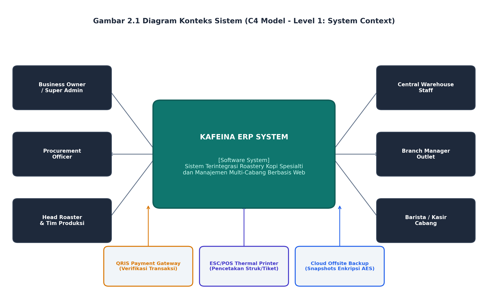
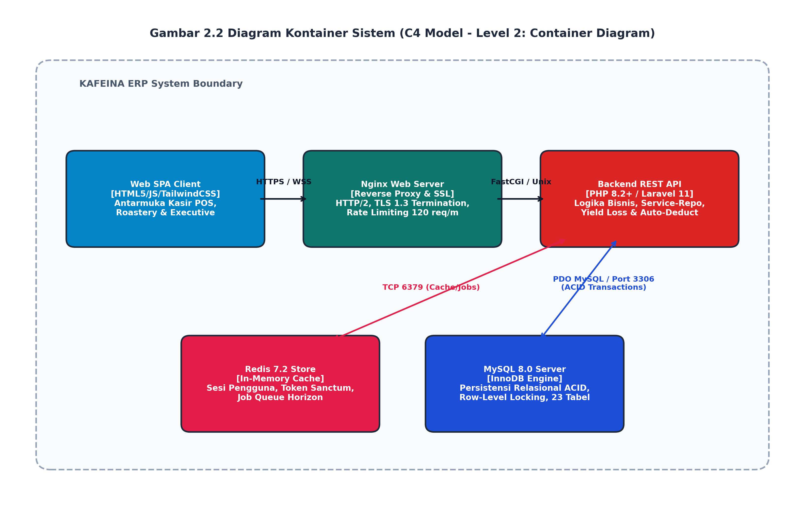
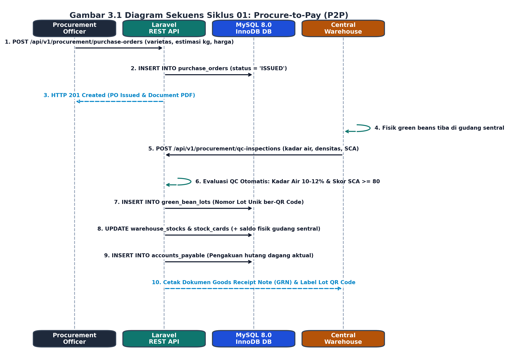
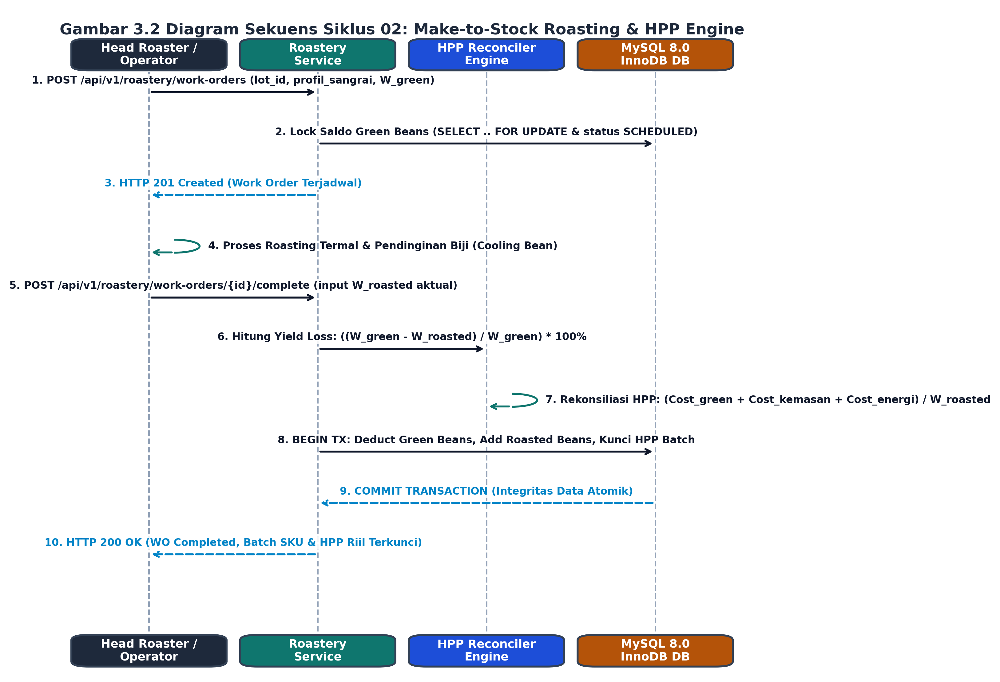
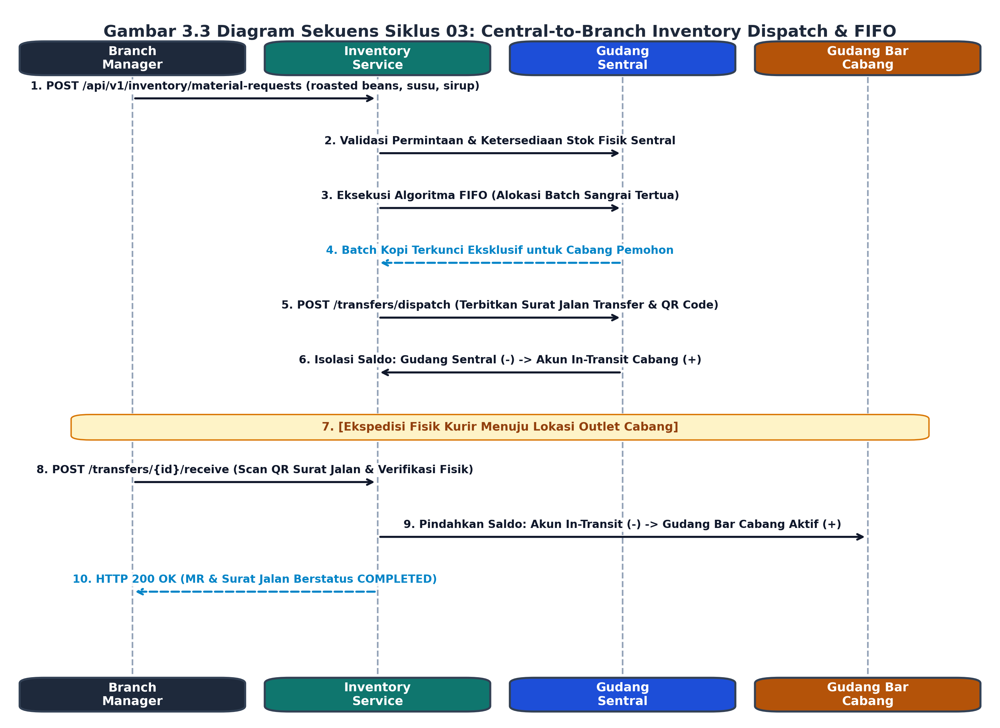
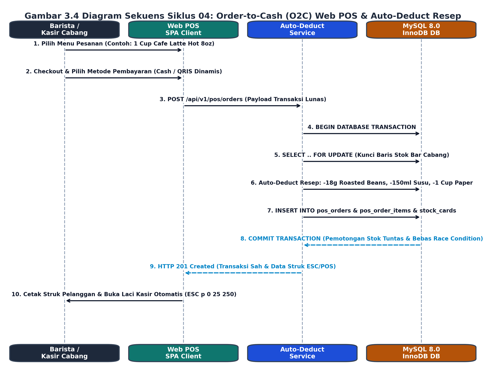
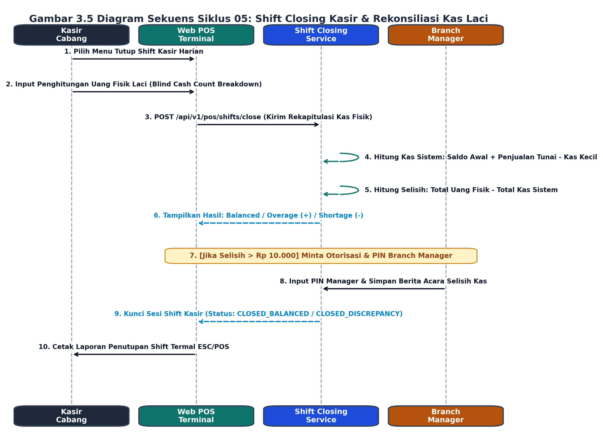
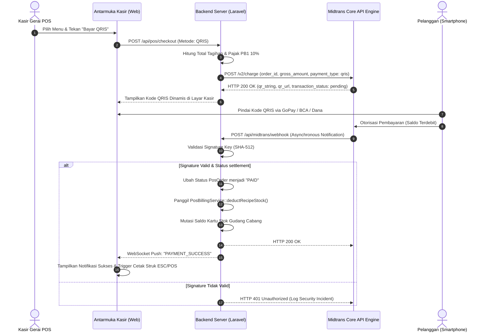
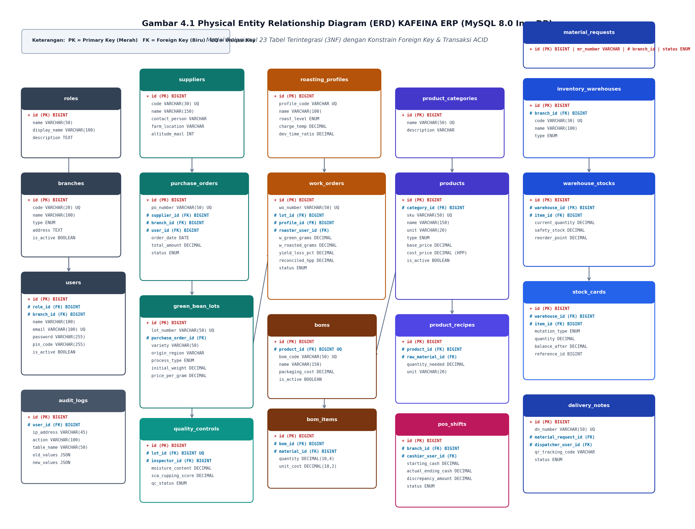

# REVISION HISTORY

| Versi | Tanggal | Penulis | Deskripsi Perubahan Dokumen Desain |
| :--- | :--- | :--- | :--- |
| 0.1 | 28 Oktober 2026 | Group 1 | Inisialisasi draf awal arsitektur dan skema database |
| 0.9 | 3 November 2026 | Group 1 | Penyusunan diagram C4 Context, Container, dan sequence diagram inti |
| 1.0 | 5 November 2026 | Group 1 | Pengesahan versi baseline tugas terstruktur |
| 2.0 | 20 November 2026 | Group 1 | **Penyempurnaan Total**: Penambahan Diagram Komponen C4, Diagram Kelas OOP Service Layer terperinci, Sequence Diagram 3-Arah Pembayaran QRIS Midtrans, Arsitektur Konkurensi *Pessimistic Locking* ACID, dan Kamus Data Fisik 29 Tabel Lengkap. |

---

# SECTION 1 - PROJECT DESCRIPTION

## 1.1 Project
1. **Nama Perangkat Lunak**: KAFEINA Enterprise Resource Planning (KAFEINA ERP)
2. **Kategori Sistem**: Sistem Informasi Terintegrasi Manufaktur Roastery Kopi Spesialti dan Ritel Multi-Cabang
3. **Versi Rilis**: Versi 2.0 (Produksi & Pengujian Lengkap)
4. **Target Pengguna**: Pemilik bisnis (*Super Admin*), manajer pengadaan (*Procurement Officer*), inspektur mutu (*QC Inspector*), kepala sangrai (*Head Roaster*), staf logistik gudang sentral, dan kasir gerai cabang.

## 1.2 Description
KAFEINA ERP adalah sistem enterprise modern yang dirancang khusus untuk memadukan seluruh rantai nilai bisnis kopi spesialti (*specialty coffee supply chain*) dari hulu ke hilir. Sistem mencakup pengadaan biji mentah (*green beans*) dari petani mitra, pengujian mutu laboratorium berbasis protokol Specialty Coffee Association (SCA), proses pemanggangan roastery sentral, manajemen pergudangan multi-cabang berbasis First-In First-Out (FIFO), hingga titik kasir ritel (*Point of Sale*) dengan pemotongan bahan baku resep secara instan.

Sistem dibangun menggunakan pola arsitektur *Clean Layered Architecture* berbasis framework Laravel 12/13 (PHP 8.3), basis data relasional MySQL 8.0 Enterprise Engine InnoDB, serta integrasi gateway pembayaran Midtrans untuk transaksi QRIS Dinamis dan Virtual Account.

---

# SECTION 2 - OVERVIEW & ESTIMATES

## 2.1 Purpose & Scope
Tujuan dari Dokumen Desain Perangkat Lunak (*Software Design Document* - SDD) ini adalah menyediakan cetak biru arsitektur teknis yang tidak ambigu bagi pengembang perangkat lunak, perancang basis data (*DBA*), dan penguji sistem (*QA*). Dokumen ini mentransformasikan seluruh kebutuhan fungsional URS dan spesifikasi teknis SRS ke dalam struktur kelas berorientasi objek, diagram komponen antarmuka, diagram sekuensial interaksi multi-sistem, skema fisik basis data, dan pola penanganan konkurensi.

## 2.2 Project Estimates & Sprints

Tabel 1. Estimasi Waktu dan Kompleksitas Modul Pengembangan

| Nama Modul | Kompleksitas Teknis | Estimasi Sprint | Alokasi Waktu | Penanggung Jawab |
| :--- | :--- | :--- | :--- | :--- |
| **Core & RBAC Security** | Sedang | Sprint 1 | 2 Minggu | Backend Lead |
| **Procurement & QC Module** | Tinggi | Sprint 2 | 2 Minggu | Fullstack Developer |
| **Roastery & Work Order Module** | Sangat Tinggi | Sprint 3 | 3 Minggu | Backend + Roastery Expert |
| **Multi-Branch Inventory & FIFO** | Sangat Tinggi | Sprint 4 | 2 Minggu | Database Architect |
| **Web POS & Recipe Deductions** | Sangat Tinggi | Sprint 5 | 2 Minggu | Frontend + Backend |
| **Finance, Reports & Vouchers** | Sedang | Sprint 6 | 1 Minggu | UI/UX + Financial Analyst |

---

# SECTION 3 - SYSTEM ARCHITECTURE (C4 MODEL)

## 3.1 C4 Context Diagram (Tingkat Sistem Kontekstual)
Diagram Konteks Sistem memvisualisasikan batas operasional KAFEINA ERP terhadap aktor pengguna dan sistem eksternal:


*Gambar 1. Diagram Konteks Sistem (C4 Context) KAFEINA ERP*

Interaksi sistem eksternal mencakup:
1. **Midtrans Payment Gateway**: Pembuatan kode pembayaran QRIS/VA dinamis dan verifikasi callback webhook status pelunasan transaksi kasir.
2. **Thermal Receipt Printer & Cash Drawer**: Pengiriman instruksi cetak dokumen transaksi berprotokol ESC/POS melalui koneksi USB/Bluetooth.
3. **Email Notification Service**: Pengiriman salinan dokumen Purchase Order ke mitra petani dan notifikasi persediaan kritis ke manajemen.

## 3.2 C4 Container Diagram (Tingkat Kontainer Aplikasi)
Diagram Kontainer memetakan komponen aplikasi tingkat tinggi yang membentuk runtime sistem:


*Gambar 2. Diagram Kontainer Perangkat Lunak (C4 Container) KAFEINA ERP*

1. **Single Page / Responsive Web Application**: Dibangun menggunakan Blade View Engine dan Tailwind CSS v4 untuk merender antarmuka pengguna responsif pada peramban klien.
2. **API Application Backend (Laravel 12/13)**: Menangani perutean HTTP, middleware otentikasi peran (RBAC), validasi form, serta orkestrasi aturan bisnis melalui Service Layer.
3. **Database Server (MySQL 8.0 InnoDB)**: Mengelola 29 tabel data relasional dengan aturan integritas kunci asing (*foreign keys*) dan transaksi atomik ACID.

## 3.3 C4 Component Diagram (Lapisan Layanan Backend)
Arsitektur internal aplikasi backend KAFEINA ERP mengadopsi pemisahan tugas secara tegas (*Separation of Concerns*):
- **HTTP Controllers Layer**: Bertugas menerima input HTTP request, memvalidasi form request, memanggil Service Layer, dan mengembalikan respons JSON atau Blade View.
- **Domain Service Layer**: Pusat logika bisnis yang sepenuhnya terpisah dari Controller, menjamin kode dapat diuji secara mandiri (*highly testable*).
- **Persistence Layer (Eloquent ORM)**: Mewakili entitas basis data, relasi relasional, scope kueri, dan mutasi saldo kartu stok.

---

# SECTION 4 - OBJECT-ORIENTED CLASS DIAGRAMS (SERVICE LAYER)

Untuk menjamin pemeliharaan kode (*maintainability*) dan pengujian otomatis bebas cacat statis (*zero static defects*), seluruh logika bisnis utama dienkapsulasi ke dalam kelas layanan (*Service Classes*) pada namespace `App\Services`.

## 4.1 Diagram Struktur Kelas Layanan Inti

Tabel 2. Spesifikasi Kelas Layanan Domain (Service Layer)

| Nama Kelas Layanan | Properti & Dependensi | Metode Publik Utama & Parameter | Nilai Kembali (*Return Type*) |
| :--- | :--- | :--- | :--- |
| `CashierPinAuthService` | • `$maxAttempts: int = 5`<br>• `$lockoutDuration: int = 900` | • `verifyPin(User $user, string $pin): bool`<br>• `isLocked(User $user): bool`<br>• `getRemainingLockoutSeconds(User $user): int` | `bool`<br>`bool`<br>`int` |
| `QualityControlService` | • `$minScaScore: float = 80.0`<br>• `$minMoisture: float = 10.0`<br>• `$maxMoisture: float = 12.0` | • `evaluateLot(array $data): array`<br>• `calculateDefectPenalty(int $primary, int $sec): float`<br>• `assignLotGrade(float $scaScore): string` | `array`<br>`float`<br>`string` |
| `WorkOrderService` | • `LotGeneratorService $lotGen`<br>• `StockCard $stockCard` | • `startWorkOrder(WorkOrder $wo): bool`<br>• `completeRoasting(WorkOrder $wo, float $roastedWeight): array`<br>• `calculateYieldLoss(float $green, float $roasted): float`<br>• `calculateRealHpp(float $greenHpp, float $yieldRatio): float` | `bool`<br>`array`<br>`float`<br>`float` |
| `FifoStockAllocatorService`| • `WarehouseStock $stockModel`<br>• `StockCard $stockCard` | • `allocateFifoStock(int $warehouseId, int $productId, float $qtyRequired): Collection`<br>• `verifyAvailability(int $warehouseId, int $productId, float $qty): bool` | `Collection`<br>`bool` |
| `InventoryDispatchService` | • `FifoStockAllocatorService $fifo`<br>• `DeliveryNote $dnModel` | • `dispatchTransfer(MaterialRequest $mr, array $payload): DeliveryNote`<br>• `confirmReceipt(DeliveryNote $dn, array $receivedItems): bool`<br>• `calculateDiscrepancy(DeliveryNoteItem $item, float $actual): float` | `DeliveryNote`<br>`bool`<br>`float` |
| `PosBillingService` | • `MidtransQrisService $midtrans`<br>• `CashierPinAuthService $pinAuth` | • `processCheckout(PosShift $shift, array $orderPayload): PosOrder`<br>• `deductRecipeStock(PosOrderItem $item): void`<br>• `applyVoucherDiscount(PosOrder $order, string $code): float` | `PosOrder`<br>`void`<br>`float` |
| `PosShiftService` | • `PosShift $shiftModel`<br>• `CashierPinAuthService $pinAuth` | • `openShift(User $cashier, float $floatAmount): PosShift`<br>• `closeShift(PosShift $shift, float $actualCash, ?string $spvPin): array`<br>• `calculateDiscrepancy(PosShift $shift, float $actualCash): float` | `PosShift`<br>`array`<br>`float` |
| `MidtransQrisService` | • `$serverKey: string`<br>• `$clientKey: string`<br>• `$baseUrl: string` | • `createQrisCharge(string $orderNumber, float $amount): array`<br>• `verifyWebhookSignature(array $payload): bool`<br>• `checkTransactionStatus(string $orderNumber): array` | `array`<br>`bool`<br>`array` |
| `FinancialReportService` | • `PosOrder $orderModel`<br>• `WorkOrder $woModel` | • `generateProfitAndLoss(string $startDate, string $endDate): array`<br>• `calculateLeakageReport(string $startDate, string $endDate): array`<br>• `exportPdfSummary(array $reportData): Response` | `array`<br>`array`<br>`Response` |

---

# SECTION 5 - SEQUENCE DIAGRAMS & DETAILED INTERACTION FLOWS

Sistem KAFEINA ERP memiliki 6 alur interaksi sekuensial utama yang menggambarkan kolaborasi objek antar-komponen perangkat lunak:

## 5.1 Siklus Pengadaan dan Inspeksi QC (Procure-to-Pay)
Menggambarkan alur pembuatan Purchase Order hingga penetapan status kelayakan lot oleh QC Inspector:


*Gambar 3. Sequence Diagram Alur Pengadaan dan Uji Mutu Biji Mentah KAFEINA ERP*

## 5.2 Siklus Manufaktur Roastery & Work Orders (Make-to-Stock)
Menggambarkan alur eksekusi Work Order sangrai, pencatatan susut bobot, rekalkulasi HPP, dan mutasi saldo atomik:


*Gambar 4. Sequence Diagram Alur Produksi Sangrai (Make-to-Stock) KAFEINA ERP*

## 5.3 Siklus Logistik Mutasi Antar-Gudang (FIFO Dispatch)
Menggambarkan alur pengajuan Material Request, alokasi batch tertua oleh `FifoStockAllocatorService`, penerbitan Surat Jalan ber-QR Code, isolasi status `IN_TRANSIT`, dan verifikasi kedatangan di cabang:


*Gambar 5. Sequence Diagram Alur Distribusi Antar-Gudang (Dispatch) KAFEINA ERP*

## 5.4 Siklus Transaksi Kasir POS & Pemotongan Resep Instan
Menggambarkan proses pesanan kasir yang memicu `PosBillingService` untuk memotong multi-bahan resep (biji sangrai, susu segar, cup kertas) secara proporsional dan instan:


*Gambar 6. Sequence Diagram Alur Pemotongan Stok Resep Transaksi POS KAFEINA ERP*

## 5.5 Siklus Penutupan Shift Kasir & Rekonsiliasi Kas (Shift Closing)
Menggambarkan perbandingan uang fisik di laci dengan omzet penjualan sistem serta penguncian verifikasi PIN Supervisor saat selisih kas melebihi batas toleransi Rp 10.000:


*Gambar 7. Sequence Diagram Alur Penutupan Shift Kasir (Shift Closing) KAFEINA ERP*

## 5.6 Siklus Pembayaran Dinamis QRIS Midtrans & Webhook Asinkron (3-Way Flow)
Menggambarkan integrasi 3 pihak antara Klien Kasir POS, Backend Server Kafeina, dan Gateway Midtrans:



---

# SECTION 6 - CONCURRENCY, ACID TRANSACTIONS, & SECURITY ARCHITECTURE

## 6.1 Penanganan Konkurensi & Pessimistic Locking
Pada saat jam sibuk (*rush hour*), puluhan kasir dapat memicu transaksi pemotongan bahan baku atau mengklaim kuota voucher secara bersamaan. Untuk mencegah kondisi balapan (*race conditions*) dan pemotongan ganda (*dirty reads*), sistem menerapkan mekanisme **Pessimistic Locking** (`lockForUpdate()`):

```php
// Cuplikan Implementasi Pessimistic Lock pada Pengurangan Kuota Voucher Promo
DB::transaction(function () use ($voucherCode, $orderTotal) {
    // Mengunci baris database hingga transaksi commit
    $voucher = RedeemCode::where('code', $voucherCode)
        ->lockForUpdate()
        ->first();

    if (!$voucher || $voucher->quota <= 0) {
        throw new Exception("Voucher tidak valid atau kuota habis.");
    }

    // Mutasi kuota secara aman dalam antrean berurutan
    $voucher->decrement('quota', 1);
});
```

## 6.2 Jaminan Transaksi Atomik (ACID Properties)
Seluruh operasi yang melibatkan perubahan lebih dari satu tabel (contoh: pembuatan pesanan POS, pembuatan baris item pesanan, pemotongan bahan baku resep, dan pencatatan buku besar kartu stok) dibungkus di dalam satu blok transaksi database tunggal:
- **Atomicity**: Jika salah satu langkah gagal (misal koneksi printer putus atau saldo stok fisik tidak mencukupi), seluruh perubahan dibatalkan 100% (*automatic rollback*), menjamin nol catatan liar (*zero orphan records*).
- **Consistency**: Aturan integritas foreign key dan batasan saldo stok ($Saldo \ge 0$) ditegakkan secara mutlak pada level database engine.
- **Isolation**: Tingkat isolasi database MySQL InnoDB disetel pada level `REPEATABLE READ`.
- **Durability**: Seluruh transaksi yang telah di-commit tersimpan permanen ke dalam berkas log InnoDB (*redo log buffer*) yang tahan terhadap kegagalan daya mendadak.

## 6.3 Arsitektur Keamanan Siber & Proteksi Input
1. **CSRF Protection**: Seluruh form input web Blade dilindungi oleh token acak anti-CSRF (`@csrf`) yang divalidasi oleh middleware `VerifyCsrfToken`.
2. **SQL Injection Prevention**: Seluruh kueri basis data dieksekusi melalui Eloquent ORM dan PDO Prepared Statements dengan parameter binding terisolasi, meniadakan kemungkinan injeksi kueri SQL mentah.
3. **XSS Protection**: Blade Template Engine secara otomatis meng-escape seluruh variabel keluaran string menggunakan fungsi `htmlspecialchars()` bawaan.

---

# SECTION 7 - PHYSICAL DATABASE SCHEMA & DATA DICTIONARY

Sistem KAFEINA ERP memodelkan basis data relasional enterprise yang terdiri atas **29 entitas tabel fisik**. Struktur relasi antar-entitas dimodelkan pada Gambar 8.


*Gambar 8. Diagram Relasi Entitas Fisik (Physical ERD) KAFEINA ERP*

## 7.1 Kamus Data Fisik 29 Tabel Relasional (Data Dictionary)

Tabel 3. Kamus Data Fisik 29 Entitas Basis Data KAFEINA ERP

| No | Nama Tabel Fisik | Nama Model Eloquent | Peran & Deskripsi Entitas | Kunci Utama (*PK*) & Kunci Asing (*FK*) |
| :---: | :--- | :--- | :--- | :--- |
| 1 | `users` | `User` | Data akun pengguna, kasir, dan staf roastery | PK: `id` \| FK: `role_id`, `branch_id` |
| 2 | `roles` | `Role` | Data hak akses RBAC (Super Admin, Roaster, Kasir, dll.) | PK: `id` |
| 3 | `branches` | `Branch` | Data outlet kedai kopi cabang dan lokasi | PK: `id` |
| 4 | `inventory_warehouses` | `InventoryWarehouse` | Master data gudang (Sentral, Cabang, dan Virtual Transit) | PK: `id` \| FK: `branch_id` |
| 5 | `suppliers` | `Supplier` | Data petani mitra, koperasi, dan prosesor kopi | PK: `id` |
| 6 | `purchase_orders` | `PurchaseOrder` | Dokumen pemesanan biji kopi mentah ke petani | PK: `id` \| FK: `supplier_id`, `user_id` |
| 7 | `purchase_order_items` | `PurchaseOrderItem` | Rincian varietas, kuantitas, dan harga satuan PO | PK: `id` \| FK: `purchase_order_id` |
| 8 | `green_bean_lots` | `GreenBeanLot` | Kode lot unik asal kebun kedatangan (`GB-FARM-YEAR-SEQ`) | PK: `id` \| FK: `purchase_order_item_id` |
| 9 | `quality_controls` | `QualityControl` | Hasil uji kadar air, densitas, dan cupping score SCA | PK: `id` \| FK: `green_bean_lot_id`, `inspector_id` |
| 10 | `roasting_profiles` | `RoastingProfile` | Formula master kurva profil sangrai (Light/Med/Dark) | PK: `id` |
| 11 | `work_orders` | `WorkOrder` | Perintah kerja sangrai harian dan kalkulasi yield loss | PK: `id` \| FK: `green_bean_lot_id`, `roasting_profile_id` |
| 12 | `boms` | `Bom` | Header Bill of Materials kemasan sekunder produk jadi | PK: `id` \| FK: `product_id` |
| 13 | `bom_items` | `BomItem` | Rincian kemasan (standing pouch, valve, label, gas) | PK: `id` \| FK: `bom_id`, `material_product_id` |
| 14 | `products` | `Product` | Master data produk (biji sangrai, menu minuman, kemasan) | PK: `id` \| FK: `category_id` |
| 15 | `product_categories` | `ProductCategory` | Kategori produk (Coffee, Non-Coffee, Beans, Packaging) | PK: `id` |
| 16 | `product_recipes` | `ProductRecipe` | Formula takaran bahan baku per porsi menu kasir | PK: `id` \| FK: `product_id`, `ingredient_product_id` |
| 17 | `warehouse_stocks` | `WarehouseStock` | Saldo persediaan aktual per barang per lokasi gudang | PK: `id` \| FK: `inventory_warehouse_id`, `product_id` |
| 18 | `stock_cards` | `StockCard` | Buku besar mutasi kartu stok persediaan (*immutable*) | PK: `id` \| FK: `warehouse_id`, `product_id`, `user_id` |
| 19 | `material_requests` | `MaterialRequest` | Pengajuan permintaan mutasi stok dari gerai cabang | PK: `id` \| FK: `branch_id`, `requested_by` |
| 20 | `material_request_items`| `MaterialRequestItem` | Rincian kuantitas barang yang diminta oleh cabang | PK: `id` \| FK: `material_request_id`, `product_id` |
| 21 | `delivery_notes` | `DeliveryNote` | Surat Jalan pengiriman transfer antar-gudang ber-QR Code | PK: `id` \| FK: `material_request_id`, `origin_warehouse_id` |
| 22 | `delivery_note_items` | `DeliveryNoteItem` | Rincian kuantitas kirim dan kuantitas terima aktual | PK: `id` \| FK: `delivery_note_id`, `product_id` |
| 23 | `pos_shifts` | `PosShift` | Sesi kerja kasir, saldo modal awal, dan rekonsiliasi kas | PK: `id` \| FK: `cashier_user_id`, `branch_id` |
| 24 | `pos_orders` | `PosOrder` | Transaksi penjualan kasir gerai ritel | PK: `id` \| FK: `pos_shift_id`, `cashier_id`, `branch_id` |
| 25 | `pos_order_items` | `PosOrderItem` | Rincian item menu, jumlah beli, harga, dan diskon | PK: `id` \| FK: `pos_order_id`, `product_id` |
| 26 | `recipe_deductions` | `RecipeDeduction` | Log rekam audit pemotongan bahan baku resep BOM instan | PK: `id` \| FK: `pos_order_item_id`, `ingredient_id` |
| 27 | `redeem_codes` | `RedeemCode` | Data kupon diskon promo, batas kuota, dan masa berlaku | PK: `id` |
| 28 | `audit_logs` | `AuditLog` | Catatan riwayat jejak audit seluruh transaksi sistem | PK: `id` \| FK: `user_id` |
| 29 | `system_settings` | `SystemSetting` | Konfigurasi global sistem, nama kafe, dan parameter pajak | PK: `id` |

---

# SECTION 8 - DETAILED USE CASES (UC-01 TO UC-07)

Sistem merinci 7 skenario *Use Case* operasional utama:

Tabel 4. Spesifikasi Use Case Fungsional KAFEINA ERP

| ID Use Case | Nama Use Case | Aktor Utama | Kondisi Awal (*Preconditions*) | Alur Utama (*Main Success Scenario*) | Kondisi Akhir (*Postconditions*) |
| :--- | :--- | :--- | :--- | :--- | :--- |
| **UC-01** | Pembuatan PO & Registrasi Pemasok | Procurement Officer | Pemasok terdaftar aktif di sistem | 1. Pilih pemasok<br>2. Isi varietas, kuantitas kg, dan harga/kg<br>3. Terbitkan dokumen PO | PO berstatus `ISSUED`, nomor PO tersimpan, dan PDF terbit |
| **UC-02** | Inspeksi Laboratorium Mutu QC | QC Inspector | Kiriman fisik biji mentah tiba di fasilitas roastery | 1. Input kadar air (%), densitas, dan skor SCA<br>2. Sistem memvalidasi parameter baku<br>3. Tetapkan status lot | Lot berstatus `ACCEPTED` (nomor lot terbit) atau `REJECTED` (dikunci di karantina) |
| **UC-03** | Eksekusi Work Order Sangrai | Head Roaster | Lot biji mentah tersedia di gudang | 1. Pilih profil sangrai dan lot green beans<br>2. Mulai proses sangrai<br>3. Input bobot matang hasil sangrai | Kuantitas green beans terpotong, roasted beans bertambah, HPP terhitung |
| **UC-04** | Mutasi Stok FIFO Antar-Gudang | Warehouse Staff & Branch Staff | Cabang mengajukan Material Request | 1. Setujui permintaan<br>2. Alokasikan stok tertua (FIFO)<br>3. Terbitkan Surat Jalan<br>4. Cabang verifikasi kedatangan | Stok fisik sentral berkurang, masuk `TRANSIT`, lalu bertambah di cabang |
| **UC-05** | Transaksi Penjualan Kasir POS | Branch Cashier | Shift kasir dalam kondisi aktif (`OPEN`) | 1. Pilih menu pesanan di layar sentuh<br>2. Pilih metode bayar (Tunai/QRIS)<br>3. Validasi pelunasan tagihan | Struk tercetak, stok bahan resep (biji/susu/cup) otomatis terpotong |
| **UC-06** | Penutupan Shift Kasir (Closing) | Branch Cashier & Supervisor | Jam operasional giliran kasir berakhir | 1. Kasir hitung uang fisik di laci<br>2. Input total uang fisik ke form closing<br>3. Sistem bandingkan dengan omzet sistem | Jika selisih $\le$ Rp 10.000 shift ditutup normal; jika $>$ Rp 10.000 butuh PIN Spv |
| **UC-07** | Analisis Laba Rugi Eksekutif | Business Owner / Super Admin | Transaksi POS dan WO telah tercatat di sistem | 1. Buka modul Finance<br>2. Tentukan periode tanggal analisis<br>3. Sistem kalkulasi laba rugi HPP riil | Laporan laba kotor riil tersaji dan dapat diekspor ke format PDF/CSV |
