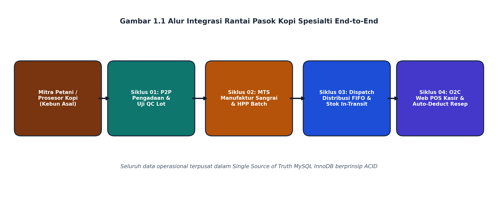
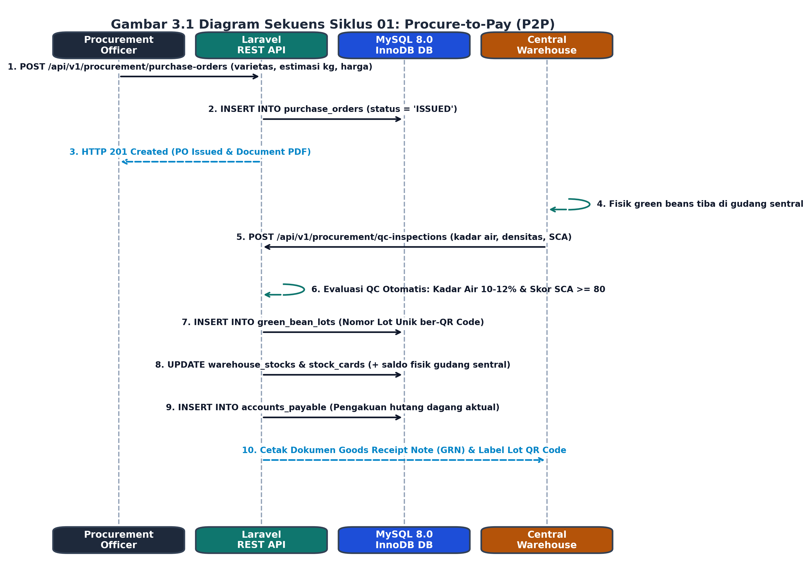
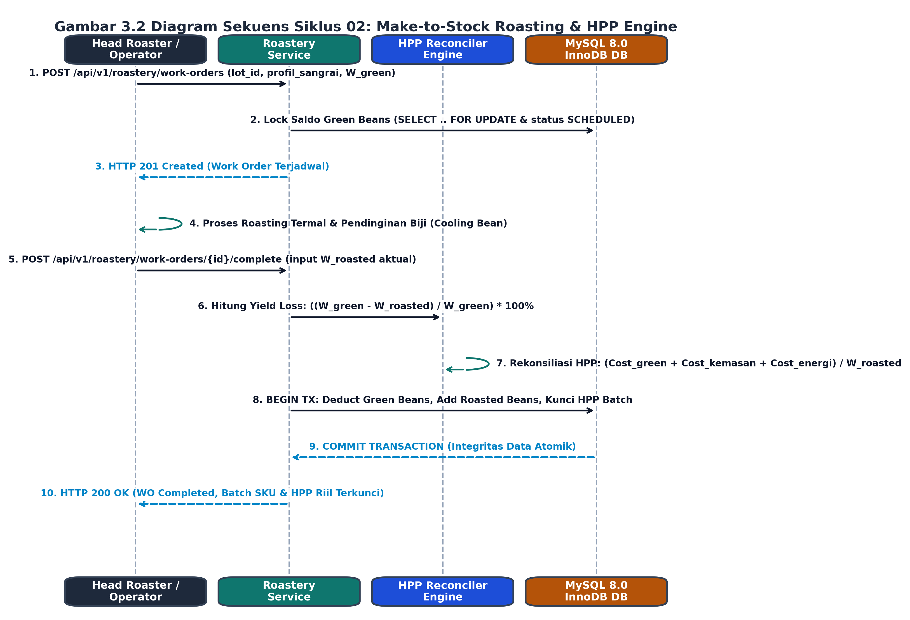
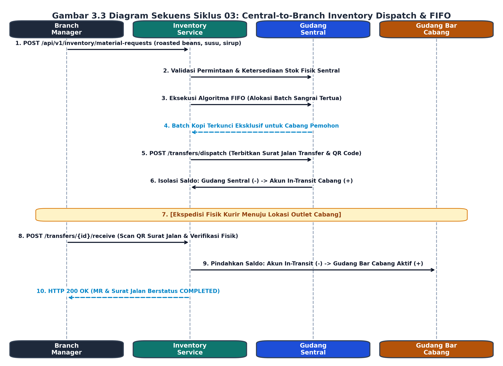
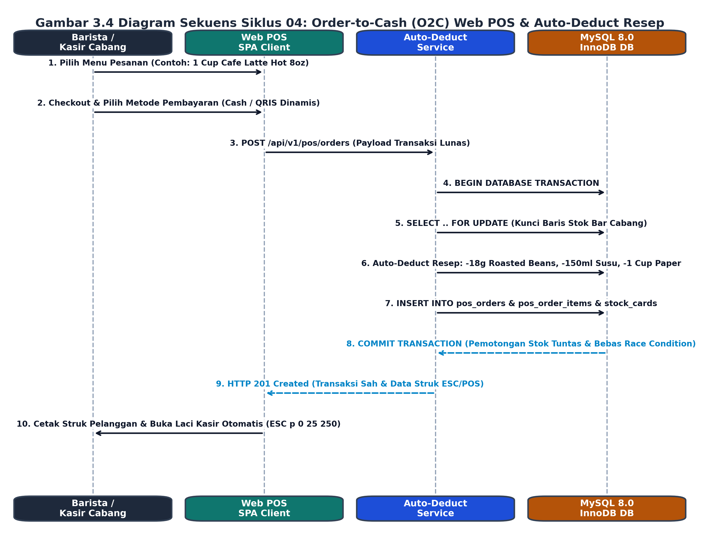
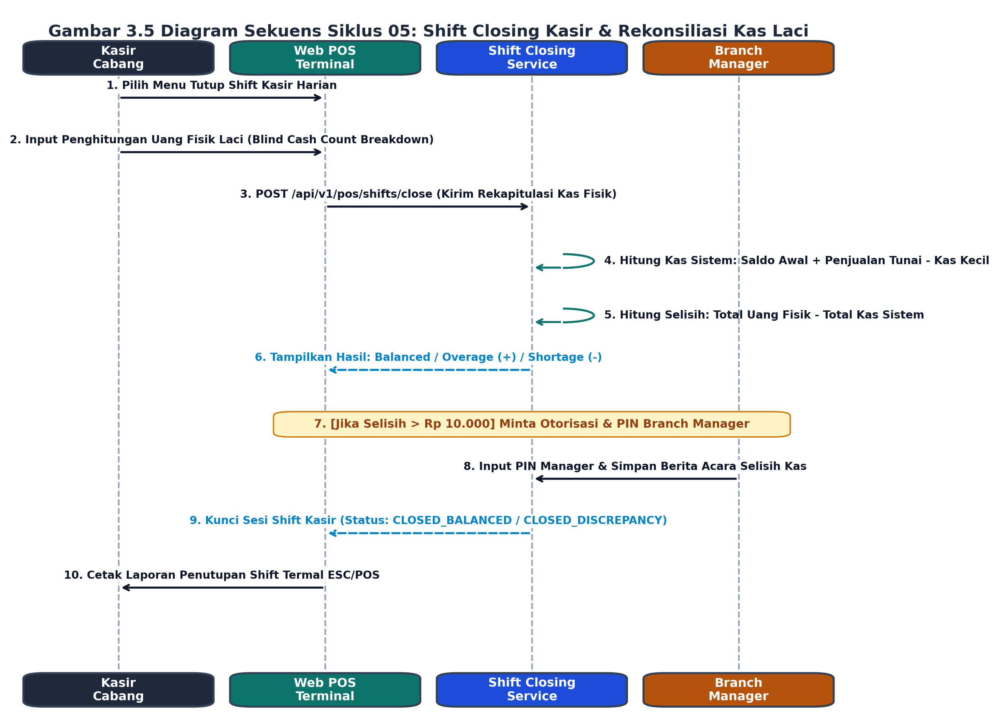
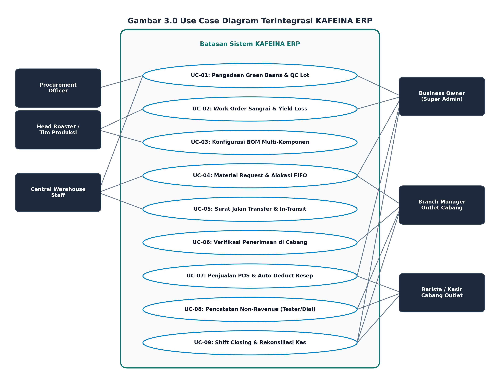

# REVISION HISTORY

| Versi | Tanggal | Penulis | Deskripsi Perubahan Dokumen |
| :--- | :--- | :--- | :--- |
| 0.1 | 28 Oktober 2026 | Group 1 | Inisialisasi draf spesifikasi kebutuhan sistem |
| 0.9 | 3 November 2026 | Group 1 | Integrasi diagram use case dan diagram sekuensial modul |
| 1.0 | 5 November 2026 | Group 1 | Pengesahan versi baseline tugas perkuliahan |
| 2.0 | 20 November 2026 | Group 1 | **Penyempurnaan Total**: Penambahan Matriks Ketertelusuran (RTM), Spesifikasi Kontrak REST API, Algoritma Tanda Tangan Webhook Midtrans, Taksonomi NFR ISO/IEC 25010, dan State Machine Kunci Akun 5-Strike. |

---

# 1. INTRODUCTION

## 1.1 Purpose
Dokumen *Software Requirements Specification* (SRS) ini merumuskan secara komprehensif, presisi, dan terstandar seluruh kebutuhan perangkat lunak untuk sistem **KAFEINA ERP Versi 2.0**. Dokumen ini menjadi acuan teknis mengikat bagi pengembang sistem (*software engineers*), arsitek basis data, penguji perangkat lunak (*QA engineers*), dan pemangku kepentingan akademik di Program Studi Informatika Universitas Jenderal Soedirman.

## 1.2 Document Conventions
Dokumen ini disusun berlandaskan standar IEEE Std 830-1998 (*IEEE Recommended Practice for Software Requirements Specifications*) dan panduan Karl E. Wiegers:
1. Naskah utama menggunakan huruf Times New Roman ukuran 12 pt dengan spasi baris 1.5 dan perataan rata kanan-kiri (*justify*).
2. Kode kebutuhan fungsional menggunakan konvensi alfanumerik terstruktur: `REQ-[MODUL]-[NOMOR]` (contoh: `REQ-PRC-01`, `REQ-POS-02`).
3. Seluruh tabel menggunakan format kisi tertutup (*grid*) dengan garis batas sel vertikal dan horizontal yang tegas.
4. Setiap gambar dan diagram disertakan dengan nomor urut, judul formal, dan penjelasan naratif yang berkaitan langsung dengan bab pembahasan.

## 1.3 Intended Audience and Reading Suggestions
1. **Dosen Pengampu & Penguji Akademik**: Disarankan memeriksa Bab 1 (Pendahuluan), Bab 2.3 (Matriks Ketertelusuran RTM), dan Bab 5 (Kebutuhan Non-Fungsional ISO/IEC 25010) untuk memvalidasi kelengkapan metodologi rekayasa perangkat lunak.
2. **Software Engineers & Backend Developers**: Disarankan mempelajari Bab 3 (Spesifikasi Kontrak Antarmuka Eksternal & REST API) dan Bab 4 (Spesifikasi Fungsional & Diagram Alur).
3. **QA & Test Engineers**: Disarankan menelaah Bab 4.x.2 (Stimulus/Response), Bab 5 (NFR), dan Bab 6.4 (State Machine Keamanan) untuk merancang skenario pengujian kotak putih (*white-box*) dan otomasi peramban (*black-box Dusk*).

## 1.4 Product Scope
KAFEINA ERP mencakup otomatisasi dan sinkronisasi rantai pasok kopi spesialti dari hulu ke hilir (*end-to-end supply chain*):
1. **Pengadaan & QC**: Pendaftaran petani mitra, PO biji mentah, registrasi lot asal kebun, dan inspeksi mutu SCA.
2. **Manufaktur Roastery**: Penjadwalan Work Order sangrai, kurva profil sangrai, dan kalkulasi susut bobot (*yield loss*).
3. **Inventori Multi-Cabang**: Material Request cabang, mutasi stok berbasis FIFO, dan isolasi status *in-transit*.
4. **Point of Sale (POS)**: Otentikasi PIN 6-digit kasir, transaksi layar sentuh, pemotongan stok bahan resep instan, dan rekonsiliasi kas *shift closing*.
5. **Finansial & Keamanan**: Laporan laba rugi berbasis HPP riil, audit trail transaksional, serta manajemen hak akses RBAC.


*Gambar 1. Alur Rantai Pasok Kopi Spesialti End-to-End KAFEINA ERP*

## 1.5 References
1. IEEE Std 830-1998, *IEEE Recommended Practice for Software Requirements Specifications*, IEEE Computer Society, 1998.
2. ISO/IEC 25010:2011, *Systems and software engineering - Systems and software Quality Requirements and Evaluation (SQuaRE) - System and software quality models*, 2011.
3. Specialty Coffee Association (SCA), *Protocols for Cupping Specialty Coffee and Green Coffee Grading*, 2021.
4. Dokumen User Requirement System (URS) KAFEINA ERP v2.0, FT Unsoed, 2026.

---

# 2. OVERALL DESCRIPTION

## 2.1 Product Perspective
KAFEINA ERP merupakan sistem mandiri berbasis arsitektur *Client-Server Three-Tier*:
1. **Presentation Layer**: Antarmuka web responsif berbasis Blade Templates, Tailwind CSS v4, dan JavaScript asinkron.
2. **Application Layer**: RESTful API berbasis Laravel 12/13 (PHP 8.3) dengan Service Layer terisolasi.
3. **Data Layer**: Database relasional MySQL 8.0 Enterprise Engine InnoDB dengan transaksi atomik berprinsip ACID.

## 2.2 User Classes and Characteristics (RBAC)
Karakteristik pengguna dan batasan peran sistem didefinisikan pada Tabel 1.

Tabel 1. Matriks Karakteristik Pengguna dan Otorisasi Peran

| Kelas Pengguna | Jumlah Pengguna | Tingkat Keahlian | Tanggung Jawab Operasional |
| :--- | :--- | :--- | :--- |
| **Super Admin / Owner** | 2 | Tinggi | Konfigurasi sistem, audit trail, laporan keuangan konsolidasi, backup database. |
| **Procurement Officer** | 3 | Menengah | Registrasi data petani, penerbitan dokumen PO biji mentah, penerimaan faktur hutang. |
| **QC Inspector** | 3 | Menengah | Pengukuran kadar air (10-12%), uji densitas, skor cupping SCA, dan status lot. |
| **Head Roaster** | 5 | Menengah | Eksekusi Work Order sangrai, kurva profil sangrai, dan kalkulasi rendemen susut. |
| **Warehouse Staff** | 6 | Menengah | Alokasi stok tertua (FIFO), penerbitan Surat Jalan, dan kartu stok gudang sentral. |
| **Branch Cashier** | 15 | Dasar | Buka/tutup shift kasir, pelayanan POS sentuh, pembayaran tunai/QRIS, cetak struk. |

## 2.3 Requirements Traceability Matrix (RTM)
Matriks Ketertelusuran Kebutuhan (*Requirements Traceability Matrix* - RTM) pada Tabel 2 memetakan korelasi 1:1 antara kebutuhan pengguna di URS, spesifikasi teknis di SRS, komponen kode program web Laravel, model data basis data, hingga ID kasus uji verifikasi.

Tabel 2. Requirements Traceability Matrix (RTM) KAFEINA ERP

| ID Kebutuhan URS | ID Kebutuhan SRS | Deskripsi Kebutuhan Teknis | Komponen Controller & Service | Model Eloquent & Tabel DB | ID Kasus Uji (Test Suite) |
| :--- | :--- | :--- | :--- | :--- | :--- |
| **FR-PRC-01** | `REQ-PRC-01` | Profil Mitra Petani & Pemasok | `ProcurementController::storeSupplier` | `Supplier` (`suppliers`) | `WB-P01`, `Tier1-Rbac-02` |
| **FR-PRC-02** | `REQ-PRC-02` | Purchase Order & Validasi Harga | `ProcurementController::storePo` | `PurchaseOrder`, `PurchaseOrderItem` | `WB-P01`, `Tier2-Domain-01` |
| **FR-PRC-03** | `REQ-PRC-03` | Kode Lot Unik (`GB-FARM-YEAR-SEQ`) | `LotGeneratorService::generate` | `GreenBeanLot` (`green_bean_lots`) | `WB-P01`, `Tier3-Pair-01` |
| **FR-PRC-04** | `REQ-PRC-04` | Validasi Mutu QC SCA ($\ge 80$) & Air | `QualityControlService::evaluate` | `QualityControl` (`quality_controls`) | `WB-P02`, `Tier2-Domain-02` |
| **FR-PRC-05** | `REQ-PRC-05` | Penerimaan GRN & Saldo Sentral | `ProcurementController::storeQc` | `StockCard`, `WarehouseStock` | `WB-P01`, `Tier4-Scen-01` |
| **FR-PRC-06** | `REQ-PRC-06` | Pengakuan Kewajiban Hutang AP | `ProcurementController::storePo` | `PurchaseOrder` (`purchase_orders`) | `WB-P01`, `Tier4-Scen-01` |
| **FR-MFG-01** | `REQ-PRD-01` | Penjadwalan Work Order Sangrai | `RoasteryController::storeWorkOrder` | `WorkOrder` (`work_orders`) | `WB-P03`, `Tier3-Pair-02` |
| **FR-MFG-02** | `REQ-PRD-02` | Master Profil Kurva Sangrai | `RoasteryController::index` | `RoastingProfile` (`roasting_profiles`) | `WB-P03`, `Tier1-Rbac-04` |
| **FR-MFG-03** | `REQ-PRD-03` | Bill of Materials (BOM) Kemasan | `RoasteryController::index` | `Bom`, `BomItem` | `WB-P03`, `Tier3-Pair-02` |
| **FR-MFG-04** | `REQ-PRD-04` | Input Bobot Mentah vs Bobot Matang | `RoasteryController::executeRoast` | `WorkOrder` (`work_orders`) | `WB-P03`, `Tier2-Domain-04` |
| **FR-MFG-05** | `REQ-PRD-05` | Formula Susut Bobot (14-18%) | `WorkOrderService::calculateYield` | `WorkOrder` (`work_orders`) | `WB-P03`, `Tier2-Domain-04` |
| **FR-MFG-06** | `REQ-PRD-06` | Rekalkulasi HPP Riil per Gram | `WorkOrderService::calculateHpp` | `WorkOrder` (`work_orders`) | `WB-P03`, `Tier4-Scen-02` |
| **FR-MFG-07** | `REQ-PRD-07` | Mutasi Atomik Hijau ke Matang | `WorkOrderService::complete` | `WarehouseStock`, `StockCard` | `WB-P03`, `Tier4-Scen-02` |
| **FR-INV-01** | `REQ-INV-01` | Partisi Gudang Sentral & Cabang | `InventoryController::index` | `InventoryWarehouse`, `Branch` | `WB-P04`, `Tier1-Rbac-05` |
| **FR-INV-02** | `REQ-INV-02` | Pengajuan Material Request (MR) | `InventoryController::storeMR` | `MaterialRequest`, `MRItem` | `WB-P04`, `Tier3-Pair-03` |
| **FR-INV-03** | `REQ-INV-03` | Alokasi Pengambilan Stok FIFO | `FifoStockAllocatorService::allocate` | `WarehouseStock`, `StockCard` | `WB-P04`, `Tier3-Pair-03` |
| **FR-INV-04** | `REQ-INV-04` | Surat Jalan & Isolasi In-Transit | `InventoryDispatchService::dispatch` | `DeliveryNote`, `DeliveryNoteItem` | `WB-P04`, `Tier4-Scen-03` |
| **FR-INV-05** | `REQ-INV-05` | Konfirmasi Terima & Discrepancy | `InventoryController::confirmReceipt`| `DeliveryNote`, `WarehouseStock` | `WB-P04`, `Tier4-Scen-03` |
| **FR-INV-06** | `REQ-INV-06` | Buku Besar Kartu Stok Immutable | `InventoryController::exportCsv` | `StockCard` (`stock_cards`) | `WB-P04`, `Tier4-Scen-01` |
| **FR-INV-07** | `REQ-INV-07` | Alert ROP & PO Konsolidasi | `DashboardController::createPO` | `WarehouseStock`, `PurchaseOrder`| `WB-P07`, `Tier2-Domain-05` |
| **FR-POS-01** | `REQ-POS-01` | Login PIN 6-Digit & Lockout 5x | `CashierPinAuthService::verify` | `User` (`users`) | `WB-P06`, `Tier2-Sec-01` |
| **FR-POS-02** | `REQ-POS-02` | Buka/Tutup Shift & Selisih Kas | `PosShiftService::closeShift` | `PosShift` (`pos_shifts`) | `WB-P06`, `Tier2-Domain-06` |
| **FR-POS-03** | `REQ-POS-03` | Layar Sentuh Grid Menu POS | `PosController::index` | `Product`, `ProductCategory` | `WB-P05`, `Tier1-Rbac-06` |
| **FR-POS-04** | `REQ-POS-04` | Auto-Deduct Resep BOM (Biji/Susu) | `PosBillingService::deductRecipe` | `ProductRecipe`, `RecipeDeduction` | `WB-P05`, `Tier3-Pair-04` |
| **FR-POS-05** | `REQ-POS-05` | Gateway Pembayaran QRIS Midtrans | `MidtransQrisService::createCharge` | `PosOrder` (`pos_orders`) | `WB-P06`, `Tier4-Scen-04` |
| **FR-POS-06** | `REQ-POS-06` | Cetak Struk Termal ESC/POS | `PosController::checkout` | `PosOrder`, `PosOrderItem` | `WB-P05`, `Tier4-Scen-04` |
| **FR-POS-07** | `REQ-POS-07` | Fitur Split-Bill & Pajak PB1 10% | `PosController::splitBill` | `PosOrder`, `PosOrderItem` | `WB-P05`, `Tier2-Domain-07` |
| **FR-FIN-01** | `REQ-FIN-01` | Executive Real-Time Dashboard | `DashboardController::index` | `PosOrder`, `WorkOrder`, `Stock` | `WB-P07`, `Tier1-Rbac-01` |
| **FR-FIN-02** | `REQ-FIN-02` | Laporan Laba Rugi Riil (P&L) | `FinancialReportService::generate` | `PosOrder`, `PosOrderItem`, `BOM` | `WB-P03`, `Tier4-Scen-05` |
| **FR-FIN-03** | `REQ-FIN-03` | Analisis Kebocoran Biaya | `FinancialReportService::leakage` | `StockCard`, `PosShift` | `WB-P04`, `Tier4-Scen-05` |
| **FR-FIN-04** | `REQ-FIN-04` | Kupon Diskon & Validasi Kuota | `VoucherController::updateQuota` | `RedeemCode` (`redeem_codes`) | `WB-P08`, `Tier2-Domain-08` |
| **-** | `REQ-SEC-01` | Enkripsi Bcrypt & Sanctum Token | `AuthController::login` | `User` (`users`) | `WB-P06`, `Tier1-Rbac-01` |
| **-** | `REQ-SEC-02` | Proteksi Middleware RBAC | `RoleMiddleware::handle` | `Role` (`roles`) | `WB-P06`, `Tier1-Rbac-01` |
| **-** | `REQ-SEC-03` | Kunci Akun 15 Menit saat 5x Gagal | `CashierPinAuthService::verify` | `User` (`users`) | `WB-P06`, `Tier2-Sec-02` |
| **-** | `REQ-SEC-04` | Audit Trail Transaksional Kekal | `AuditLog::create` | `AuditLog` (`audit_logs`) | `WB-P06`, `Tier1-Rbac-01` |

---

# 3. EXTERNAL INTERFACE REQUIREMENTS & REST API CONTRACTS

## 3.1 Spesifikasi Kontrak Endpoint REST API
Komunikasi antarmuka terprogram (*Application Programming Interface*) KAFEINA ERP menggunakan format pertukaran data JSON berbasis standar RFC 8259. Rincian kontrak endpoint disajikan pada Tabel 3.

Tabel 3. Spesifikasi Kontrak REST API KAFEINA ERP

| Endpoint URI | Method | Otorisasi & Role | Request Payload JSON Schema | Format Respons Sukses (HTTP 200/201) | Respons Error |
| :--- | :---: | :--- | :--- | :--- | :--- |
| `/api/auth/login` | POST | Publik | `{"email": "string", "password": "string"}` | `{"status": "ok", "token": "string", "user": {"id": 1, "role": "string"}}` | `401 Unauthorized`<br>`422 Unprocessable` |
| `/api/auth/verify-pin` | POST | Publik | `{"pin": "string (6-digit)", "branch_id": 1}` | `{"status": "ok", "authenticated": true, "user": {"id": 1, "name": "string"}}` | `401 Invalid PIN`<br>`429 Too Many Requests` |
| `/api/qc/{lotId}/inspect` | POST | `auth:sanctum`<br>Role: `super_admin,qc_inspector` | `{"moisture": 11.2, "defect_score": 0, "sca_score": 84.5, "notes": "string"}` | `{"status": "ok", "qc_status": "ACCEPTED", "grade": "Specialty Grade 1"}` | `400 Out of Range`<br>`403 Forbidden` |
| `/api/work-orders` | POST | `auth:sanctum`<br>Role: `super_admin,head_roaster` | `{"lot_id": 1, "profile_id": 2, "green_weight": 10000.0, "scheduled_at": "date"}` | `{"status": "ok", "wo_number": "WO-2026-11-001", "status": "SCHEDULED"}` | `422 Insufficient Lot Stock` |
| `/api/work-orders/{id}/complete` | POST | `auth:sanctum`<br>Role: `super_admin,head_roaster` | `{"roasted_weight": 8480.0, "roast_duration_seconds": 720}` | `{"status": "ok", "yield_loss": 15.20, "real_hpp_per_gram": 141.51}` | `400 Anomaly Yield Alert` |
| `/api/inventory/material-requests` | POST | `auth:sanctum`<br>Role: `super_admin,branch_cashier` | `{"branch_id": 2, "items": [{"product_id": 1, "quantity": 5000}]}` | `{"status": "ok", "mr_number": "MR-2026-11-001", "status": "PENDING"}` | `422 Invalid Product ID` |
| `/api/inventory/material-requests/{id}/dispatch` | POST | `auth:sanctum`<br>Role: `super_admin,warehouse_staff` | `{"notes": "Pengiriman Armada 1"}` | `{"status": "ok", "dn_number": "DN-2026-11-001", "status": "IN_TRANSIT"}` | `400 Stock Not Ready` |
| `/api/inventory/delivery-notes/{id}/verify` | POST | `auth:sanctum`<br>Role: `super_admin,warehouse_staff` | `{"received_items": [{"item_id": 1, "received_qty": 5000.0}]}` | `{"status": "ok", "status": "COMPLETED", "discrepancy": 0.0}` | `400 Discrepancy Flagged` |
| `/api/pos/checkout` | POST | `auth:sanctum`<br>Role: `super_admin,branch_cashier` | `{"shift_id": 1, "payment_method": "CASH", "paid_amount": 100000, "items": [...]}` | `{"status": "ok", "order_number": "POS-20261120-001", "change_amount": 25000}` | `400 Stock Out of Stock`<br>`403 Closed Shift` |
| `/api/pos/split-bill` | POST | `auth:sanctum`<br>Role: `super_admin,branch_cashier` | `{"original_order_id": 1, "splits": [{"subtotal": 50000}, {"subtotal": 50000}]}` | `{"status": "ok", "split_orders": [{"order_number": "..."}, {"order_number": "..."}]}` | `422 Total Mismatch` |
| `/api/midtrans/webhook` | POST | Publik (Verifikasi Signature) | `{"order_id": "POS-...", "status_code": "200", "gross_amount": "75000.00", "signature_key": "..."}` | `{"status": "ok", "message": "Payment verified and settled"}` | `401 Invalid Signature`<br>`404 Order Not Found` |

## 3.2 Spesifikasi Keamanan Webhook Midtrans & Algoritma Tanda Tangan
Untuk mencegah serangan penyusupan notifikasi pembayaran palsu (*fake callback injection*), sistem memvalidasi keabsahan parameter `signature_key` menggunakan fungsi hash kriptografi SHA-512 dengan formula baku:
$$\text{Signature Key} = \text{SHA-512}\left(\text{order\_id} + \text{status\_code} + \text{gross\_amount} + \text{server\_key}\right)$$

Tahapan validasi webhook di backend:
1. Menerima payload JSON callback dari server Midtrans.
2. Membentuk string gabungan: `$payload['order_id'] . $payload['status_code'] . $payload['gross_amount'] . config('services.midtrans.server_key')`.
3. Menghitung nilai hash SHA-512: `$expectedSignature = hash('sha512', $rawString)`.
4. Jika `$expectedSignature === $payload['signature_key']`, sistem memperbarui status pesanan menjadi `PAID`, mengeksekusi pemotongan bahan baku resep BOM, dan mencatat transaksi ke buku besar penjualan. Jika tidak cocok, request ditolak dengan kode status HTTP 401 Unauthorized.

---

# 4. SYSTEM FEATURES & DETAILED SPECIFICATIONS

## 4.1 Modul Pengadaan Biji Mentah & Quality Control (QC)
Mencakup siklus pengadaan komoditas dari petani mitra hingga pengujian mutu laboratorium sentral.


*Gambar 2. Sequence Diagram Alur Pengadaan dan Uji Mutu Biji Mentah KAFEINA ERP*

### 4.1.1 Urutan Stimulus dan Respons
1. **Penerbitan PO**: Procurement Officer menginput identitas petani dan kuantitas pesanan. Sistem memvalidasi harga satuan $\ge 0$ dan menerbitkan PO berstatus `ISSUED`.
2. **Inspeksi QC**: Truk pengiriman tiba di fasilitas roastery sentral. QC Inspector mengukur kadar air (alat ukur kapasitif) dan cupping score sensorik.
3. **Pencabangan Logika Keputusan Mutu**:
   - Jika Kadar Air berada pada $10.00\% \le \text{Moisture} \le 12.00\%$ dan Skor Cupping $\ge 80.00$, maka status menjadi `ACCEPTED`, nomor lot diterbitkan (`GB-FARM-YEAR-SEQ`), dan saldo fisik gudang sentral bertambah.
   - Jika Kadar Air $> 12.00\%$ atau Skor Cupping $< 80.00$, maka status menjadi `REJECTED`, lot dikunci di area karantina, dan penerimaan fisik ditolak.

---

## 4.2 Modul Produksi Sangrai Roastery & Work Orders
Mengelola penjadwalan sangrai harian, kurva profil sangrai, dan kalkulasi rendemen susut bobot.


*Gambar 3. Sequence Diagram Alur Produksi Sangrai (Make-to-Stock) KAFEINA ERP*

### 4.2.1 Urutan Stimulus dan Respons
1. **Penerbitan Work Order**: Head Roaster memilih profil sangrai (Light, Medium, Dark) dan lot biji mentah. Sistem memverifikasi saldo lot dan memesan (*reserve*) kuantitas bahan.
2. **Eksekusi Sangrai**: Mesin sangrai dijalankan hingga mencapai titik akhir. Roaster menimbang bobot matang dan memasukkannya ke sistem.
3. **Kalkulasi Matematis Yield Loss & HPP**:
   - Sistem menghitung persentase susut bobot: $\text{Yield Loss (\%)} = \left(\frac{\text{Bobot Mentah} - \text{Bobot Matang}}{\text{Bobot Mentah}}\right) \times 100$.
   - Sistem menghitung HPP riil bahan: $\text{HPP Riil per gram} = \text{Harga Beli per gram} \times \left(\frac{\text{Bobot Mentah}}{\text{Bobot Matang}}\right)$.
   - Secara atomik, saldo biji mentah berkurang dan saldo roasted beans bertambah pada kartu stok.

---

## 4.3 Modul Distribusi & Mutasi Persediaan Multi-Cabang
Mengelola distribusi biji sangrai dan kemasan dari gudang sentral ke gerai cabang outlet ritel.


*Gambar 4. Sequence Diagram Alur Distribusi Antar-Gudang (Dispatch) KAFEINA ERP*

### 4.3.1 Urutan Stimulus dan Respons
1. **Pengajuan Material Request**: Branch Manager mengajukan permintaan bahan baku.
2. **Alokasi FIFO & Penerbitan Surat Jalan**: Petugas gudang menyetujui permintaan. Algoritma `FifoStockAllocatorService` mengambil lot dengan tanggal produksi terlama, mengurangi stok fisik gudang sentral, memindahkan barang ke status virtual `TRANSIT`, dan mencetak Surat Jalan ber-QR Code.
3. **Verifikasi Penerimaan Cabang**: Kurir tiba di gerai cabang. Staf memindai QR Code. Jika kuantitas fisik cocok, stok masuk ke gudang cabang. Jika terdapat selisih, sistem mencatat `RECEIVED_WITH_DISCREPANCY` dan mencatat selisih sebagai biaya penyusutan logistik (*in-transit shrinkage expense*).

---

## 4.4 Modul Kasir Ritel (Point of Sale) & Pemotongan Resep Instan
Memfasilitasi transaksi penjualan menu di meja kasir gerai kopi dan pemotongan bahan baku resep secara real-time.


*Gambar 5. Sequence Diagram Alur Pemotongan Stok Resep Transaksi POS KAFEINA ERP*


*Gambar 6. Sequence Diagram Alur Penutupan Shift Kasir (Shift Closing) KAFEINA ERP*

### 4.4.1 Urutan Stimulus dan Respons
1. **Buka Shift**: Kasir menginput uang modal awal (*opening cash*). Sistem memvalidasi dan mengaktifkan terminal kasir.
2. **Pemesanan & Pembayaran**: Kasir memilih menu pada layar sentuh. Konsumen membayar dengan tunai atau QRIS Midtrans.
3. **Eksekusi Resep BOM**: Sistem secara atomik memotong bahan baku resep (contoh 1 cangkir Latte: 18g biji sangrai, 200ml susu segar, 1 cup) pada gudang gerai cabang.
4. **Tutup Shift**: Kasir menginput uang fisik akhir. Jika selisih kas $\le$ Rp 10.000, sistem menutup shift. Jika selisih kas $>$ Rp 10.000, penutupan shift dibekukan hingga diverifikasi oleh 6-digit PIN Supervisor.

---

# 5. OTHER NONFUNCTIONAL REQUIREMENTS (ISO/IEC 25010)

Kebutuhan non-fungsional KAFEINA ERP dikelompokkan secara terstandar ke dalam 8 pilar baku mutu ISO/IEC 25010 pada Tabel 4.

Tabel 4. Spesifikasi Kebutuhan Non-Fungsional Standar ISO/IEC 25010

| Pilar Karakteristik ISO/IEC 25010 | Sub-Karakteristik Mutu | Batas Parameter & Metrik Kuantitatif Terukur |
| :--- | :--- | :--- |
| **1. Functional Suitability** | Completeness & Correctness | 100% dari 31 butir kebutuhan fungsional URS terpenuhi tanpa ada selisih perhitungan yield loss dan alokasi FIFO. |
| **2. Performance Efficiency** | Time Behavior & Capacity | Waktu respons transaksi kasir $\le 500$ ms; kueri alokasi kartu stok FIFO $\le 300$ ms; melayani sedikitnya 50 terminal kasir konkuren simultan. |
| **3. Compatibility** | Interoperability & Hardware | Kompatibel dengan protokol ESC/POS printer termal 58mm/80mm; integrasi API RESTful JSON Midtrans Payment Gateway. |
| **4. Usability** | Learnability & Operability | Waktu pelatihan kasir baru $< 30$ menit; target sentuh tombol kasir minimal 48 x 48 px dengan margin antartombol minimal 8 px. |
| **5. Reliability** | Availability & Fault Tolerance | Ketersediaan sistem (*uptime*) $\ge 99.50\%$; transaksi atomik ACID dengan garansi 100% *clean rollback* saat simulasi crash server. |
| **6. Security** | Confidentiality & Integrity | Enkripsi TLS 1.3 HTTPS; hash sandi Bcrypt (*cost factor* 10); otentikasi PIN kasir 6-digit dengan proteksi *5-strike lockout* 15 menit. |
| **7. Maintainability** | Modularity & Testability | Arsitektur berlapis Controller-Service-Model; *Zero Static Defect* pada pemindaian **Larastan Level 1 s/d Level 5**. |
| **8. Portability** | Adaptability | Tampilan responsif fluida pada berbagai resolusi layar peramban (layar sentuh tablet 10 inci, laptop, dan monitor desktop 24 inci). |

---

# 6. SYSTEM SECURITY & STATE MACHINES

## 6.1 State Machine Proteksi PIN Kasir (5-Strike Lockout)
Sistem melindungi antarmuka kasir dari serangan penebakan PIN (*brute-force attack*) menggunakan diagram status transisi mesin (*finite state machine*) sebagai berikut:

```
[IDLE / LOGGED_OUT]
       │
       ▼ (Kasir Menginput PIN 6-Digit)
[VERIFYING_PIN]
       │
       ├──► PIN Benar ──────► [ACCESS_GRANTED] (Reset Counter Gagal = 0)
       │
       └──► PIN Salah ──────► Gagal < 5 ───► [STRIKE_INCREMENTED] (Tampilkan Sisa Kesempatan)
                                   │
                                   └──► Gagal == 5 ──► [LOCKED_OUT] (Kunci 15 Menit / HTTP 429)
                                                             │
                                                             ▼ (Setelah 15 Menit Berlalu)
                                                     [LOCKOUT_EXPIRED] ──► [IDLE]
```

## 6.2 Audit Trail & Legalitas Transaksi
Setiap manipulasi data persediaan dan transaksi keuangan dicatat secara permanen (*immutable*) pada tabel `audit_logs` yang merekam:
1. `user_id`: ID pengguna pelaku transaksi.
2. `action`: Jenis operasi (CREATE, UPDATE, DELETE).
3. `table_name`: Nama entitas tabel target.
4. `old_values`: Nilai data sebelum perubahan (format JSON).
5. `new_values`: Nilai data sesudah perubahan (format JSON).
6. `ip_address`: Alamat IP perangkat klien.
7. `created_at`: Timestamp presisi waktu hingga milidetik.

---

# APPENDIX A: ANALYSIS MODELS

Sistem dianalisis menggunakan diagram use case yang merepresentasikan seluruh interaksi aktor pengguna dengan batas operasional sistem KAFEINA ERP:


*Gambar 7. Diagram Use Case Lengkap Sistem KAFEINA ERP*
