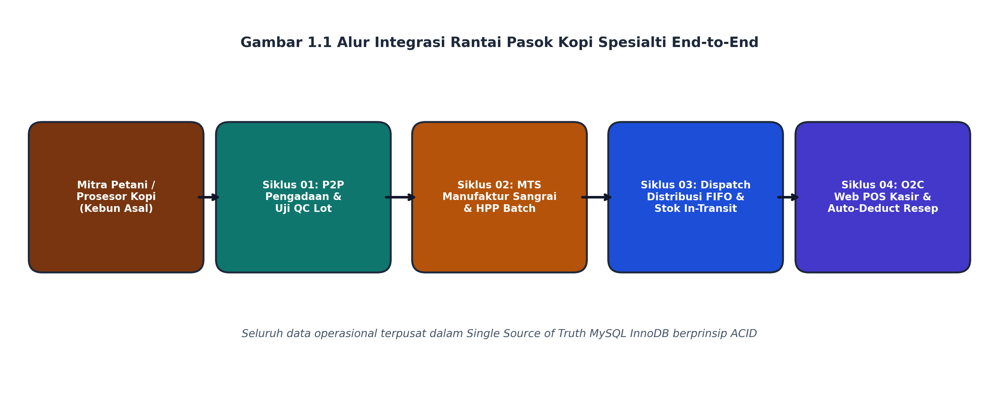

# BAB I PENDAHULUAN

## 1.1 Latar Belakang
Industri kopi spesialti (*specialty coffee*) di Indonesia mengalami transformasi pesat dari model bisnis kedai kopi konvensional (*third-wave coffee shop*) menuju ekosistem terpadu hulu-ke-hilir (*farm-to-cup ecosystem*). Para pelaku industri tidak hanya mengoperasikan gerai ritel, melainkan juga mengelola fasilitas pemanggangan mandiri (*micro-roastery*), laboratorium evaluasi mutu sensorik (*cupping lab*), serta jaringan distribusi multi-cabang. Karakteristik komoditas kopi spesialti menuntut kepatuhan parameter mutu yang sangat presisi, seperti pemantauan kadar air biji mentah (*green beans*), toleransi susut bobot sangrai (*yield loss*), hingga alokasi persediaan berbasis *First-In First-Out* (FIFO) guna menjaga kesegaran (*freshness*).

Namun, sebagian besar operasional industri roastery skala UMKM dan multi-cabang masih mengandalkan pencatatan terfragmentasi, seperti penggunaan lembar sebar digital (*spreadsheet*) manual untuk inventori gudang serta aplikasi kasir (*Point of Sale*) terpisah yang tidak terhubung dengan fasilitas produksi. Kondisi ini memicu berbagai masalah krusial:
1. **Asimetri Informasi Mutasi Bahan Baku**: Penjualan ratusan cangkir minuman di meja kasir gerai tidak memotong stok biji sangrai, susu segar, dan kemasan secara otomatis (*real-time*), sehingga memicu selisih stok fisik (*stock opname leakage*).
2. **Ketiadaan Rekalkulasi Harga Pokok Penjualan (HPP) Riil**: Fluktuasi susut bobot saat pemanggangan (umumnya berkisar 14% hingga 18%) tidak dikalkulasikan secara langsung ke dalam HPP per gram biji sangrai, sehingga laporan laba rugi menjadi bias (*inaccurate gross margin*).
3. **Risiko Kesalahan Alokasi Persediaan**: Biji kopi yang disimpan lebih lama di gudang sentral kerap terlewat akibat ketiadaan penegakan alokasi batch otomatis berbasis FIFO.

Untuk mengatasi permasalahan tersebut, dirancanglah sistem **KAFEINA ERP**, sebuah platform manajemen sumber daya enterprise yang mengintegrasikan pengadaan biji mentah, laboratorium kendali mutu, manufaktur roastery, logistik multi-cabang, kasir ritel, hingga pelaporan finansial eksekutif dalam satu arsitektur terpadu.

## 1.2 Identifikasi Masalah
Berdasarkan analisis alur kerja bisnis roastery multi-cabang, dirumuskan identifikasi masalah operasional sebagai berikut:
1. Bagaimana mengintegrasikan pencatatan pengadaan biji mentah dari mitra petani dengan pengujian parameter laboratorium kendali mutu (*moisture* dan *SCA cupping score*) berstandar internasional?
2. Bagaimana mengotomatisasi kalkulasi susut bobot (*yield loss*) dan pembentukan HPP riil pada modul produksi sangrai roastery?
3. Bagaimana menjamin keadilan dan ketepatan mutasi stok antar-gudang (sentral ke cabang) menggunakan aturan First-In First-Out (FIFO) dan pengawalan status barang dalam perjalanan (*in-transit*)?
4. Bagaimana mewujudkan pemotongan otomatis bahan baku resep multi-komponen (*Bill of Materials recipe auto-deduction*) pada saat transaksi kasir ritel berlangsung secara instan tanpa memperlambat antrean?
5. Bagaimana menyediakan rekonsiliasi kas kasir harian (*shift closing*) yang aman dengan otorisasi berbasis peran dan jejak audit (*audit trail*) transaksional?

## 1.3 Tujuan Pengembangan Sistem
Tujuan dari perancangan Dokumen Spesifikasi Kebutuhan Sistem (*User Requirement System* - URS) KAFEINA ERP adalah:
1. Mendefinisikan seluruh kebutuhan bisnis pemangku kepentingan (*business requirements*) ke dalam bentuk kebutuhan fungsional yang terukur dan dapat diverifikasi.
2. Menyediakan kontrak operasional bagi tim pengembang (*software engineers*) dan tim penguji (*QA*) untuk memandu implementasi sistem berbasis web Laravel.
3. Menyusun kriteria keberterimaan formal (*Acceptance Criteria*) berbasis skenario *Given-When-Then* (Gherkin) pada setiap butir kebutuhan.
4. Memetakan manajemen risiko operasional dan rencana mitigasi kegagalan sistem di lingkungan nyata kedai kopi multi-cabang.

## 1.4 Ruang Lingkup Sistem (Scope & Boundary)
Ruang lingkup sistem KAFEINA ERP mencakup 5 domain fungsional inti dan 1 domain pendukung tata kelola sistem:
1. **Modul 01: Procurement & Green Beans Management**: Siklus *Procure-to-Pay* (P2P), pengelolaan database petani mitra, penerbitan Purchase Order (PO), registrasi kode lot asal kebun unik, dan inspeksi laboratorium Quality Control (QC).
2. **Modul 02: Roastery Manufacturing & Bill of Materials (BOM)**: Siklus *Make-to-Stock* (MTS), pengelolaan master formula profil sangrai, eksekusi Work Order (WO), kalkulasi otomatis persentase susut bobot (*yield loss*), dan pembentukan HPP batch produksi.
3. **Modul 03: Central-to-Branch Inventory & Distribution**: Partisi multi-gudang (Sentral, Cabang, dan Virtual Transit), pengajuan *Material Request* (MR), alokasi pengeluaran barang berbasis FIFO, penerbitan Surat Jalan (*Delivery Note*), dan verifikasi selisih penerimaan (*discrepancy*).
4. **Modul 04: Point of Sale (POS) & Billing System**: Siklus *Order-to-Cash* (O2C), pembukaan/penutupan shift kasir, antarmuka layar sentuh responsif, pemotongan otomatis bahan baku resep BOM, integrasi gateway pembayaran tunai/dinamis QRIS Midtrans, cetak struk termal, dan fitur *split-bill*.
5. **Modul 05: Executive Dashboard, Finance, & Reporting**: Pemantauan KPI omzet, persediaan kritis, peringatan *Reorder Point* (ROP), laporan laba rugi riil, analisis kebocoran persediaan (*leakage analysis*), dan manajemen voucher promosi.
6. **Modul 06 (Pendukung): Master Data & Keamanan Sistem**: Autentikasi berbasis *Role-Based Access Control* (RBAC), otorisasi 6-digit PIN kasir dengan proteksi *5-strike lockout*, pencatatan riwayat perubahan (*audit logs*), pencadangan database mandiri, serta fitur *Fast Account Switcher*.

## 1.5 Definisi, Singkatan, dan Istilah Teknis
Definisi dan istilah teknis yang digunakan dalam dokumen URS ini dirangkum pada Tabel 1.

Tabel 1. Definisi dan Singkatan Istilah Teknis

| Istilah / Singkatan | Definisi dan Keterangan |
| :--- | :--- |
| **BOM (Bill of Materials)** | Struktur pohon daftar bahan baku dan kemasan pendukung yang dibutuhkan untuk meracik satu porsi menu atau satu kemasan produk jadi. |
| **Cupping Score** | Nilai evaluasi sensorik cita rasa kopi berdasarkan protokol standar Specialty Coffee Association (SCA) dengan rentang skala 0 hingga 100. Kopi dengan skor $\ge 80.00$ dikategorikan sebagai *Specialty Grade*. |
| **DTR (Development Time Ratio)** | Rasio persentase waktu pemanggangan kopi sejak fase *first crack* hingga proses sangrai diakhiri terhadap total durasi sangrai. |
| **FIFO (First-In First-Out)** | Prinsip perputaran stok di mana barang yang diproduksi atau tiba lebih awal wajib dialokasikan dan didistribusikan terlebih dahulu. |
| **Green Beans** | Biji kopi mentah berkadar air ideal 10.00% hingga 12.00% hasil pemrosesan pasca-panen petani kopi. |
| **GRN (Goods Receipt Note)** | Dokumen tanda bukti penerimaan fisik barang di gudang setelah melalui verifikasi kuantitas dan mutu. |
| **HPP Riil** | Harga Pokok Penjualan aktual per satuan gram yang membebankan biaya bahan baku mentah, bahan kemasan sekunder, dan faktor penyusutan bobot sangrai. |
| **In-Transit** | Status isolasi persediaan barang yang sedang berpindah antar-gudang (dikirim oleh gudang sentral namun belum diverifikasi oleh cabang penerima). |
| **Moisture Content** | Persentase kadar air bebas di dalam biji kopi mentah yang diukur menggunakan alat *grain moisture meter*. |
| **P2P (Procure-to-Pay)** | Siklus bisnis pengadaan barang mulai dari pemesanan ke petani mitra hingga penerbitan tagihan hutang dagang. |
| **PO (Purchase Order)** | Dokumen komersial resmi pemesanan barang dari pembeli kepada pemasok dengan kuantitas dan harga yang telah disepakati. |
| **POS (Point of Sale)** | Titik layanan kasir tempat konsumen melakukan pemesanan dan pembayaran produk ritel kopi. |
| **ROP (Reorder Point)** | Titik ambang batas kuantitas minimum persediaan yang memicu sistem menerbitkan peringatan pengadaan darurat secara otomatis. |
| **Work Order (WO)** | Dokumen perintah kerja resmi di stasiun pemanggangan untuk menyangrai sejumlah lot biji mentah menjadi biji sangrai. |
| **Yield Loss** | Persentase susut massa biji kopi mentah selama proses pemanggangan akibat pelepasan uap air dan gas karbon dioksida. |

---

# BAB II GAMBARAN UMUM SISTEM (SYSTEM OVERVIEW)

## 2.1 Perspektif Produk dan Arsitektur Konseptual
KAFEINA ERP dirancang sebagai sistem enterprise mandiri (*self-contained enterprise platform*) yang beroperasi menggunakan arsitektur web modern *Three-Tier*:
1. **Tier 1 - Presentation Layer**: Antarmuka web pengguna berbasis HTML5, Blade Templates, dan Tailwind CSS v4 yang dioptimalkan untuk berbagai ukuran layar (layar desktop roastery 24 inci, laptop manajer cabang, hingga tablet layar sentuh kasir 10 inci).
2. **Tier 2 - Application Logic Layer**: Inti pemrosesan berbasis framework Laravel 12/13 (PHP 8.3) yang mengisolasi aturan bisnis ke dalam lapisan layanan (*Service Layer*), meliputi kalkulasi yield loss, alokasi FIFO, proteksi PIN kasir, dan integrasi payment gateway.
3. **Tier 3 - Data Persistence Layer**: Penyimpanan data relasional menggunakan basis data MySQL 8.0 Enterprise Engine InnoDB yang menjamin transaksi *Atomicity, Consistency, Isolation, Durability* (ACID) serta penguncian baris pesimis (*pessimistic row locking*) saat terjadi lonjakan transaksi kasir.

*Gambar 1. Alur Integrasi Rantai Pasok Kopi Spesialti End-to-End KAFEINA ERP*

## 2.2 Karakteristik Pengguna dan Matriks Peran (RBAC)
Sistem membatasi hak akses operasional pengguna secara ketat menggunakan otorisasi berbasis peran (*Role-Based Access Control* - RBAC) yang terdiri atas 6 peran, sebagaimana dirangkum pada Tabel 2.

Tabel 2. Matriks Karakteristik dan Hak Akses Pengguna (RBAC)

| Peran Pengguna (Role) | Karakteristik & Tanggung Jawab Operasional | Lingkup Hak Akses Modul |
| :--- | :--- | :--- |
| **Business Owner / Super Admin** | Pengawasan menyeluruh terhadap performa finansial, margin laba kotor, audit mutasi stok, serta konfigurasi hak akses pengguna dan cabang. | Akses penuh (*Full Access*) ke seluruh menu, konfigurasi sistem, audit log, backup database, dan laporan laba rugi. |
| **Procurement Officer** | Pengelolaan kemitraan petani, pembuatan dokumen PO biji mentah, penerimaan barang, dan validasi hutang dagang. | Akses penuh Modul Pengadaan, database pemasok, pembuatan PO, dan rekonsiliasi tagihan hutang (*Accounts Payable*). |
| **QC Inspector** | Pengujian parameter fisik biji mentah di laboratorium, pengukuran kadar air, densitas, dan skor sensorik cupping SCA. | Akses input formulir inspeksi QC, penetapan status kelayakan lot (ACCEPTED/REJECTED), dan penerbitan nomor lot green bean. |
| **Head Roaster** | Perencanaan jadwal sangrai harian, pengaturan kurva profil sangrai baku, dan input bobot aktual untuk kalkulasi susut sangrai. | Akses Modul Roastery, pembuatan Work Order, master profil sangrai, Bill of Materials kemasan, dan analitik yield loss. |
| **Central Warehouse Staff** | Pengelolaan persediaan gudang sentral, alokasi stok tertua berbasis FIFO, dan penerbitan Surat Jalan pengiriman cabang. | Akses Modul Inventori Sentral, penerimaan barang GRN, Surat Jalan (*Delivery Note*), dan kartu stok mutasi. |
| **Branch Manager / Supervisor** | Pemantauan persediaan outlet cabang, pengajuan Material Request, dan persetujuan selisih kas kasir yang melebihi batas toleransi. | Akses Modul Inventori Cabang, pengajuan Material Request, penerimaan barang transfer, dan otorisasi supervisor shift closing. |
| **Barista / Cashier Cabang** | Pelayanan pemesanan menu konsumen, penerimaan pembayaran tunai/QRIS, pembukaan/penutupan shift kasir, dan cetak struk. | Akses Modul Web POS, pembukaan/penutupan shift kasir, katalog menu, pembayaran, cetak struk, dan riwayat transaksi gerai. |

## 2.3 Lingkungan Operasional dan Batasan Teknologi
Lingkungan operasional perangkat lunak KAFEINA ERP meliputi:
1. **Perangkat Keras Kasir (POS Hardware)**:
   - Terminal tablet sentuh dengan resolusi minimal 1280 x 800 piksel dengan waktu respons sentuh $\le 100$ milidetik.
   - Printer termal tanda terima 58mm atau 80mm yang mendukung set instruksi ESC/POS melalui koneksi kabel USB atau nirkabel Bluetooth.
   - Laci uang otomatis (*automatic cash drawer*) dengan antarmuka RJ-11 yang dipicu melalui sinyal pulsa mikro oleh printer termal.
2. **Infrastruktur Jaringan dan Komunikasi**:
   - Protokol komunikasi aman Hypertext Transfer Protocol Secure (HTTPS) dengan enkripsi TLS 1.3 pada port 443.
   - Latensi jaringan rata-rata di bawah 150 milidetik dengan toleransi lonjakan hingga 300 milidetik untuk gerai cabang di area terluar.
3. **Kompatibilitas Peramban Web**:
   - Peramban web berbasis Chromium (Google Chrome $\ge$ v115, Microsoft Edge $\ge$ v115) dan Mozilla Firefox $\ge$ v118 dengan dukungan ECMAScript 2022 dan Web Storage API.

## 2.4 Fitur-Fitur Tambahan Web (Nilai Tambah Sistem)
Aplikasi KAFEINA ERP dilengkapi dengan fitur-fitur modern yang meningkatkan kemudahan penggunaan dan pengujian sistem:
1. **Fast Account Switcher (Vercel-Style)**: Fasilitas peralihan peran instan di pojok kanan atas layar (`/switch-user/{user}`) yang memungkinkan evaluator atau penguji berpindah akun (Super Admin $\leftrightarrow$ Roaster $\leftrightarrow$ Kasir) secara instan tanpa perlu memasukkan kredensial berulang kali.
2. **Midtrans Sandbox Payment Simulator**: Simulator transaksi digital instan (`/pos/qris/simulate-pay` dan `/pos/va/simulate-pay`) yang memungkinkan demonstrasi pembayaran QRIS dan Virtual Account tanpa memerlukan pemindaian ponsel atau saldo e-wallet sungguhan.
3. **Ekspor Laporan Format Cetak (PDF & CSV)**: Fasilitas ekspor data laporan laba rugi, buku besar penjualan, dan kartu stok ke dalam berkas PDF formal siap cetak dan lembar CSV untuk analisis lanjutan.
4. **Pusat Cadangan Basis Data Mandiri**: Halaman Pengaturan (`/settings`) yang menyediakan tombol pengunduhan cadangan data SQL (*database dump*) langsung dari antarmuka pengguna tanpa memerlukan akses terminal server.

---

# BAB III SPESIFIKASI KEBUTUHAN SISTEM & KRITERIA KEBERTERIMAAN (GHERKIN)

Setiap butir Kebutuhan Fungsional (*Functional Requirement* - FR) pada bab ini dirumuskan secara terukur dan dilengkapi dengan Kriteria Keberterimaan formal (*Acceptance Criteria*) berbasis sintaks **Given-When-Then (Gherkin)**.

## 3.1 Modul 01: Procurement & Green Beans Management

### FR-PRC-01: Manajemen Database Pemasok (Petani & Processor)
Sistem harus mampu mencatat profil petani mitra, kelompok tani, koperasi, dan prosesor kopi, mencakup nama kontak, legalitas, lokasi perkebunan, elevasi kebun (mdpl), dan varietas tanaman.
- **Kriteria Keberterimaan (Acceptance Criteria)**:
  - *Given* Procurement Officer berada pada halaman data pemasok dan memasukkan data baru yang valid dengan elevasi kebun bertipe angka positif,
  - *When* tombol simpan ditekan,
  - *Then* sistem menyimpan data pemasok ke tabel `suppliers`, menampilkan alert sukses, dan menampilkan pemasok pada daftar aktif.

### FR-PRC-02: Pembuatan Purchase Order (PO) Biji Mentah
Sistem harus menyediakan formulir pembuatan dokumen PO biji mentah dengan rincian varietas, proses pasca-panen (Washed, Natural, Honey, Anaerobic), estimasi bobot (kg), dan harga satuan per kg.
- **Kriteria Keberterimaan (Acceptance Criteria)**:
  - *Given* Procurement Officer memilih pemasok aktif dan mengisi kuantitas 100 kg dengan harga Rp 120.000/kg,
  - *When* dokumen PO diterbitkan,
  - *Then* sistem secara otomatis mengalkulasi total nilai PO menjadi Rp 12.000.000, menetapkan status dokumen menjadi `ISSUED`, dan menghasilkan nomor referensi berformat `PO-[TAHUN]-[BULAN]-[NO_URUT]`.

### FR-PRC-03: Pencatatan Lot Asal (Lot Number Tracking)
Sistem harus menerbitkan nomor lot unik untuk setiap kiriman biji mentah yang tiba guna menjamin ketertelusuran (*traceability*) hingga ke petak kebun asal.
- **Kriteria Keberterimaan (Acceptance Criteria)**:
  - *Given* kiriman biji mentah dari kebun Ijen Lestari diterima pada tahun 2026 sebagai kedatangan ke-3,
  - *When* sistem memvalidasi lot kedatangan,
  - *Then* sistem menerbitkan kode lot unik dengan format baku `GB-IJEN-2026-003` dan menguncinya di tabel `green_bean_lots`.

### FR-PRC-04: Pemeriksaan Mutu Fisik & Cupping (Quality Control)
Sistem harus menyediakan formulir input parameter QC saat barang tiba, meliputi kadar air (*moisture content*), densitas, skor cacat (*defect score*), dan skor sensorik *cupping* skala SCA (0–100).
- **Kriteria Keberterimaan (Acceptance Criteria)**:
  - *Given* QC Inspector memasukkan kadar air 11.20%, cacat primer 0, dan skor cupping SCA 84.50,
  - *When* tombol validasi QC ditekan,
  - *Then* sistem menetapkan status lot menjadi `ACCEPTED`, mengategorikan biji sebagai *Specialty Grade 1*, dan membuka akses lot untuk digunakan pada modul sangrai.
  - *Given* kiriman biji mentah memiliki kadar air 13.50% atau skor cupping 78.00,
  - *When* hasil QC disimpan,
  - *Then* sistem secara otomatis menetapkan status lot menjadi `REJECTED`, menampilkan badge peringatan merah, dan melarang lot tersebut dialokasikan ke Work Order.

### FR-PRC-05: Penerimaan Barang & Penambahan Stok Fisik (Goods Receipt)
Sistem harus mendukung pencatatan tanda terima barang (*Goods Receipt Note* - GRN) dan secara otomatis memperbarui saldo fisik green beans pada kartu stok gudang sentral.
- **Kriteria Keberterimaan (Acceptance Criteria)**:
  - *Given* lot biji mentah berstatus `ACCEPTED` dengan bobot bersih 100.000 gram,
  - *When* petugas gudang mengonfirmasi penerimaan fisik,
  - *Then* sistem menambahkan saldo fisik gudang sentral sebesar 100.000 gram dan mencatat transaksi mutasi bertipe `IN_PROCUREMENT` pada tabel `stock_cards`.

### FR-PRC-06: Integrasi Pencatatan Kewajiban Hutang Dagang (Accounts Payable)
Sistem harus secara otomatis membuat catatan kewajiban hutang dagang (*Accounts Payable*) berdasarkan nilai total dokumen PO yang barangnya telah diterima.
- **Kriteria Keberterimaan (Acceptance Criteria)**:
  - *Given* PO senilai Rp 12.000.000 telah berstatus barang diterima penuh,
  - *When* proses GRN divalidasi,
  - *Then* sistem memperbarui status keuangan PO menjadi `PENDING_PAYMENT` dan menyajikan total kewajiban pada buku besar keuangan.

---

## 3.2 Modul 02: Roastery Manufacturing & Bill of Materials (BOM)

### FR-MFG-01: Penerbitan dan Penjadwalan Work Order (WO)
Sistem harus mampu menerbitkan dokumen perintah kerja sangrai harian berdasarkan profil sangrai yang dipilih dan lot biji mentah yang tersedia.
- **Kriteria Keberterimaan (Acceptance Criteria)**:
  - *Given* Head Roaster memilih lot `GB-IJEN-2026-003` (saldo tersedia 50.000g) dan menjadwalkan sangrai 10.000g,
  - *When* Work Order diterbitkan,
  - *Then* sistem mengunci kuantitas 10.000g pada lot tersebut, menetapkan status WO menjadi `SCHEDULED`, dan menerbitkan kode WO `WO-[TAHUN]-[BULAN]-[NO_URUT]`.

### FR-MFG-02: Master Formula Profil Sangrai (Roasting Profile)
Sistem harus menyimpan parameter kurva pemanggangan baku, meliputi tingkat sangrai (*Light*, *Medium*, *Dark*), suhu awal (*charge temperature*), titik balik (*turning point*), dan Development Time Ratio (DTR).
- **Kriteria Keberterimaan (Acceptance Criteria)**:
  - *Given* data profil pemanggangan baru dengan suhu charge 200°C dan turning point 95°C diinput,
  - *When* form profil disimpan,
  - *Then* sistem memvalidasi bahwa suhu charge lebih besar dari turning point dan menyimpan konfigurasi ke tabel `roasting_profiles`.

### FR-MFG-03: Konfigurasi Bill of Materials (BOM) Kemasan Sekunder
Sistem harus mengaitkan hasil sangrai dengan kebutuhan kemasan sekunder (standing pouch 250g/1kg, one-way valve, label stiker, dan nitrogen flush).
- **Kriteria Keberterimaan (Acceptance Criteria)**:
  - *Given* profil produk roasted bean kemasan 250g,
  - *When* konfigurasi BOM disimpan,
  - *Then* sistem menghubungkan 1 kemasan produk jadi dengan 250g roasted beans, 1 buah standing pouch, 1 buah valve, dan 1 lembar label stiker pada tabel `boms` dan `bom_items`.

### FR-MFG-04: Pencatatan Bobot Aktual Masuk dan Keluar Sangrai
Sistem harus menyediakan antarmuka pencatatan bobot awal green beans yang dimasukkan ke mesin sangrai dan bobot akhir roasted beans matang setelah proses pendinginan (*cooling*).
- **Kriteria Keberterimaan (Acceptance Criteria)**:
  - *Given* Work Order dengan input green beans 10.000 gram,
  - *When* operator menginput bobot matang sebesar 8.480 gram dan menekan tombol selesai sangrai,
  - *Then* sistem mencatat kedua bobot tersebut pada rekaman Work Order.

### FR-MFG-05: Kalkulasi Otomatis Persentase Susut Bobot (Yield Loss)
Sistem harus secara otomatis menghitung persentase susut bobot sangrai berdasarkan formula:
$$\text{Yield Loss (\%)} = \left( \frac{\text{Bobot Mentah} - \text{Bobot Matang}}{\text{Bobot Mentah}} \right) \times 100$$
- **Kriteria Keberterimaan (Acceptance Criteria)**:
  - *Given* bobot mentah 10.000 gram dan bobot matang 8.480 gram,
  - *When* sistem melakukan kalkulasi,
  - *Then* sistem menghasilkan persentase susut sebesar 15.20%, menampilkan indikator status `NORMAL` (karena berada di batas toleransi 14.00% - 18.00%), dan mengizinkan batch untuk dipaketkan.
  - *Given* bobot matang bernilai 8.000 gram (susut 20.00%),
  - *When* sistem melakukan kalkulasi,
  - *Then* sistem menghasilkan indikator status `OVER_ROASTED_ALERT` dan mewajibkan otorisasi manual Head Roaster sebelum batch diizinkan masuk gudang produk jadi.

### FR-MFG-06: Rekonsiliasi HPP Riil Batch Produksi
Sistem harus mengalkulasi ulang Harga Pokok Penjualan (HPP) riil per gram roasted beans yang dihasilkan dengan membebankan biaya bahan mentah terpakai dan faktor penyusutan bobot.
- **Kriteria Keberterimaan (Acceptance Criteria)**:
  - *Given* harga beli green beans Rp 120/gram dan rasio bobot mentah terhadap matang bernilai $10.000 / 8.480 \approx 1.179$,
  - *When* batch sangrai diselesaikan,
  - *Then* sistem mengalkulasi HPP bahan baku menjadi Rp 141,51/gram dan menyimpan nilai `real_hpp_per_gram` pada tabel `work_orders`.

### FR-MFG-07: Pemotongan Stok Bahan Baku dan Penambahan Stok Biji Sangrai
Sistem harus secara atomik memotong green beans dari gudang bahan baku dan menambahkan roasted beans ke gudang produk jadi saat status WO dinyatakan `COMPLETED`.
- **Kriteria Keberterimaan (Acceptance Criteria)**:
  - *Given* WO selesai dengan input 10.000g biji mentah dan output 8.480g biji sangrai,
  - *When* transaksi eksekusi diproses,
  - *Then* sistem mengurangi saldo green beans sebesar 10.000g, menambah saldo roasted beans sebesar 8.480g, dan menerbitkan dua kartu stok mutasi terkait dalam satu transaksi database tunggal.

---

## 3.3 Modul 03: Central-to-Branch Inventory & Distribution

### FR-INV-01: Partisi Multi-Gudang (Sentral, Cabang, dan Virtual Transit)
Sistem harus memisahkan saldo fisik persediaan antara Gudang Sentral Roastery, Gudang Bar Outlet Cabang, dan Entitas Virtual `TRANSIT`.
- **Kriteria Keberterimaan (Acceptance Criteria)**:
  - *Given* sistem memiliki 1 gudang sentral dan 3 cabang aktif,
  - *When* kueri persediaan dijalankan,
  - *Then* saldo stok masing-masing gudang terisolasi secara mandiri dan total konsolidasi sama dengan penjumlahan seluruh partisi fisik dan transit.

### FR-INV-02: Pengajuan Permintaan Barang (Material Request)
Sistem harus memfasilitasi Branch Manager untuk mengajukan permintaan mutasi persediaan biji sangrai dan bahan pendukung ke gudang sentral.
- **Kriteria Keberterimaan (Acceptance Criteria)**:
  - *Given* Branch Manager memilih item Espresso Blend sebanyak 5.000 gram,
  - *When* form Material Request dikirimkan,
  - *Then* sistem mencatat dokumen dengan status `PENDING_APPROVAL` dan mengirimkan sinyal notifikasi ke dasbor gudang sentral.

### FR-INV-03: Alokasi Pengambilan Stok Berbasis FIFO
Sistem harus secara otomatis menentukan lot atau batch roasted beans yang harus diambil berdasarkan tanggal sangrai terlama (*oldest batch first*).
- **Kriteria Keberterimaan (Acceptance Criteria)**:
  - *Given* terdapat Batch A (disangrai 1 Nov, saldo 3.000g) dan Batch B (disangrai 3 Nov, saldo 5.000g),
  - *When* gudang sentral memproses permintaan cabang sebesar 4.000g,
  - *Then* sistem secara otomatis mengalokasikan 3.000g penuh dari Batch A dan 1.000g sisanya dari Batch B.

### FR-INV-04: Penerbitan Surat Jalan Digital (Delivery Note) Ber-QR Code
Sistem harus menerbitkan dokumen pengiriman resmi yang mengunci stok ke status `IN_TRANSIT` dan menyematkan kode QR verifikasi unik.
- **Kriteria Keberterimaan (Acceptance Criteria)**:
  - *Given* petugas gudang sentral menyetujui Material Request dan menekan tombol Kirim,
  - *When* Surat Jalan diterbitkan,
  - *Then* sistem mengurangi stok fisik gudang sentral, memindahkan kuantitas barang ke gudang virtual `TRANSIT`, dan menghasilkan dokumen Delivery Note lengkap dengan QR Code pelacakan.

### FR-INV-05: Konfirmasi Penerimaan dan Rekonsiliasi Selisih (Discrepancy)
Sistem harus memvalidasi barang fisik yang tiba di cabang pemesan dan mencatat berita acara selisih jika terjadi kerusakan atau kehilangan dalam perjalanan.
- **Kriteria Keberterimaan (Acceptance Criteria)**:
  - *Given* Surat Jalan mencatat kiriman 5.000 gram dan cabang menerima tepat 5.000 gram,
  - *When* tombol konfirmasi terima ditekan,
  - *Then* stok keluar dari gudang `TRANSIT` dan masuk penuh ke gudang gerai cabang.
  - *Given* cabang hanya menerima 4.800 gram (selisih susut 200 gram dalam perjalanan),
  - *When* cabang memasukkan kuantitas aktual 4.800 gram,
  - *Then* sistem mencatat 4.800 gram ke stok cabang, mencatat 200 gram sebagai biaya kebocoran perjalanan (*in-transit shrinkage expense*), dan menandai Surat Jalan sebagai `RECEIVED_WITH_DISCREPANCY`.

### FR-INV-06: Pencatatan Kartu Stok Mutasi Otomatis (Immutable Stock Card)
Sistem harus mencatat setiap mutasi penambahan atau pengurangan barang ke dalam buku besar kartu stok yang bersifat kekal (*append-only*).
- **Kriteria Keberterimaan (Acceptance Criteria)**:
  - *Given* terjadi transaksi mutasi persediaan jenis apa pun,
  - *When* proses berhasil disimpan,
  - *Then* sistem menambahkan baris baru pada tabel `stock_cards` dengan mencatat saldo awal, nilai mutasi (positif/negatif), saldo akhir, nomor dokumen referensi, dan identitas pengguna pembuat transaksi.

### FR-INV-07: Ambang Batas Stok Minimum dan Alert Reorder Point (ROP)
Sistem harus memantau saldo persediaan terhadap batas stok pengaman (*safety stock*) dan memunculkan notifikasi peringatan saat saldo menipis.
- **Kriteria Keberterimaan (Acceptance Criteria)**:
  - *Given* batas ROP biji sangrai di cabang ditetapkan 2.000 gram dan saldo aktual tersisa 1.800 gram,
  - *When* dasbor atau modul inventori dimuat,
  - *Then* sistem menyajikan lencana peringatan kuning (*Low Stock Warning*) dan menyediakan pintasan pembuatan Material Request otomatis.

---

## 3.4 Modul 04: Point of Sale (POS) & Billing System

### FR-POS-01: Otentikasi Cepat Kasir dengan 6-Digit PIN
Sistem harus menyediakan mekanisme otentikasi kasir menggunakan 6-digit Personal Identification Number (PIN) untuk mempercepat pergantian giliran kasir.
- **Kriteria Keberterimaan (Acceptance Criteria)**:
  - *Given* kasir memasukkan 6-digit PIN yang cocok dengan hash terenkripsi di database,
  - *When* tombol verifikasi ditekan,
  - *Then* sistem memberikan akses ke terminal kasir dalam waktu $\le 100$ milidetik.
  - *Given* pengguna salah memasukkan PIN sebanyak 5 kali berturut-turut,
  - *When* percobaan ke-5 gagal,
  - *Then* sistem mengunci sesi selama 15 menit dan mengembalikan respons HTTP 429 Too Many Requests.

### FR-POS-02: Manajemen Sesi Shift Kasir dan Rekonsiliasi Kas Harian
Sistem harus mewajibkan kasir memasukkan uang modal awal (*opening float*) saat membuka shift dan melakukan rekonsiliasi uang fisik saat penutupan shift (*shift closing*).
- **Kriteria Keberterimaan (Acceptance Criteria)**:
  - *Given* kasir membuka shift dengan modal awal Rp 200.000,
  - *When* shift dimulai,
  - *Then* sistem mencatat status shift menjadi `OPEN` pada tabel `pos_shifts` dan mengizinkan transaksi penjualan.
  - *Given* kasir menutup shift dengan total penjualan tunai sistem Rp 1.500.000 dan uang fisik di laci sebesar Rp 1.500.000 (selisih Rp 0),
  - *When* shift ditutup,
  - *Then* sistem mengunci status shift menjadi `CLOSED` dan mencetak laporan rekonsiliasi kas.
  - *Given* terdapat selisih uang fisik sebesar Rp 15.000 (melebihi ambang batas toleransi Rp 10.000),
  - *When* kasir mencoba menutup shift,
  - *Then* sistem membekukan penutupan dan mewajibkan otorisasi PIN 6-digit Supervisor sebelum closing disetujui.

### FR-POS-03: Antarmuka Kasir Layar Sentuh Responsif (Touchscreen POS)
Sistem harus menyajikan grid menu produk responsif dengan pengelompokan kategori (Coffee, Non-Coffee, Beans, Pastry) yang nyaman dioperasikan pada tablet layar sentuh.
- **Kriteria Keberterimaan (Acceptance Criteria)**:
  - *Given* kasir mengetuk gambar menu Caffe Latte di layar tablet,
  - *When* sentuhan terdeteksi,
  - *Then* item langsung masuk ke keranjang belanja di sisi kanan layar dalam waktu kurang dari 50 milidetik lengkap dengan opsi ukuran dan suhu (Hot/Iced).

### FR-POS-04: Pemotongan Bahan Baku Resep Otomatis (Recipe Auto-Deductions)
Sistem harus secara otomatis memotong stok bahan baku di gudang gerai cabang secara proporsional sesuai takaran formula resep BOM saat pesanan dibayar.
- **Kriteria Keberterimaan (Acceptance Criteria)**:
  - *Given* transaksi penjualan 2 cangkir Flat White (resep per cangkir: 18g biji sangrai, 200ml susu segar, 1 paper cup 8oz),
  - *When* pembayaran divalidasi sukses,
  - *Then* saldo gudang gerai cabang berkurang tepat 36 gram biji sangrai, 400 ml susu segar, dan 2 buah paper cup, serta dicatat pada tabel `recipe_deductions`.

### FR-POS-05: Multi-Metode Pembayaran (Tunai, Dynamic QRIS, & Virtual Account)
Sistem harus mendukung pembayaran tunai dengan kalkulasi kembalian otomatis serta pembayaran nontunai melalui QRIS Dinamis dan Virtual Account Midtrans.
- **Kriteria Keberterimaan (Acceptance Criteria)**:
  - *Given* total belanja Rp 75.000 dan pelanggan memilih pembayaran QRIS,
  - *When* kasir menekan tombol Bayar QRIS,
  - *Then* sistem memanggil API Midtrans, menampilkan QR code dinamis di layar, dan otomatis memvalidasi lunas saat notifikasi webhook Midtrans diterima.

### FR-POS-06: Pencetakan Struk Digital dan Fisik Termal (58mm/80mm)
Sistem harus mampu mengirimkan instruksi cetak ke printer termal kasir dan menyediakan opsi pengiriman struk digital berbasis tautan web.
- **Kriteria Keberterimaan (Acceptance Criteria)**:
  - *Given* pembayaran pesanan selesai diverifikasi,
  - *When* kasir menekan tombol Cetak Struk,
  - *Then* sistem mengirimkan perintah ESC/POS ke printer termal untuk mencetak rincian item, nomor meja, pajak PB1 10%, dan kode referensi pesanan.

### FR-POS-07: Pemisahan Tagihan (Split-Bill) dan Pemisahan Pajak PB1 10%
Sistem harus memungkinkan satu pesanan meja dibagi menjadi beberapa sub-tagihan terpisah serta mengisolasi komponen Pajak Barang dan Jasa Tertentu (PB1) sebesar 10%.
- **Kriteria Keberterimaan (Acceptance Criteria)**:
  - *Given* pesanan meja dengan total Rp 110.000 (Subtotal Rp 100.000 + PB1 Rp 10.000) yang terdiri atas 2 menu terpisah,
  - *When* kasir memilih fitur Split-Bill menjadi 2 bagian sama rata,
  - *Then* sistem menerbitkan 2 sub-tagihan masing-masing bernilai Rp 55.000 (Rp 50.000 + PB1 Rp 5.000) yang dapat dibayar dengan metode pembayaran berbeda.

---

## 3.5 Modul 05: Executive Dashboard, Finance, & Reporting

### FR-FIN-01: Executive Dashboard Kinerja Bisnis Real-Time
Sistem harus menyajikan grafik analitik pendapatan harian/bulanan, margin laba kotor, perputaran batch sangrai, dan daftar persediaan yang mendekati batas kritis.
- **Kriteria Keberterimaan (Acceptance Criteria)**:
  - *Given* Super Admin membuka halaman dasbor utama (`/dashboard`),
  - *When* halaman dimuat,
  - *Then* sistem menyajikan metrik omzet hari ini, estimasi laba kotor, jumlah batch sangrai aktif, dan kartu peringatan stok minimum dalam waktu $\le 300$ milidetik.

### FR-FIN-02: Laporan Laba Rugi Riil (P&L) Berbasis HPP Aktual
Sistem harus menyajikan laporan laba rugi berkala yang mengurangkan pendapatan penjualan dengan HPP aktual yang memperhitungkan susut sangrai.
- **Kriteria Keberterimaan (Acceptance Criteria)**:
  - *Given* manajer keuangan memilih rentang tanggal 1 s/d 30 November 2026,
  - *When* tombol Tampilkan Laporan ditekan,
  - *Then* sistem menampilkan pendapatan bersih, HPP biji kopi riil terpakai, HPP susu dan kemasan, serta margin laba kotor bersih secara akurat.

### FR-FIN-03: Analisis Kebocoran Biaya (Leakage & Shrinkage Analysis)
Sistem harus mendeteksi dan melaporkan anomali susut sangrai di luar standar 14-18%, selisih mutasi dalam perjalanan (*transit loss*), dan selisih kas kasir.
- **Kriteria Keberterimaan (Acceptance Criteria)**:
  - *Given* terdapat selisih kas kasir sebesar Rp 25.000 dan susut sangrai berlebih sebesar Rp 120.000 pada bulan berjalan,
  - *When* laporan kebocoran dibuka,
  - *Then* sistem menyajikan rincian insiden, nomor referensi dokumen terkait, serta total kerugian operasional yang dialami.

### FR-FIN-04: Manajemen Kupon Diskon dan Kuota Promo (Vouchers)
Sistem harus mampu mengelola kode kupon diskon (persentase atau nominal rupiah) dengan pembatasan kuota penggunaan dan masa kedaluwarsa.
- **Kriteria Keberterimaan (Acceptance Criteria)**:
  - *Given* kode voucher `KAFEINA20` dengan kuota 50 kali dan diskon 20%,
  - *When* kasir memasukkan kode tersebut pada transaksi POS,
  - *Then* sistem memvalidasi keaktifan voucher, memotong nilai belanja sebesar 20%, dan mendebit kuota pemakaian tersisa menjadi 49.
  - *Given* kuota voucher telah habis (0 kali tersisa),
  - *When* kode voucher diinput,
  - *Then* sistem menolak kode tersebut dan menampilkan pesan kesalahan `VOUCHER_QUOTA_EXHAUSTED`.

---

# BAB IV SPESIFIKASI KEBUTUHAN NON-FUNGSIONAL (ISO/IEC 25010)

Kebutuhan non-fungsional KAFEINA ERP diklasifikasikan secara formal mengacu pada 8 pilar standar kualitas perangkat lunak internasional **ISO/IEC 25010**:

## 4.1 Functional Suitability (Kesesuaian Fungsional)
1. **Kelengkapan Fungsional**: Sistem mencakup 100% alur rantai pasok kopi dari pengadaan biji mentah hingga pelaporan keuangan ritel multi-cabang.
2. **Kebenaran Fungsional**: Formulasi matematis yield loss, pembagian HPP riil per gram, alokasi FIFO persediaan, dan pemotongan resep BOM menghasilkan presisi perhitungan hingga 2 angka desimal tanpa selisih pembulatan.

## 4.2 Performance Efficiency (Efisiensi Kinerja)
1. **Waktu Respons Transaksi POS**: Transaksi pembayaran kasir dari penekanan tombol bayar hingga pemotongan stok bahan baku dan penerbitan instruksi cetak struk diselesaikan dalam waktu $\le 500$ milidetik.
2. **Kueri Persediaan FIFO**: Pengecekan saldo kartu stok gudang sentral dan cabang diselesaikan dalam waktu $\le 300$ milidetik.
3. **Kapasitas Konkurensi**: Sistem mampu melayani sedikitnya 50 terminal kasir cabang secara simultan pada jam sibuk (*rush hour*) tanpa terjadinya kegagalan transaksi (*zero lock timeouts*).

## 4.3 Compatibility & Offline-First Tolerance (Kompatibilitas & Toleransi Jaringan)
1. **Kompatibilitas Perangkat Keras**: Antarmuka web kasir kompatibel penuh dengan berbagai printer termal (58mm/80mm) berbasis driver ESC/POS standar dan pemindai barcode kamera/USB.
2. **Toleransi Jaringan Terdegradasi (Offline-First POS)**:
   - Apabila koneksi internet terputus di tengah operasional kasir, antarmuka POS tetap dapat menerima input pesanan menggunakan *Local Storage Buffer*.
   - Saat koneksi pulih (*reconnected*), sistem melakukan sinkronisasi otomatis (*background queue sync*) ke server sentral dengan validasi urutan waktu (*idempotent order synchronization*).

## 4.4 Usability (Kebergunaan & Ergonomi Layar Sentuh)
1. **Kecepatan Pelatihan Kasir**: Antarmuka kasir dirancang dengan alur kerja intuitif sehingga staf kasir baru dapat mengoperasikan sistem secara mandiri dalam waktu pelatihan kurang dari 30 menit.
2. **Ukuran Elemen Layar Sentuh**: Seluruh tombol navigasi dan menu pada antarmuka kasir memiliki ukuran target sentuh minimal 48 x 48 piksel dengan jarak antar-tombol minimal 8 piksel guna mencegah kesalahan ketuk (*fat-finger error*).

## 4.5 Reliability & Fault Tolerance (Keandalan & Ketahanan Kesalahan)
1. **Ketersediaan Sistem (Uptime)**: Ketersediaan operasional sistem KAFEINA ERP ditargetkan minimal 99.50% waktu operasional aktif per tahun.
2. **Integritas Transaksi Atomik (ACID Guarantee)**: Seluruh pemotongan stok bahan baku di POS dan pergeseran persediaan gudang wajib berada di dalam blok `DB::transaction()` MySQL InnoDB dengan *rollback* 100% otomatis apabila terjadi kegagalan jaringan atau server di tengah eksekusi.
3. **Pencegahan Saldo Negatif**: Sistem secara mutlak menolak transaksi yang menyebabkan saldo fisik gudang bernilai negatif ($Saldo \ge 0$).

## 4.6 Security (Keamanan Informasi & Proteksi Akses)
1. **Enkripsi Lalu Lintas Data**: Seluruh pertukaran data antara browser klien dan server backend dilindungi protokol HTTPS dengan sertifikat TLS 1.3.
2. **Enkripsi Kredensial**: Seluruh kata sandi pengguna dienkripsi menggunakan fungsi *hash* satu arah Bcrypt dengan *cost factor* minimal 10.
3. **Proteksi PIN Kasir**: PIN 6-digit kasir disimpan dalam bentuk hash terenkripsi dan dilindungi oleh mekanisme *5-strike lockout* (pemblokiran akses 15 menit jika salah memasukkan PIN 5 kali berturut-turut).
4. **Proteksi Kerentanan Web OWASP**: Sistem mengimplementasikan proteksi bawaan Laravel terhadap serangan *Cross-Site Request Forgery* (CSRF), *SQL Injection* melalui *PDO Parameter Binding*, serta *Cross-Site Scripting* (XSS) melalui *Blade automatic string escaping*.

## 4.7 Maintainability (Kemudahan Pemeliharaan & Kode Bersih)
1. **Arsitektur Berlapis (Layered Architecture)**: Kode sumber dipartisi secara bersih ke dalam lapisan Controller, Service Layer, dan Eloquent Model guna memudahkan penambahan modul baru di masa depan.
2. **Analisis Statis Bebas Cacat (*Zero Static Defect*)**: Kode sumber dipindai secara berkala menggunakan **Larastan / PHPStan** untuk menjamin kepatuhan *strict typing* dan meniadakan potensi *null pointer exception*.

## 4.8 Portability (Portabilitas Perangkat)
Antarmuka web mengadopsi prinsip desain responsif fluida yang dapat menyesuaikan tata letak secara mulus pada berbagai resolusi layar (desktop monitor 1920x1080, laptop 1366x768, tablet 1280x800, hingga ponsel pintar 390x844).

---

# BAB V ANALISIS RISIKO BISNIS & MITIGASI OPERASIONAL

Penerapan KAFEINA ERP pada industri kopi spesialti multi-cabang melibatkan berbagai risiko operasional dan teknologi. Matriks analisis risiko dan rencana penanggulangannya dirangkum pada Tabel 3.

Tabel 3. Matriks Analisis Risiko Bisnis dan Rencana Mitigasi

| ID Risiko | Deskripsi Potensi Risiko | Tingkat Dampak | Probabilitas | Rencana Mitigasi & Mekanisme Kontrol Sistem |
| :--- | :--- | :---: | :---: | :--- |
| **RSK-01** | **Manipulasi Timbangan Susut Sangrai**: Operator produksi melaporkan bobot matang yang lebih rendah dari fakta riil untuk menggelapkan biji sangrai. | Tinggi | Sedang | Sistem mengunci rentang susut normal pada 14.00%–18.00%. Batch dengan susut di luar rentang ini otomatis memicu status `OVER_ROASTED_ALERT` dan mewajibkan otorisasi manual Head Roaster disertai laporan investigasi sensorik. |
| **RSK-02** | **Selisih Uang Fisik Kasir (Cash Discrepancy)**: Kasir mengalami kekurangan atau kelebihan uang fisik di laci saat penutupan shift harian. | Sedang | Tinggi | Sistem menetapkan batas toleransi selisih kas maksimal Rp 10.000. Jika selisih melebihi batas tersebut, penutupan shift dibekukan dan sistem mewajibkan verifikasi PIN 6-digit Supervisor serta menerbitkan berita acara audit. |
| **RSK-03** | **Rebutan Kuota Voucher Promo (*Race Condition*)**: Banyak pelanggan menggunakan kode voucher promo terbatas secara bersamaan di berbagai cabang gerai. | Sedang | Sedang | Sistem menerapkan mekanisme *Pessimistic Locking* (`DB::table('redeem_codes')->lockForUpdate()`) untuk menjamin kuota didebit secara berurutan (*serialized execution*) sehingga kuota tidak pernah tembus melampaui batas maksimum. |
| **RSK-04** | **Kegagalan Gateway Pembayaran Digital Midtrans**: Server gateway pembayaran pihak ketiga mengalami *timeout* atau gangguan koneksi saat pelanggan membayar via QRIS. | Tinggi | Rendah | Sistem menyediakan tombol pengecekan status bayar manual (*Check QRIS Status*) dan menyediakan opsi pembatalan pesanan aman (*clean rollback*) tanpa merusak integritas nomor transaksi. |
| **RSK-05** | **Kerusakan / Kehilangan Barang dalam Perjalanan Cabang**: Jumlah biji sangrai atau kemasan yang diterima cabang lebih sedikit dibanding yang dikirim gudang sentral. | Sedang | Sedang | Sistem mengisolasi stok kiriman ke status virtual `TRANSIT`. Cabang wajib memverifikasi kuantitas aktual; jika terjadi selisih, sistem mencatat status `RECEIVED_WITH_DISCREPANCY` dan membebankan kerugian ke akun biaya kebocoran transit. |
| **RSK-06** | **Serangan Brute-Force PIN Kasir**: Pihak tidak berwenang mencoba menebak 6-digit PIN kasir untuk mengakses laci uang atau melakukan manipulasi penjualan. | Tinggi | Rendah | Sistem menerapkan aturan *5-strike lockout*: 5 kali kegagalan input berturut-turut langsung mengunci terminal kasir selama 15 menit dan mencatat alamat IP serta timestamp ke dalam `audit_logs`. |

---

# BAB VI RENCANA KERJA, DAMPAK BISNIS, DAN PENUTUP

## 6.1 Roadmap Pengembangan Sistem (Sprint 1 s/d Sprint 6)
Pengembangan sistem KAFEINA ERP dilaksanakan dalam 6 sprint terstruktur selama total 12 minggu:
1. **Sprint 1 (Minggu 1–2)**: Fondasi arsitektur, manajemen database MySQL, modul otentikasi peran (RBAC), middleware keamanan, dan antarmuka profil pengguna.
2. **Sprint 2 (Minggu 3–4)**: Implementasi Modul Pengadaan (*Procurement*), manajemen petani mitra, dokumen Purchase Order, dan laboratorium QC kopi spesialti (SCA standards).
3. **Sprint 3 (Minggu 5–6)**: Implementasi Modul Roastery Manufacturing, master profil pemanggangan, formulasi BOM, eksekusi Work Order, dan rekalkulasi HPP riil.
4. **Sprint 4 (Minggu 7–8)**: Implementasi Modul Inventori Multi-Cabang, Material Request, alokasi stok FIFO, Surat Jalan Delivery Note, dan virtual transit tracking.
5. **Sprint 5 (Minggu 9–10)**: Implementasi Modul Web POS, antarmuka sentuh responsif, pembukaan/penutupan shift, pemotongan stok resep instan, dan integrasi QRIS Midtrans.
6. **Sprint 6 (Minggu 11–12)**: Implementasi Executive Dashboard, laporan laba rugi riil, analisis kebocoran, manajemen voucher diskon, dan pengujian kualitas komprehensif.

## 6.2 Dampak Bisnis Nyata bagi UMKM Kopi Spesialti
Implementasi KAFEINA ERP memberikan dampak terukur bagi efisiensi bisnis roastery dan kedai kopi multi-cabang:
1. **Eliminasi Kebocoran Persediaan (*Stock Leakage Reduction*)**: Pengurangan selisih fisik persediaan hingga di bawah 1.5% berkat pencatatan kartu stok mutasi otomatis dan pemotongan resep instan di meja kasir.
2. **Akurasi Penentuan HPP Produk Jadi**: Penghitungan margin kotor menjadi 100% akurat karena biaya susut sangrai (14–18%) terdistribusi merata ke dalam HPP per gram roasted beans.
3. **Peningkatan Kecepatan Layanan Kasir**: Waktu pemrosesan transaksi kasir terpangkas menjadi di bawah 15 detik per pelanggan dengan dukungan otentikasi PIN cepat dan pembayaran dinamis QRIS.
4. **Jaminan Kesegaran Kopi Pelanggan**: Penegakan aturan mutasi persediaan berbasis FIFO menjamin pelanggan selalu mendapatkan seduhan biji kopi dalam rentang umur simpan ideal (*peak freshness*).

## 6.3 Kesimpulan
Dokumen Spesifikasi Kebutuhan Sistem (*User Requirement System* - URS) KAFEINA ERP versi 2.0 ini telah disempurnakan secara menyeluruh dengan menambal seluruh kekurangan pada dokumen sebelumnya. Dengan penambahan kriteria keberterimaan formal berbasis sintaks Gherkin pada seluruh 31 butir kebutuhan fungsional, klasifikasi kebutuhan non-fungsional berstandar ISO/IEC 25010, matriks analisis risiko operasional, serta pencatatan fitur unggulan web aktif, dokumen ini siap menjadi fondasi yang kokoh bagi perancangan teknis (SRS & SDD) dan verifikasi pengujian akademik.
